# Interação & Cursor (127)

Prévia: estado normal | com o cursor em cima. Código: `node scripts/atlas-find.mjs code <uid>` ou os arquivos em `catalog.jsonl → files`.

| prévia | componente | tipo de aplicação | biblioteca · licença | dependências npm |
|---|---|---|---|---|
|  | **Animated Border Trail** `animata:container/animated-border-trail` | Efeitos & Animação | animata · MIT | — |
|  | **Cursor Tracker** `animata:container/cursor-tracker` | Efeitos & Animação | animata · MIT | — |
| 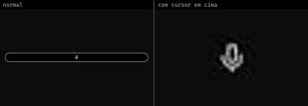 | **Icon Ripple** `animata:icon/icon-ripple` | Efeitos & Animação | animata · MIT | lucide-react |
|  | **Click** `animateui:primitives/effects/click` | Efeitos & Animação | animateui · MIT + Commons Clause | motion |
| 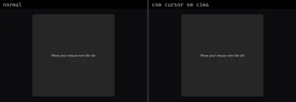 | **Cursor** `animateui:components/animate/cursor` | Efeitos & Animação | animateui · MIT + Commons Clause | @workspace/ui |
| 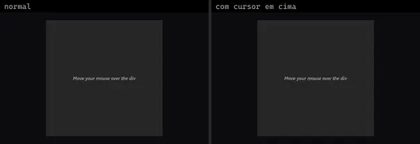 | **Cursor** `animateui:primitives/animate/cursor` | Efeitos & Animação | animateui · MIT + Commons Clause | motion |
| 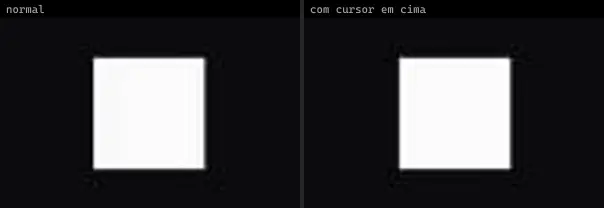 | **Magnetic** `animateui:primitives/effects/magnetic` | Efeitos & Animação | animateui · MIT + Commons Clause | motion |
| 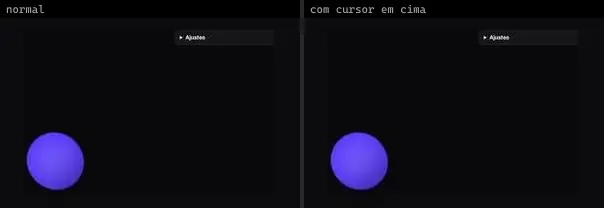 | **BlobCursor** `atlas:Interactions/BlobCursor` | Efeitos & Animação | atlas (própria) · Proprietária (Atlas) | — |
| 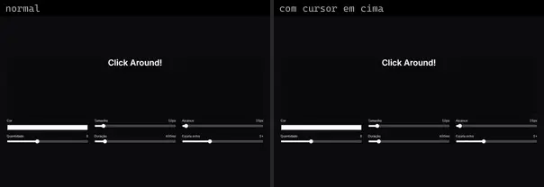 | **ClickBurst** `atlas:Interactions/ClickBurst` | Efeitos & Animação | atlas (própria) · Proprietária (Atlas) | — |
| 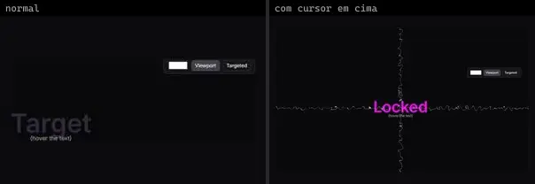 | **CrosshairCursor** `atlas:Interactions/CrosshairCursor` | Efeitos & Animação | atlas (própria) · Proprietária (Atlas) | — |
| 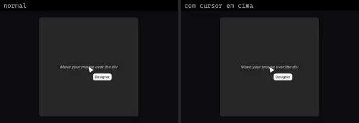 | **CustomCursor** `atlas:Interactions/CustomCursor` | Efeitos & Animação | atlas (própria) · Proprietária (Atlas) | motion |
| 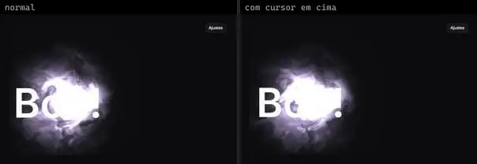 | **GhostTrail** `atlas:Interactions/GhostTrail` | Efeitos & Animação | atlas (própria) · Proprietária (Atlas) | ogl |
| 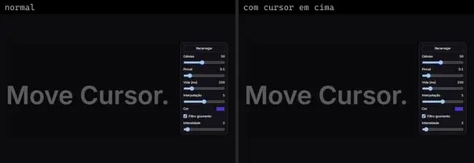 | **PixelTrail** `atlas:Interactions/PixelTrail` | Efeitos & Animação | atlas (própria) · Proprietária (Atlas) | — |
| 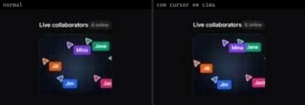 | **Illustration Cursor** `cultui:illustration-cursor-demo` | Efeitos & Animação | cultui · MIT | — |
|  | **Svg Ripple Effect** `eldoraui:svg-ripple-effect-demo` | Efeitos & Animação | eldoraui · MIT | clsx, motion |
| 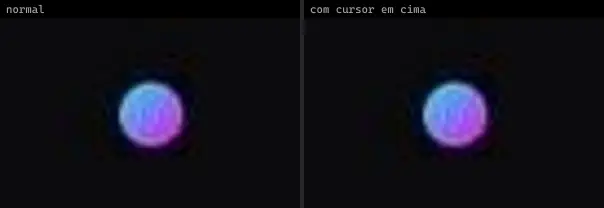 | **Svg Ripple Effect Demo 2** `eldoraui:svg-ripple-effect-demo-2` | Efeitos & Animação | eldoraui · MIT | clsx, motion |
| 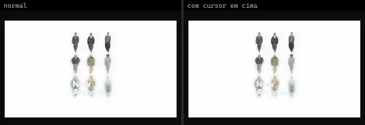 | **Css Box Scroll** `fancy:blocks/css-box-scroll-demo` | Efeitos & Animação | fancy · MIT | clsx, motion, tailwind-merge |
| 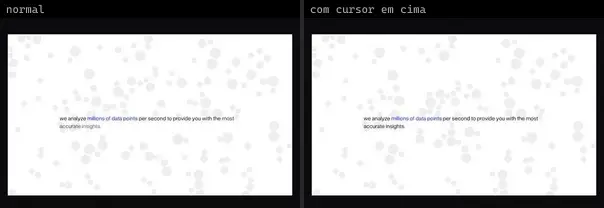 | **Cursor Attractor And Gravity** `fancy:physics/cursor-attractor-and-gravity-demo` | Efeitos & Animação | fancy · MIT | lodash, matter-js, motion, poly-decomp |
| 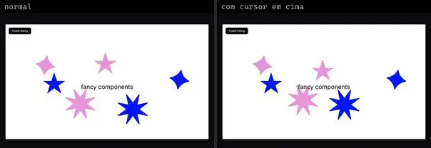 | **Cursor Attractor And Gravity Svg** `fancy:physics/cursor-attractor-and-gravity-svg-demo` | Efeitos & Animação | fancy · MIT | lodash, matter-js, poly-decomp |
| 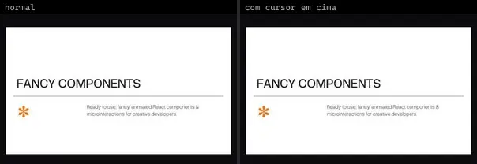 | **Elastic Line** `fancy:physics/elastic-line-demo` | Efeitos & Animação | fancy · MIT | motion |
|  | **Float** `fancy:blocks/float-demo` | Efeitos & Animação | fancy · MIT | motion |
| 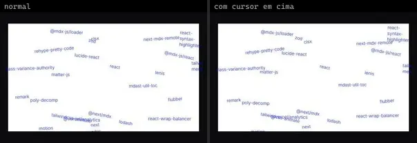 | **Float Offset** `fancy:blocks/float-offset-demo` | Efeitos & Animação | fancy · MIT | clsx, motion, tailwind-merge |
|  | **Gooey Svg Filter Pixel Trail** `fancy:filter/gooey-svg-filter-pixel-trail-demo` | Efeitos & Animação | fancy · MIT | motion, uuid |
| 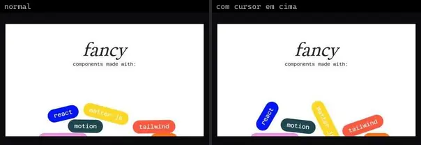 | **Gravity** `fancy:physics/gravity-demo` | Efeitos & Animação | fancy · MIT | lodash, matter-js, poly-decomp |
| 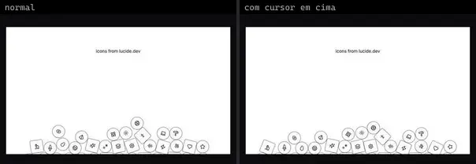 | **Gravity Body Types** `fancy:physics/gravity-body-types-demo` | Efeitos & Animação | fancy · MIT | lodash, lucide-react, matter-js, poly-decomp |
| 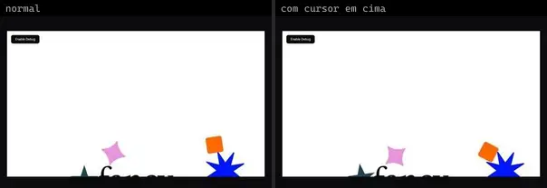 | **Gravity Svg Bodies** `fancy:physics/gravity-svg-bodies-demo` | Efeitos & Animação | fancy · MIT | lodash, matter-js, poly-decomp |
| 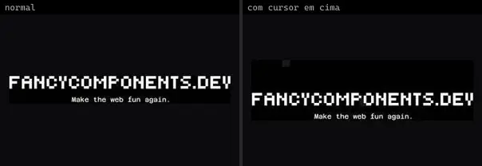 | **Pixel Trail** `fancy:background/pixel-trail-demo` | Efeitos & Animação | fancy · MIT | motion, uuid |
| 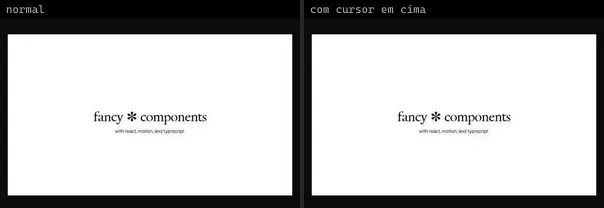 | **Pixel Trail Custom Pixel** `fancy:background/pixel-trail-custom-pixel-demo` | Efeitos & Animação | fancy · MIT | motion, uuid |
|  | **Pixel Trail No Fade** `fancy:background/pixel-trail-no-fade-demo` | Efeitos & Animação | fancy · MIT | motion, uuid |
|  | **Cursor** `kibo:cursor` | Efeitos & Animação | kibo · MIT | @repo/cursor |
| 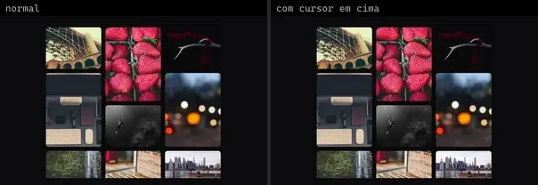 | **Blur Fade** `magicui:blur-fade-demo` | Efeitos & Animação | magicui · MIT | motion |
|  | **Confetti** `magicui:confetti-demo` | Efeitos & Animação | magicui · MIT | canvas-confetti |
|  | **Confetti Basic Cannon** `magicui:confetti-basic-cannon` | Efeitos & Animação | magicui · MIT | canvas-confetti |
| 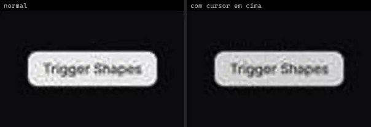 | **Confetti Custom Shapes** `magicui:confetti-custom-shapes` | Efeitos & Animação | magicui · MIT | canvas-confetti |
| 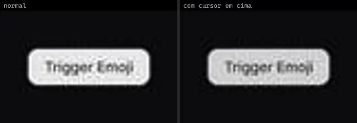 | **Confetti Emoji** `magicui:confetti-emoji` | Efeitos & Animação | magicui · MIT | canvas-confetti |
|  | **Confetti Fireworks** `magicui:confetti-fireworks` | Efeitos & Animação | magicui · MIT | canvas-confetti |
|  | **Confetti Random Direction** `magicui:confetti-random-direction` | Efeitos & Animação | magicui · MIT | canvas-confetti |
|  | **Confetti Side Cannons** `magicui:confetti-side-cannons` | Efeitos & Animação | magicui · MIT | canvas-confetti |
|  | **Confetti Stars** `magicui:confetti-stars` | Efeitos & Animação | magicui · MIT | canvas-confetti |
| 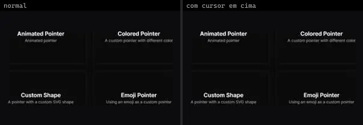 | **Pointer 1** `magicui:pointer-demo-1` | Efeitos & Animação | magicui · MIT | motion |
|  | **Scroll Based Velocity** `magicui:scroll-based-velocity-demo` | Efeitos & Animação | magicui · MIT | motion |
|  | **Smooth Cursor Demo** `magicui:smooth-cursor-demo` | Efeitos & Animação | magicui · MIT | motion |
| 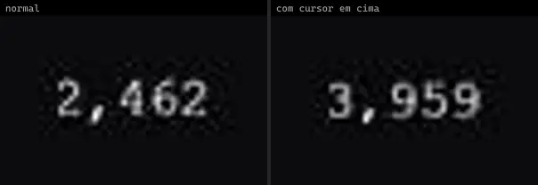 | **Animated Number In View** `motionprimitives:animated-number/animated-number-in-view` | Efeitos & Animação | motionprimitives · MIT | motion |
|  | **Cursor 1** `motionprimitives:cursor/cursor-1` | Efeitos & Animação | motionprimitives · MIT | lucide-react, motion |
| 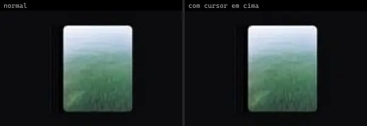 | **Cursor 2** `motionprimitives:cursor/cursor-2` | Efeitos & Animação | motionprimitives · MIT | motion |
|  | **Cursor 3** `motionprimitives:cursor/cursor-3` | Efeitos & Animação | motionprimitives · MIT | motion |
|  | **In View Basic** `motionprimitives:in-view/in-view-basic` | Efeitos & Animação | motionprimitives · MIT | motion |
|  | **In View Basic Multiple** `motionprimitives:in-view/in-view-basic-multiple` | Efeitos & Animação | motionprimitives · MIT | motion |
| 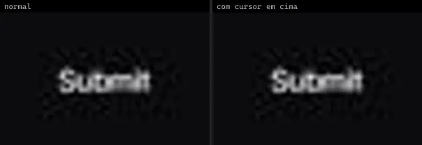 | **Magnetic Basic** `motionprimitives:magnetic/magnetic-basic` | Efeitos & Animação | motionprimitives · MIT | motion |
| 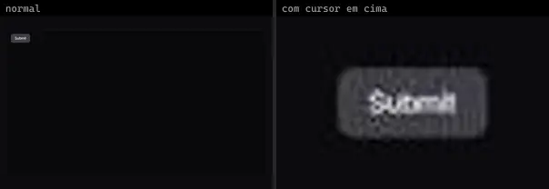 | **Magnetic Nested** `motionprimitives:magnetic/magnetic-nested` | Efeitos & Animação | motionprimitives · MIT | motion |
| 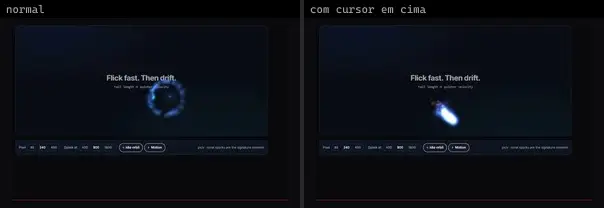 | **Cursor Comet** `motiq:cursor-comet` | Efeitos & Animação | motiq · MIT | — |
| 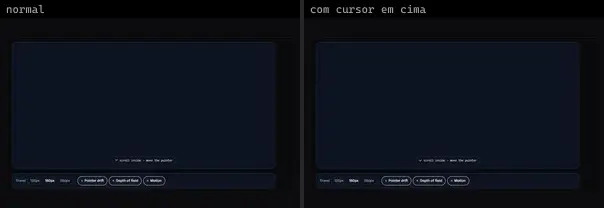 | **Depth Parallax Scene** `motiq:depth-parallax-scene` | Efeitos & Animação | motiq · MIT | — |
|  | **Filter Result Transition** `motiq:catalog/filter-result-transition` | Efeitos & Animação | motiq · MIT | motion |
|  | **Filter Result Transition** `motiq:filter-result-transition` | Efeitos & Animação | motiq · MIT | motion |
| 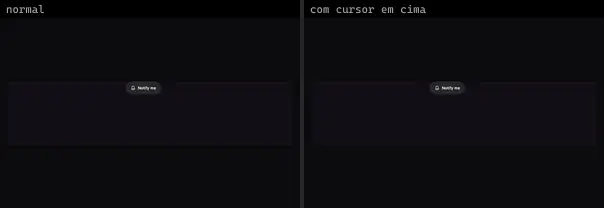 | **BellToggle** `reactbits:Micro/BellToggleDemo` | Efeitos & Animação | reactbits · MIT + Commons Clause | @chakra-ui/react, @hugeicons/core-free-icons, @hugeicons/react, motion |
| 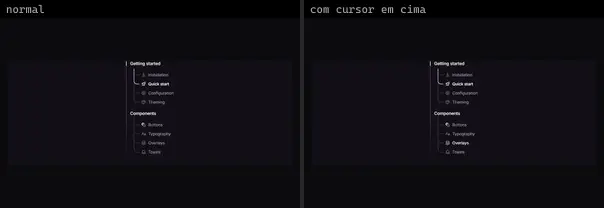 | **BranchedMenu** `reactbits:Micro/BranchedMenuDemo` | Efeitos & Animação | reactbits · MIT + Commons Clause | @chakra-ui/react, @hugeicons/core-free-icons, @hugeicons/react |
| 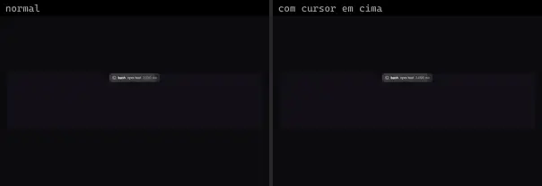 | **CallChip** `reactbits:Micro/CallChipDemo` | Efeitos & Animação | reactbits · MIT + Commons Clause | @chakra-ui/react, @hugeicons/core-free-icons, @hugeicons/react |
| 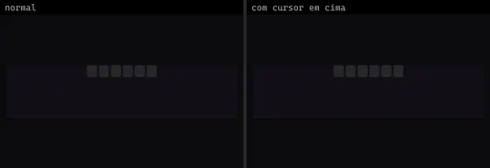 | **CodeSlots** `reactbits:Micro/CodeSlotsDemo` | Efeitos & Animação | reactbits · MIT + Commons Clause | @chakra-ui/react, @hugeicons/core-free-icons, @hugeicons/react, motion |
| 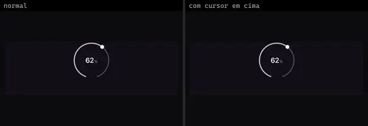 | **CometDial** `reactbits:Micro/CometDialDemo` | Efeitos & Animação | reactbits · MIT + Commons Clause | @chakra-ui/react, motion |
| 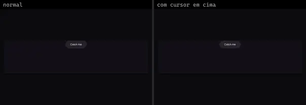 | **DodgeField** `reactbits:Micro/DodgeFieldDemo` | Efeitos & Animação | reactbits · MIT + Commons Clause | @chakra-ui/react, motion |
|  | **FlipCard** `reactbits:Micro/FlipCardDemo` | Efeitos & Animação | reactbits · MIT + Commons Clause | @chakra-ui/react, motion |
| 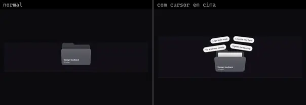 | **FolderFloat** `reactbits:Micro/FolderFloatDemo` | Efeitos & Animação | reactbits · MIT + Commons Clause | @chakra-ui/react, matter-js |
| 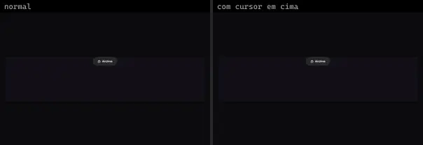 | **FuseButton** `reactbits:Micro/FuseButtonDemo` | Efeitos & Animação | reactbits · MIT + Commons Clause | @chakra-ui/react, @hugeicons/core-free-icons, @hugeicons/react |
| 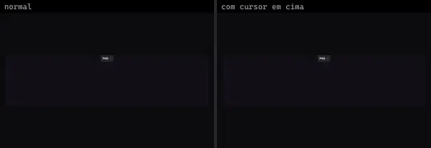 | **GlideSelect** `reactbits:Micro/GlideSelectDemo` | Efeitos & Animação | reactbits · MIT + Commons Clause | @chakra-ui/react, @hugeicons/core-free-icons, @hugeicons/react |
| 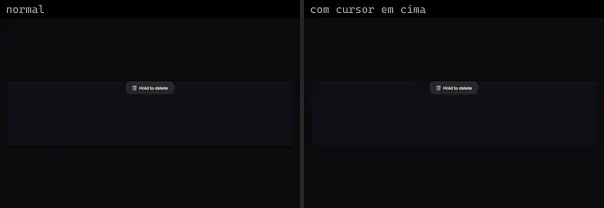 | **HoldButton** `reactbits:Micro/HoldButtonDemo` | Efeitos & Animação | reactbits · MIT + Commons Clause | @chakra-ui/react, @hugeicons/core-free-icons, @hugeicons/react |
| 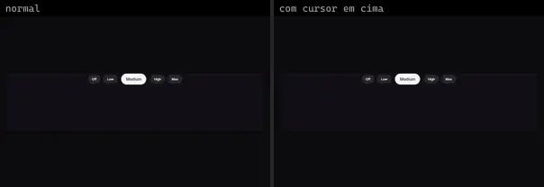 | **JellyRadio** `reactbits:Micro/JellyRadioDemo` | Efeitos & Animação | reactbits · MIT + Commons Clause | @chakra-ui/react, motion |
| 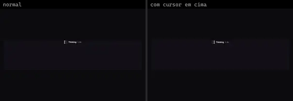 | **LatticeLoader** `reactbits:Micro/LatticeLoaderDemo` | Efeitos & Animação | reactbits · MIT + Commons Clause | @chakra-ui/react |
|  | **PaperCrumple** `reactbits:Micro/PaperCrumpleDemo` | Efeitos & Animação | reactbits · MIT + Commons Clause | @chakra-ui/react, three |
|  | **PeekRating** `reactbits:Micro/PeekRatingDemo` | Efeitos & Animação | reactbits · MIT + Commons Clause | @chakra-ui/react, @hugeicons/core-free-icons, @hugeicons/react |
| 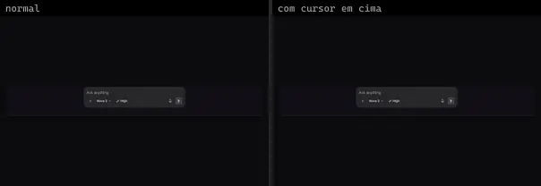 | **PromptBar** `reactbits:Micro/PromptBarDemo` | Efeitos & Animação | reactbits · MIT + Commons Clause | @chakra-ui/react, @hugeicons/core-free-icons, @hugeicons/react, motion |
| 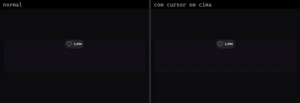 | **PulseHeart** `reactbits:Micro/PulseHeartDemo` | Efeitos & Animação | reactbits · MIT + Commons Clause | @chakra-ui/react, @hugeicons/core-free-icons |
|  | **RefineFrame** `reactbits:Micro/RefineFrameDemo` | Efeitos & Animação | reactbits · MIT + Commons Clause | @chakra-ui/react, @hugeicons/core-free-icons, @hugeicons/react |
| 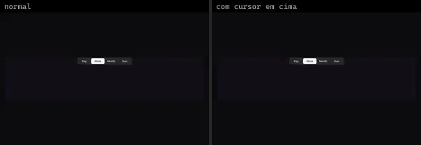 | **RubberSegment** `reactbits:Micro/RubberSegmentDemo` | Efeitos & Animação | reactbits · MIT + Commons Clause | @chakra-ui/react, motion |
| 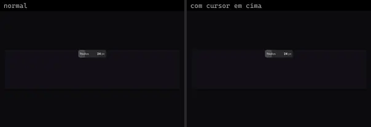 | **ScrubField** `reactbits:Micro/ScrubFieldDemo` | Efeitos & Animação | reactbits · MIT + Commons Clause | @chakra-ui/react, motion |
|  | **Shredder** `reactbits:Micro/ShredderDemo` | Efeitos & Animação | reactbits · MIT + Commons Clause · ⚠needs-network | @chakra-ui/react |
| 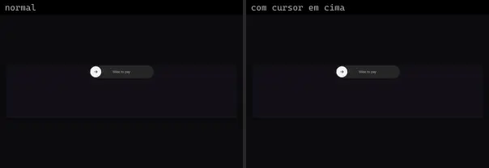 | **SlideCommit** `reactbits:Micro/SlideCommitDemo` | Efeitos & Animação | reactbits · MIT + Commons Clause | @chakra-ui/react, @hugeicons/core-free-icons, @hugeicons/react, motion |
| 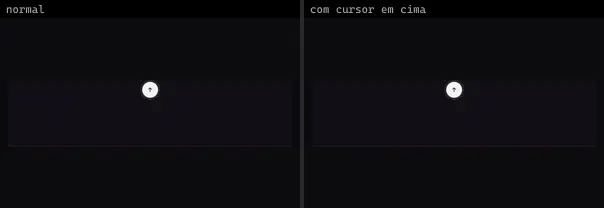 | **SlingButton** `reactbits:Micro/SlingButtonDemo` | Efeitos & Animação | reactbits · MIT + Commons Clause | @chakra-ui/react, @hugeicons/core-free-icons, @hugeicons/react, motion |
|  | **SloshGauge** `reactbits:Micro/SloshGaugeDemo` | Efeitos & Animação | reactbits · MIT + Commons Clause | @chakra-ui/react |
|  | **SpringCheck** `reactbits:Micro/SpringCheckDemo` | Efeitos & Animação | reactbits · MIT + Commons Clause | @chakra-ui/react, @hugeicons/core-free-icons, motion |
|  | **SquishSwitch** `reactbits:Micro/SquishSwitchDemo` | Efeitos & Animação | reactbits · MIT + Commons Clause | @chakra-ui/react, motion |
|  | **StatusMark** `reactbits:Micro/StatusMarkDemo` | Efeitos & Animação | reactbits · MIT + Commons Clause | @chakra-ui/react, motion |
|  | **SwipeRow** `reactbits:Micro/SwipeRowDemo` | Efeitos & Animação | reactbits · MIT + Commons Clause | @chakra-ui/react, @hugeicons/core-free-icons, @hugeicons/react, motion |
|  | **SwipeToast** `reactbits:Micro/SwipeToastDemo` | Efeitos & Animação | reactbits · MIT + Commons Clause | @chakra-ui/react, @hugeicons/core-free-icons, @hugeicons/react, motion |
|  | **TearTicket** `reactbits:Micro/TearTicketDemo` | Efeitos & Animação | reactbits · MIT + Commons Clause | @chakra-ui/react, motion |
|  | **ThoughtLine** `reactbits:Micro/ThoughtLineDemo` | Efeitos & Animação | reactbits · MIT + Commons Clause | @chakra-ui/react, @hugeicons/core-free-icons, @hugeicons/react, motion |
|  | **VoicePill** `reactbits:Micro/VoicePillDemo` | Efeitos & Animação | reactbits · MIT + Commons Clause | @chakra-ui/react, @hugeicons/core-free-icons, @hugeicons/react |
|  | **WakeSlider** `reactbits:Micro/WakeSliderDemo` | Efeitos & Animação | reactbits · MIT + Commons Clause | @chakra-ui/react, motion |
|  | **WarmTooltip** `reactbits:Micro/WarmTooltipDemo` | Efeitos & Animação | reactbits · MIT + Commons Clause | @chakra-ui/react, @hugeicons/core-free-icons, @hugeicons/react, motion |
|  | **Aperture Blur Transition** `smoothui:aperture-blur-transition` | Efeitos & Animação | smoothui · MIT | @repo/shadcn-ui, @repo/smoothui, motion |
|  | **Chroma Blur Transition** `smoothui:chroma-blur-transition` | Efeitos & Animação | smoothui · MIT | @repo/shadcn-ui, @repo/smoothui, motion |
|  | **Cursor Follow** `smoothui:cursor-follow` | Efeitos & Animação | smoothui · MIT | @repo/smoothui, @smoothui/data, motion |
|  | **Drawing Cursor** `smoothui:drawing-cursor` | Efeitos & Animação | smoothui · MIT | @repo/shadcn-ui, @repo/smoothui, motion |
|  | **Kinetic Type Scroll** `smoothui:kinetic-type-scroll` | Efeitos & Animação | smoothui · MIT | @radix-ui/react-slot, @repo/shadcn-ui, @repo/smoothui, class-variance-authority, lucide-react, motion |
|  | **Organic Merge Transition** `smoothui:organic-merge-transition` | Efeitos & Animação | smoothui · MIT | @repo/smoothui |
|  | **Parallax Layers** `smoothui:parallax-layers` | Efeitos & Animação | smoothui · MIT | @repo/shadcn-ui, @repo/smoothui, lucide-react, motion |
|  | **Prism Sweep Transition** `smoothui:prism-sweep-transition` | Efeitos & Animação | smoothui · MIT | @repo/shadcn-ui, @repo/smoothui, motion |
|  | **Radial Circles Transition** `smoothui:radial-circles-transition` | Efeitos & Animação | smoothui · MIT | @repo/smoothui |
|  | **Sdf Circle Transition** `smoothui:sdf-circle-transition` | Efeitos & Animação | smoothui · MIT | @repo/smoothui |
|  | **Shared Axis X** `smoothui:shared-axis-x` | Efeitos & Animação | smoothui · MIT | @repo/smoothui, motion |
|  | **Shared Axis Y** `smoothui:shared-axis-y` | Efeitos & Animação | smoothui · MIT | @repo/smoothui, motion |
|  | **Shared Axis Z** `smoothui:shared-axis-z` | Efeitos & Animação | smoothui · MIT | @repo/smoothui, motion |
|  | **Svg Draw On Scroll** `smoothui:svg-draw-on-scroll` | Efeitos & Animação | smoothui · MIT | @repo/shadcn-ui, @repo/smoothui, lucide-react, motion |
|  | **Cursor Trail** `systaliko:components/cursor-trail` | Efeitos & Animação | systaliko · MIT | lucide-react, motion |
|  | **Custom Cursor** `systaliko:components/custom-cursor` | Efeitos & Animação | systaliko · MIT | @radix-ui/react-slot, class-variance-authority, lucide-react, motion |
|  | **Custom Cursor 2** `systaliko:components/custom-cursor-2` | Efeitos & Animação | systaliko · MIT | motion |
|  | **Floating Elements** `systaliko:blocks/floating-elements` | Efeitos & Animação | systaliko · MIT | @radix-ui/react-slider, motion, radix-ui |
|  | **Floating Elements Infinite** `systaliko:blocks/floating-elements-infinite` | Efeitos & Animação | systaliko · MIT | @radix-ui/react-slider, motion, radix-ui |
|  | **Infinite Scroll** `systaliko:ecommerce/infinite-scroll` | Efeitos & Animação | systaliko · MIT · ⚠needs-network | motion |
|  | **Magnetic Grid** `systaliko:blocks/magnetic-grid` | Efeitos & Animação | systaliko · MIT | @radix-ui/react-slider, class-variance-authority, motion, react-aria-components |
|  | **Parallax** `systaliko:scroll-animations/parallax` | Efeitos & Animação | systaliko · MIT | motion |
|  | **Scroll Animation Combo** `systaliko:scroll-animations/scroll-animation-combo` | Efeitos & Animação | systaliko · MIT | motion |
|  | **Scroll Animation Inset** `systaliko:scroll-animations/scroll-animation-inset` | Efeitos & Animação | systaliko · MIT · ⚠needs-network | motion |
|  | **Scroll Animation Inset X** `systaliko:scroll-animations/scroll-animation-inset-x` | Efeitos & Animação | systaliko · MIT · ⚠needs-network | motion |
|  | **Scroll Animation Inset Y** `systaliko:scroll-animations/scroll-animation-inset-y` | Efeitos & Animação | systaliko · MIT · ⚠needs-network | motion |
|  | **Scroll Animation Radius** `systaliko:scroll-animations/scroll-animation-radius` | Efeitos & Animação | systaliko · MIT | motion |
|  | **Scroll Animation Rotate** `systaliko:scroll-animations/scroll-animation-rotate` | Efeitos & Animação | systaliko · MIT | motion |
|  | **Scroll Animation Rotate X** `systaliko:scroll-animations/scroll-animation-rotate-x` | Efeitos & Animação | systaliko · MIT | motion |
|  | **Scroll Animation Rotate Y** `systaliko:scroll-animations/scroll-animation-rotate-y` | Efeitos & Animação | systaliko · MIT · ⚠needs-network | motion |
|  | **Scroll Animation Scale** `systaliko:scroll-animations/scroll-animation-scale` | Efeitos & Animação | systaliko · MIT | motion |
|  | **Scroll Animation Translate X** `systaliko:scroll-animations/scroll-animation-translate-x` | Efeitos & Animação | systaliko · MIT | motion |
|  | **Scroll Autoplay** `systaliko:scroll-animations/scroll-autoplay` | Efeitos & Animação | systaliko · MIT | motion |
|  | **Scroll Reverse Scale Animation** `systaliko:scroll-animations/scroll-reverse-scale-animation` | Efeitos & Animação | systaliko · MIT | @radix-ui/react-slot, class-variance-authority, motion |
|  | **Wavy Block** `systaliko:scroll-animations/wavy-block` | Efeitos & Animação | systaliko · MIT | motion |
|  | **Wavy Block Y** `systaliko:scroll-animations/wavy-block-y` | Efeitos & Animação | systaliko · MIT | motion |
|  | **Floating Gradient** `uitripled:decorative/background/floating-gradient` | Efeitos & Animação | uitripled · MIT | framer-motion |
|  | **Liquid Cursor** `uitripled:liquid-cursor` | Efeitos & Animação | uitripled · MIT | — |
|  | **Native Magnetic** `uitripled:native/demo/native-magnetic-demo` | Efeitos & Animação | uitripled · MIT | @radix-ui/react-slot, class-variance-authority |
