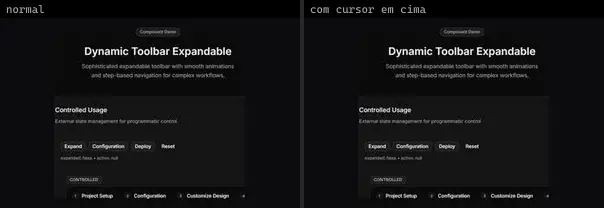
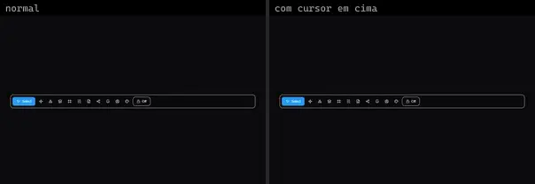
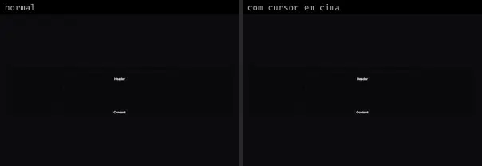
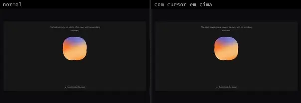
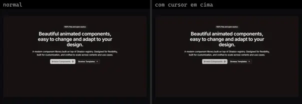
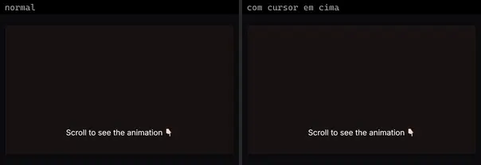

# Layout (6)

Prévia: estado normal | com o cursor em cima. Código: `node scripts/atlas-find.mjs code <uid>` ou os arquivos em `catalog.jsonl → files`.

| prévia | componente | tipo de aplicação | biblioteca · licença | dependências npm |
|---|---|---|---|---|
|  | **Toolbar Expandable** `cultui:toolbar-expandable-demo` | UI base | cultui · MIT | @radix-ui/react-scroll-area, lucide-react, motion |
|  | **Toolbar** `kokonutui:toolbar` | UI base | kokonutui · MIT | clsx, lucide-react, motion, tailwind-merge |
|  | **Resizable 1** `reui:resizable/c-resizable-1` | UI base | reui · MIT | cn, react-resizable-panels |
|  | **Svg Clip Mask** `smoothui:svg-clip-mask` | UI base | smoothui · MIT | @repo/shadcn-ui, @repo/smoothui, lucide-react, motion |
|  | **Container Stagger** `systaliko:blocks/container-stagger` | UI base | systaliko · MIT | @radix-ui/react-slot, class-variance-authority, lucide-react, motion |
|  | **Container Stagger 2** `systaliko:blocks/container-stagger-2` | UI base | systaliko · MIT | motion |
