# Lista & Timeline (78)

Prévia: estado normal | com o cursor em cima. Código: `node scripts/atlas-find.mjs code <uid>` ou os arquivos em `catalog.jsonl → files`.

| prévia | componente | tipo de aplicação | biblioteca · licença | dependências npm |
|---|---|---|---|---|
|  | **News Feed** `uitripled:components/news-feed/news-feed` | Blog & Conteúdo | uitripled · MIT | @radix-ui/react-avatar, @radix-ui/react-slot, class-variance-authority, framer-motion, lucide-react |
|  | **Kanban Board** `cultui:kanban-board-demo` | Dashboard & Admin | cultui · MIT | motion |
| 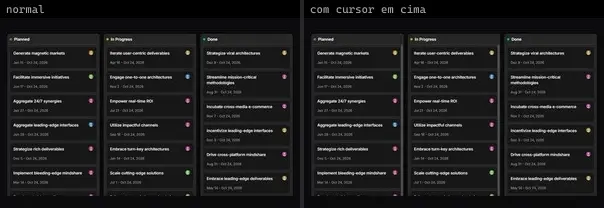 | **Kanban** `kibo:kanban` | Dashboard & Admin | kibo · MIT | @dnd-kit/core, @dnd-kit/sortable, @dnd-kit/utilities, @faker-js/faker, @repo/kanban, @repo/shadcn-ui, radix-ui, tunnel-rat |
| 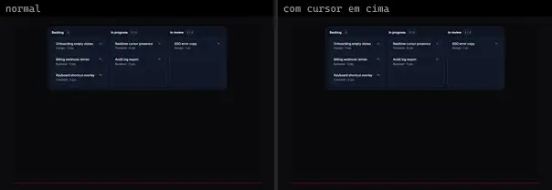 | **Kanban Card Movement** `motiq:catalog/kanban-card-movement` | Dashboard & Admin | motiq · MIT | motion |
| 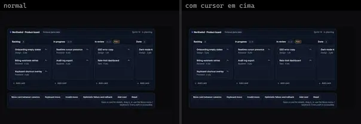 | **Kanban Card Movement** `motiq:kanban-card-movement` | Dashboard & Admin | motiq · MIT | @radix-ui/react-dialog, motion |
| 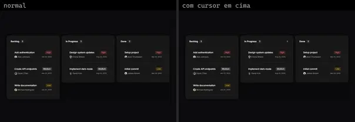 | **Kanban 1** `reui:kanban/c-kanban-1` | Dashboard & Admin | reui · MIT | @dnd-kit/core, @dnd-kit/sortable, @dnd-kit/utilities, class-variance-authority, cn, radix-ui |
| 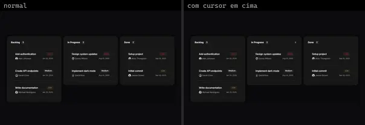 | **Kanban 2** `reui:kanban/c-kanban-2` | Dashboard & Admin | reui · MIT | @dnd-kit/core, @dnd-kit/sortable, @dnd-kit/utilities, class-variance-authority, cn, radix-ui |
|  | **Kanban Board** `uitripled:components/kanban/kanban-board` | Dashboard & Admin | uitripled · MIT | @dnd-kit/core, @dnd-kit/sortable, @dnd-kit/utilities, @radix-ui/react-avatar, @radix-ui/react-slot, class-variance-authority, lucide-react |
|  | **Shopping List** `animata:widget/shopping-list` | E-commerce | animata · MIT | — |
|  | **Cart Item Transition** `motiq:cart-item-transition` | E-commerce | motiq · MIT | motion |
|  | **Cart Item Transition** `motiq:catalog/cart-item-transition` | E-commerce | motiq · MIT | motion |
|  | **Sketchbook** `threeui:sketchbook` | Login & Conta | threeui · MIT | — |
|  | **Native Nested List** `uitripled:native/demo/native-nested-list-demo` | Mobile & App | uitripled · MIT | lucide-react |
| 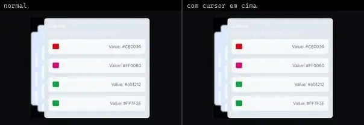 | **Blur Stack Card** `animata:card/blur-stack-card` | UI base | animata · MIT | motion |
|  | **Card Stack** `animata:card/card-stack` | UI base | animata · MIT | lucide-react, motion |
| 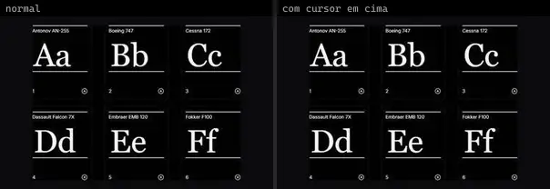 | **Flipping Cards** `animata:list/flipping-cards` | UI base | animata · MIT | lucide-react |
| 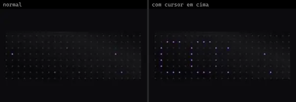 | **Led Board** `animata:card/led-board` | UI base | animata · MIT | — |
|  | **Music Stack Interaction** `animata:widget/music-stack-interaction` | UI base | animata · MIT | lucide-react, motion |
| 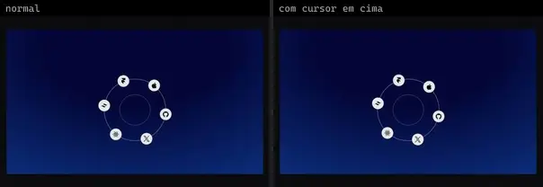 | **Orbiting Items** `animata:list/orbiting-items` | UI base | animata · MIT | — |
| 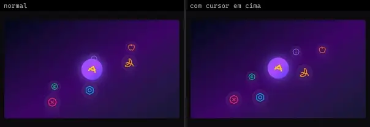 | **Orbiting Items 3 D** `animata:list/orbiting-items-3-d` | UI base | animata · MIT | lucide-react |
|  | **Transaction List** `animata:list/transaction-list` | UI base | animata · MIT | lucide-react, motion |
|  | **Transition List** `animata:list/transition-list` | UI base | animata · MIT | motion |
| 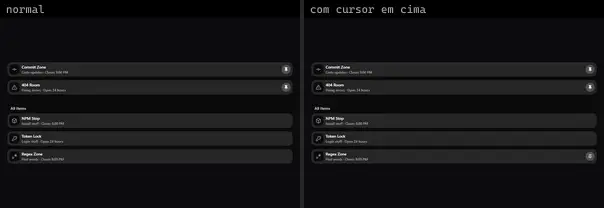 | **Pin List** `animateui:components/community/pin-list` | UI base | animateui · MIT + Commons Clause | @workspace/ui, lucide-react, motion |
| 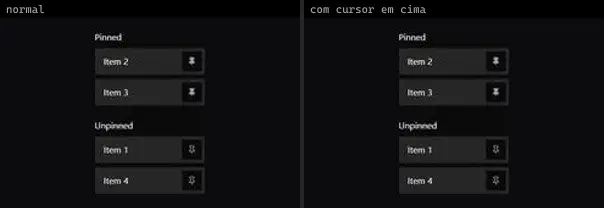 | **Pinned List** `animateui:primitives/animate/pinned-list` | UI base | animateui · MIT + Commons Clause | lucide-react, motion |
| 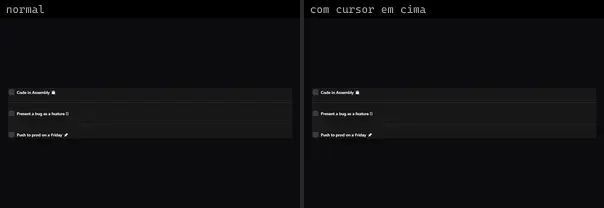 | **Playful Todolist** `animateui:components/community/playful-todolist` | UI base | animateui · MIT + Commons Clause | @workspace/ui, motion |
| 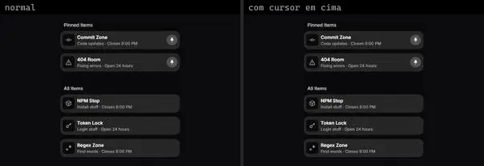 | **PinList** `atlas:Lists/PinList` | UI base | atlas (própria) · Proprietária (Atlas) | motion |
| 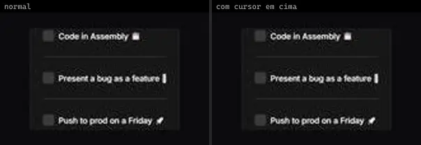 | **PlayfulTodolist** `atlas:Lists/PlayfulTodolist` | UI base | atlas (própria) · Proprietária (Atlas) | motion |
| 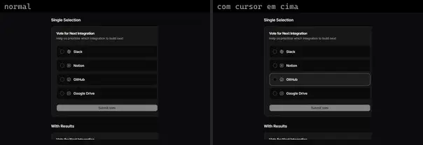 | **Choice Poll** `cultui:choice-poll-demo` | UI base | cultui · MIT | @hugeicons/core-free-icons, @hugeicons/react, @radix-ui/react-use-controllable-state, class-variance-authority, lucide-react |
| 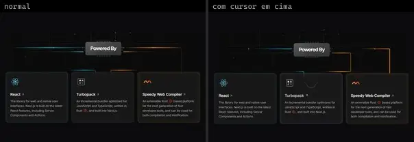 | **Circuit Board** `cultui:circuit-board-demo` | UI base | cultui · MIT | lucide-react, motion |
| 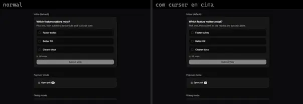 | **Poll Widget** `cultui:poll-widget-demo` | UI base | cultui · MIT | @radix-ui/react-use-controllable-state, class-variance-authority, lucide-react, motion |
|  | **Sortable List** `cultui:sortable-list-demo` | UI base | cultui · MIT | lucide-react, motion, react-use-measure, sonner |
|  | **Animated List** `eldoraui:animated-list-demo` | UI base | eldoraui · MIT | motion |
|  | **Drag Elements** `fancy:blocks/drag-elements-demo` | UI base | fancy · MIT | motion |
|  | **Drag Elements Momentum** `fancy:blocks/drag-elements-momentum-demo` | UI base | fancy · MIT | motion |
|  | **Gravity Non Draggable** `fancy:physics/gravity-non-draggable-demo` | UI base | fancy · MIT | lodash, matter-js, motion, poly-decomp |
|  | **Gantt** `kibo:gantt` | UI base | kibo · MIT | @dnd-kit/core, @dnd-kit/modifiers, @faker-js/faker, @repo/gantt, @repo/shadcn-ui, @uidotdev/usehooks, date-fns, jotai, lodash.groupby, lodash.throttle, lucide-react, radix-ui |
| 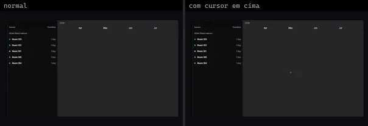 | **Gantt Lanes** `kibo:gantt-lanes` | UI base | kibo · MIT | @dnd-kit/core, @dnd-kit/modifiers, @faker-js/faker, @repo/gantt, @repo/shadcn-ui, @uidotdev/usehooks, date-fns, jotai, lodash.groupby, lodash.throttle, lucide-react, radix-ui |
| 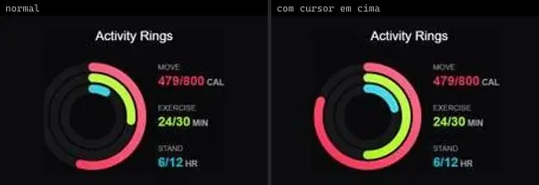 | **Apple Activity Card** `kokonutui:apple-activity-card` | UI base | kokonutui · MIT | clsx, motion, tailwind-merge |
|  | **Card Stack** `kokonutui:card-stack` | UI base | kokonutui · MIT | clsx, motion, tailwind-merge |
|  | **Animated List** `magicui:animated-list-demo` | UI base | magicui · MIT | motion |
|  | **Activity Stream** `motiq:activity-stream` | UI base | motiq · MIT | motion |
| 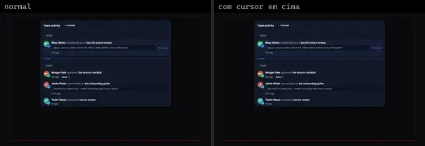 | **Activity Stream** `motiq:catalog/activity-stream` | UI base | motiq · MIT | motion |
|  | **Animated List** `motiq:catalog/animated-list` | UI base | motiq · MIT | motion |
| 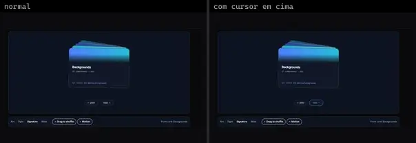 | **Card Stack Deck** `motiq:card-stack-deck` | UI base | motiq · MIT | — |
|  | **Live Presence Stack** `motiq:catalog/live-presence-stack` | UI base | motiq · MIT | motion |
|  | **Live Presence Stack** `motiq:live-presence-stack` | UI base | motiq · MIT | motion |
|  | **Multi File Queue** `motiq:catalog/multi-file-queue` | UI base | motiq · MIT | motion |
|  | **Multi File Queue** `motiq:multi-file-queue` | UI base | motiq · MIT | motion |
| 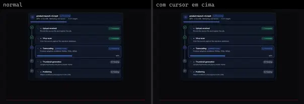 | **Processing Timeline** `motiq:catalog/processing-timeline` | UI base | motiq · MIT | motion |
| 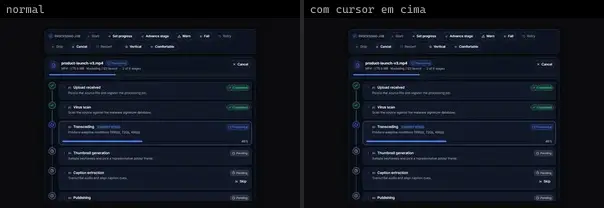 | **Processing Timeline** `motiq:processing-timeline` | UI base | motiq · MIT | motion |
| 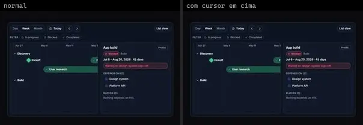 | **Project Timeline** `motiq:catalog/project-timeline` | UI base | motiq · MIT | motion |
| 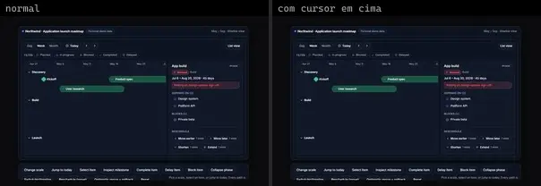 | **Project Timeline** `motiq:project-timeline` | UI base | motiq · MIT | motion |
|  | **Tool Call Activity** `motiq:catalog/tool-call-activity` | UI base | motiq · MIT | motion |
|  | **Tool Call Activity** `motiq:tool-call-activity` | UI base | motiq · MIT | motion |
|  | **Velocity Skew Feed** `motiq:velocity-skew-feed` | UI base | motiq · MIT | — |
|  | **AnimatedList** `reactbits:Components/AnimatedListDemo` | UI base | reactbits · MIT + Commons Clause | @chakra-ui/react, motion |
|  | **ScrollStack** `reactbits:Components/ScrollStackDemo` | UI base | reactbits · MIT + Commons Clause | @chakra-ui/react, lenis, react-icons |
| 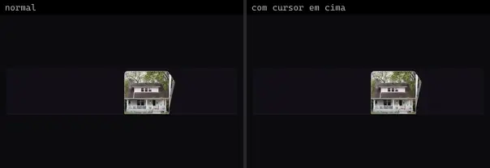 | **Stack** `reactbits:Components/StackDemo` | UI base | reactbits · MIT + Commons Clause | @chakra-ui/react, motion |
| 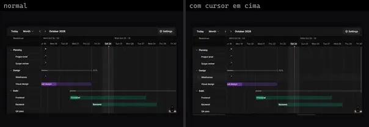 | **Gantt 1** `reui:gantt/c-gantt-1` | UI base | reui · MIT | class-variance-authority, cn, date-fns, radix-ui |
| 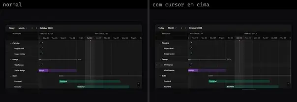 | **Gantt 2** `reui:gantt/c-gantt-2` | UI base | reui · MIT | cn, date-fns, radix-ui |
| 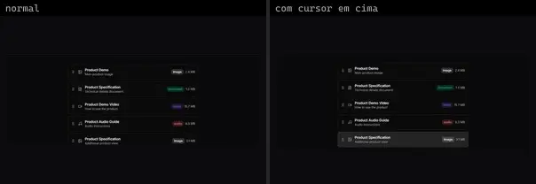 | **Sortable 1** `reui:sortable/c-sortable-1` | UI base | reui · MIT | @dnd-kit/core, @dnd-kit/sortable, @dnd-kit/utilities, class-variance-authority, cn, radix-ui, sonner |
| 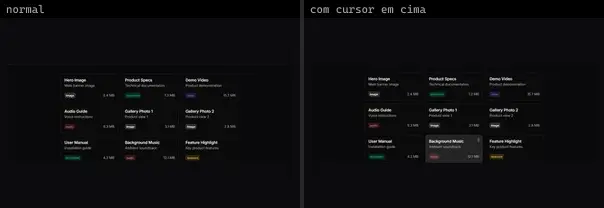 | **Sortable 2** `reui:sortable/c-sortable-2` | UI base | reui · MIT | @dnd-kit/core, @dnd-kit/sortable, @dnd-kit/utilities, class-variance-authority, cn, radix-ui, sonner |
| 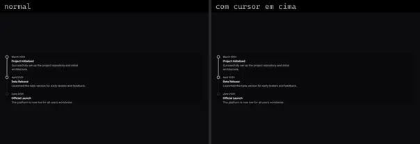 | **Timeline 1** `reui:timeline/c-timeline-1` | UI base | reui · MIT | cn, radix-ui |
|  | **Animated List** `smoothui:animated-list` | UI base | smoothui · MIT | @repo/shadcn-ui, @repo/smoothui, @smoothui/data, motion |
| 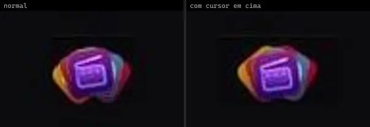 | **App Download Stack** `smoothui:app-download-stack` | UI base | smoothui · MIT | @repo/smoothui, @smoothui/data, lucide-react, motion |
| 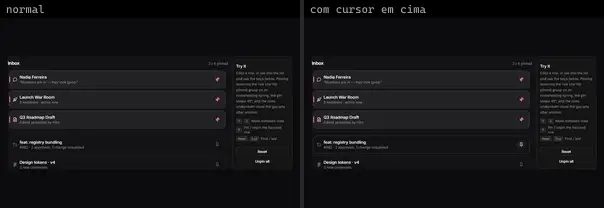 | **Pinned List** `smoothui:pinned-list` | UI base | smoothui · MIT | @radix-ui/react-slot, @repo/shadcn-ui, @repo/smoothui, class-variance-authority, lucide-react, motion |
|  | **Scrollable Card Stack** `smoothui:canvas/scrollable-card-stack` | UI base | smoothui · MIT | @docs/examples, @repo/shadcn-ui, @repo/smoothui, @smoothui/data, motion |
|  | **Scrollable Card Stack** `smoothui:scrollable-card-stack` | UI base | smoothui · MIT | @docs/examples, @repo/shadcn-ui, @repo/smoothui, @smoothui/data, motion |
|  | **Time Machine Stack** `smoothui:time-machine-stack` | UI base | smoothui · MIT | @radix-ui/react-slot, @repo/shadcn-ui, @repo/smoothui, @smoothui/data, class-variance-authority, motion |
|  | **Recent Activity** `spectrumui:recent-activity` | UI base | spectrumui · Apache-2.0 | clsx, lucide-react, motion, tailwind-merge |
| 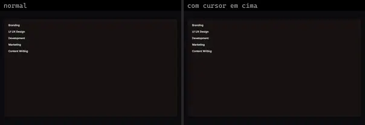 | **Spotlight List** `systaliko:components/spotlight-list` | UI base | systaliko · MIT | class-variance-authority |
| 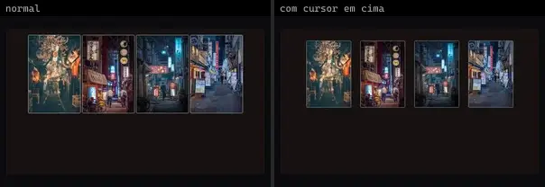 | **Spotlight List 2** `systaliko:components/spotlight-list-2` | UI base | systaliko · MIT | class-variance-authority |
| 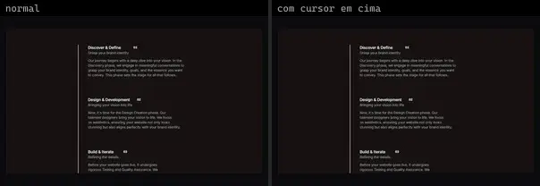 | **Timeline** `systaliko:blocks/timeline` | UI base | systaliko · MIT | motion |
|  | **Sketchbook** `threeui:meng-to-sketchbook-landing-page` | UI base | threeui · MIT · ⚠needs-files | — |
| 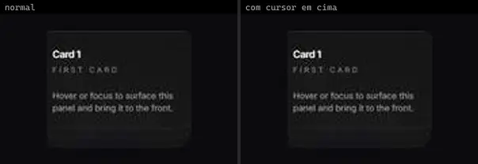 | **Animated Card Stack** `uitripled:components/cards/shadcnui/animated-card-stack` | UI base | uitripled · MIT | framer-motion |
|  | **Animated List** `uitripled:components/lists/animated-list` | UI base | uitripled · MIT | framer-motion, lucide-react |
| 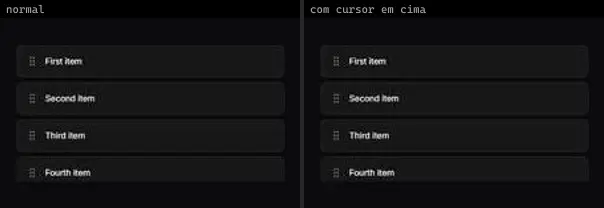 | **Draggable List** `uitripled:components/lists/draggable-list` | UI base | uitripled · MIT | framer-motion, lucide-react |
| 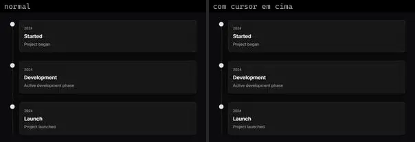 | **Interactive Timeline** `uitripled:motion-core/interactive-timeline` | UI base | uitripled · MIT | framer-motion |
