# Mídia & Galeria (114)

Prévia: estado normal | com o cursor em cima. Código: `node scripts/atlas-find.mjs code <uid>` ou os arquivos em `catalog.jsonl → files`.

| prévia | componente | tipo de aplicação | biblioteca · licença | dependências npm |
|---|---|---|---|---|
|  | **Case Study Card** `animata:card/case-study-card` | Portfólio & Mídia | animata · MIT | — |
| 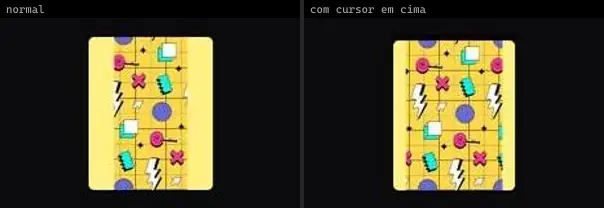 | **Disclose Image** `animata:image/disclose-image` | Portfólio & Mídia | animata · MIT | — |
| 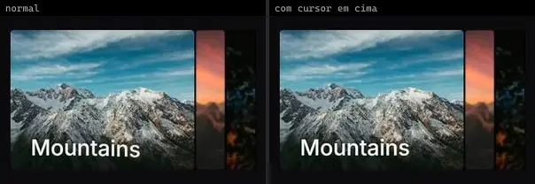 | **Expandable** `animata:carousel/expandable` | Portfólio & Mídia | animata · MIT | — |
|  | **Image Carousel** `animata:carousel/image-carousel` | Portfólio & Mídia | animata · MIT | lucide-react |
|  | **Images Reveal** `animata:image/images-reveal` | Portfólio & Mídia | animata · MIT | motion |
| 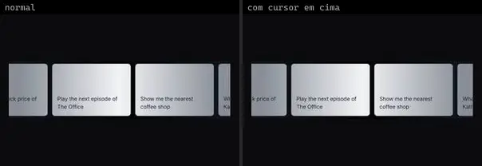 | **Marquee** `animata:container/marquee` | Portfólio & Mídia | animata · MIT | lucide-react |
|  | **Reveal image** `animata:list/reveal-image` | Portfólio & Mídia | animata · MIT | — |
|  | **Skew Image** `animata:image/skew-image` | Portfólio & Mídia | animata · MIT | — |
| 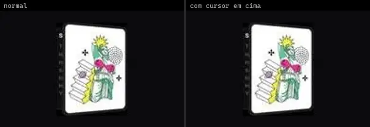 | **Tilted Cover** `animata:image/tilted-cover` | Portfólio & Mídia | animata · MIT | — |
|  | **Trailing Image** `animata:image/trailing-image` | Portfólio & Mídia | animata · MIT | motion |
| 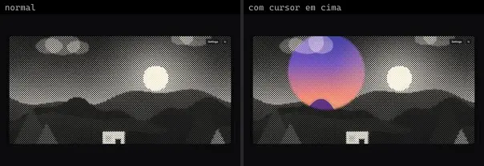 | **HalftoneReveal** `atlas:Media/HalftoneReveal` | Portfólio & Mídia | atlas (própria) · Proprietária (Atlas) | — |
| 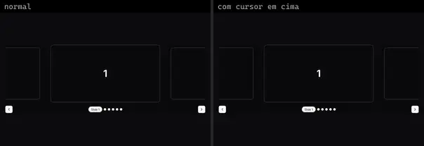 | **SpringCarousel** `atlas:Media/SpringCarousel` | Portfólio & Mídia | atlas (própria) · Proprietária (Atlas) | lucide-react, motion |
| 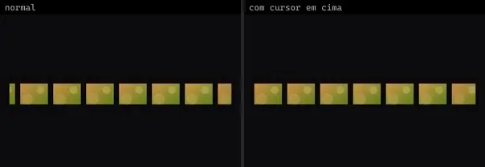 | **Base** `bundui:marquee-effect/base` | Portfólio & Mídia | bundui · MIT | motion, react-use-measure |
| 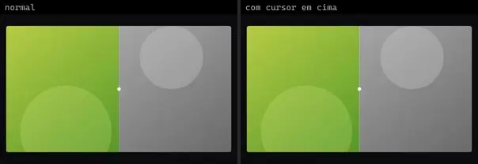 | **Image Comparison** `bundui:image-comparison` | Portfólio & Mídia | bundui · MIT | motion |
| 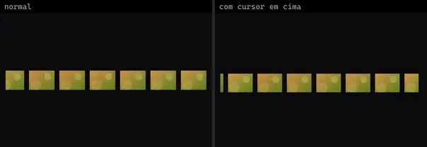 | **Reverse** `bundui:marquee-effect/reverse` | Portfólio & Mídia | bundui · MIT | motion, react-use-measure |
|  | **Vertical** `bundui:marquee-effect/vertical` | Portfólio & Mídia | bundui · MIT | motion, react-use-measure |
| 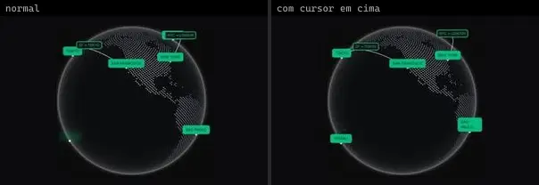 | **Globe** `cultui:globe-demo` | Portfólio & Mídia | cultui · MIT | cobe, motion, next-themes |
|  | **Hover Video Player** `cultui:hover-video-player-demo` | Portfólio & Mídia | cultui · MIT · ⚠needs-network | @radix-ui/react-slot, class-variance-authority, lucide-react, motion |
| 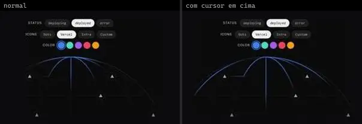 | **Illustration Globe Vercel** `cultui:illustration-globe-vercel-demo` | Portfólio & Mídia | cultui · MIT | — |
| 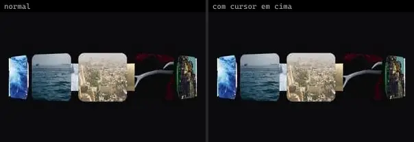 | **Three D Carousel** `cultui:three-d-carousel-demo` | Portfólio & Mídia | cultui · MIT | motion |
|  | **Youtube Video Player** `cultui:youtube-video-player-demo` | Portfólio & Mídia | cultui · MIT | lucide-react, motion |
| 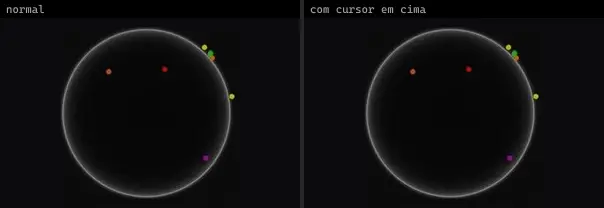 | **Cobe Globe** `eldoraui:cobe-globe-demo` | Portfólio & Mídia | eldoraui · MIT · ⚠needs-network | cobe, react-spring |
| 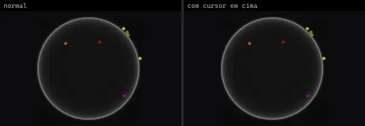 | **Cobe Globe Demo 2** `eldoraui:cobe-globe-demo-2` | Portfólio & Mídia | eldoraui · MIT | cobe, react-spring |
| 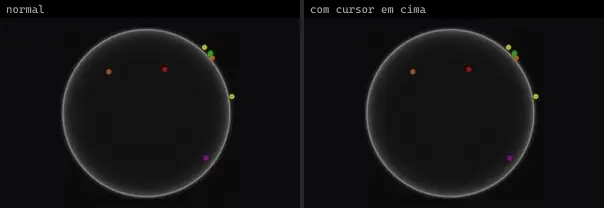 | **Cobe Globe Demo 3** `eldoraui:cobe-globe-demo-3` | Portfólio & Mídia | eldoraui · MIT | cobe, react-spring |
| 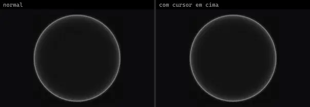 | **Cobe Globe Demo 4** `eldoraui:cobe-globe-demo-4` | Portfólio & Mídia | eldoraui · MIT · ⚠needs-network | cobe, react-spring |
| 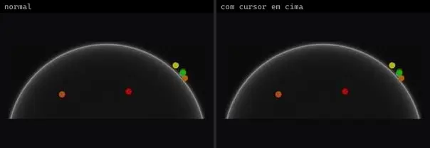 | **Cobe Globe Demo 5** `eldoraui:cobe-globe-demo-5` | Portfólio & Mídia | eldoraui · MIT · ⚠needs-network | cobe, react-spring |
| 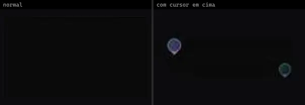 | **Map** `eldoraui:map-demo` | Portfólio & Mídia | eldoraui · MIT · ⚠needs-network | motion |
| 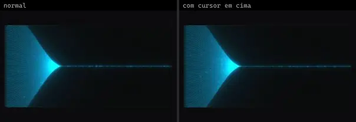 | **Photon Beam** `eldoraui:photon-beam-demo` | Portfólio & Mídia | eldoraui · MIT | three |
| 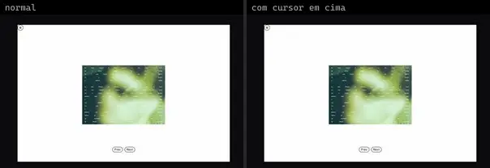 | **Box Carousel** `fancy:carousel/box-carousel-demo` | Portfólio & Mídia | fancy · MIT | lucide-react, motion |
| 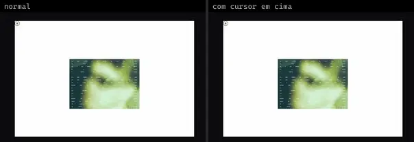 | **Box Carousel Autoplay** `fancy:carousel/box-carousel-autoplay-demo` | Portfólio & Mídia | fancy · MIT | lucide-react, motion |
| 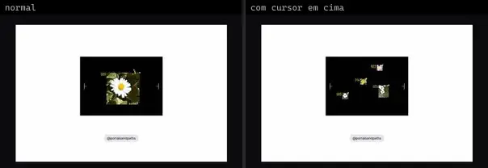 | **Box Carousel Video** `fancy:carousel/box-carousel-video-demo` | Portfólio & Mídia | fancy · MIT · ⚠needs-network | motion |
|  | **Cursor Attractor And Gravity Image** `fancy:physics/cursor-attractor-and-gravity-image-demo` | Portfólio & Mídia | fancy · MIT | lodash, matter-js, poly-decomp |
|  | **Image Trail** `fancy:image/image-trail-demo` | Portfólio & Mídia | fancy · MIT | motion |
| 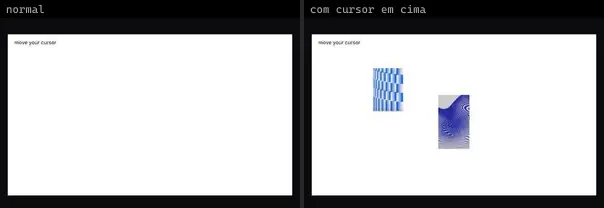 | **Image Trail Instant** `fancy:image/image-trail-instant-demo` | Portfólio & Mídia | fancy · MIT | motion |
| 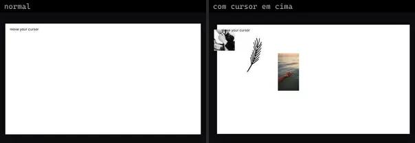 | **Image Trail Various Elements** `fancy:image/image-trail-various-elements-demo` | Portfólio & Mídia | fancy · MIT · ⚠needs-network | motion |
| 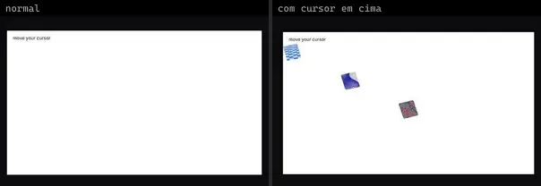 | **Image Trail Zindex** `fancy:image/image-trail-zindex-demo` | Portfólio & Mídia | fancy · MIT | motion |
| 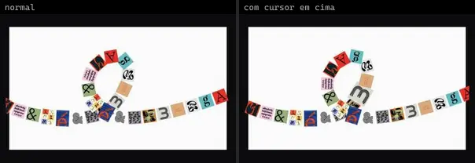 | **Marquee Along Svg Path** `fancy:blocks/marquee-along-svg-path-demo` | Portfólio & Mídia | fancy · MIT | motion |
| 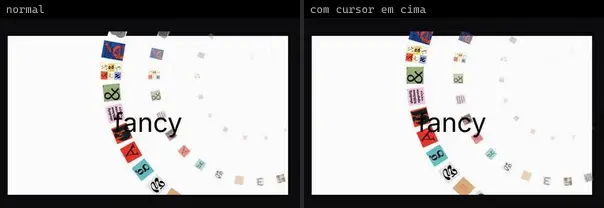 | **Marquee Along Svg Path Mapping** `fancy:blocks/marquee-along-svg-path-mapping-demo` | Portfólio & Mídia | fancy · MIT | motion |
| 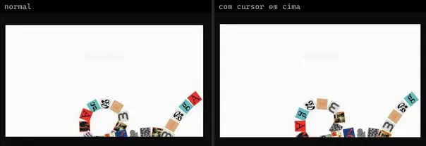 | **Marquee Along Svg Path Scroll** `fancy:blocks/marquee-along-svg-path-scroll-demo` | Portfólio & Mídia | fancy · MIT | motion |
|  | **Media Between Text** `fancy:blocks/media-between-text-demo` | Portfólio & Mídia | fancy · MIT | motion |
|  | **Media Between Text Scroll** `fancy:blocks/media-between-text-scroll-demo` | Portfólio & Mídia | fancy · MIT · ⚠needs-network | motion |
|  | **Media Between Text Vertical** `fancy:blocks/media-between-text-vertical-demo` | Portfólio & Mídia | fancy · MIT · ⚠needs-network | @radix-ui/react-slot, class-variance-authority, motion |
| 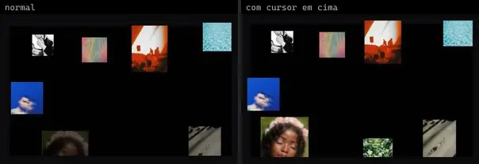 | **Parallax Floating** `fancy:image/parallax-floating-demo` | Portfólio & Mídia | fancy · MIT | motion |
|  | **Simple Marquee** `fancy:blocks/simple-marquee-demo` | Portfólio & Mídia | fancy · MIT | motion |
|  | **Simple Marquee 3d** `fancy:blocks/simple-marquee-3d-demo` | Portfólio & Mídia | fancy · MIT | clsx, motion, tailwind-merge |
| 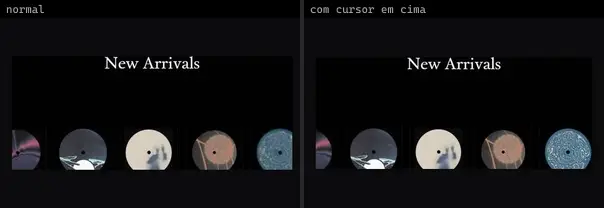 | **Simple Marquee Drag** `fancy:blocks/simple-marquee-drag-demo` | Portfólio & Mídia | fancy · MIT | motion |
| 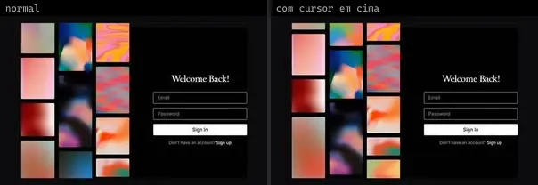 | **Simple Marquee Easing** `fancy:blocks/simple-marquee-easing-demo` | Portfólio & Mídia | fancy · MIT | motion |
| 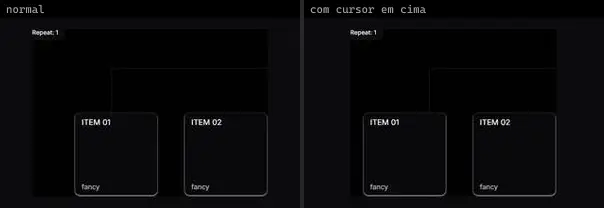 | **Simple Marquee Explainer** `fancy:blocks/simple-marquee-explainer-demo` | Portfólio & Mídia | fancy · MIT | @radix-ui/react-slot, class-variance-authority, motion |
|  | **Image Crop** `kibo:image-crop` | Portfólio & Mídia | kibo · MIT | @repo/image-crop, @repo/shadcn-ui, class-variance-authority, lucide-react, radix-ui, react-image-crop |
| 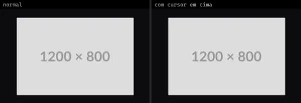 | **Image Zoom** `kibo:image-zoom` | Portfólio & Mídia | kibo · MIT | @repo/image-zoom, react-medium-image-zoom |
| 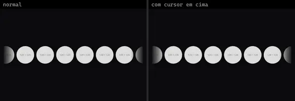 | **Marquee** `kibo:marquee` | Portfólio & Mídia | kibo · MIT | @repo/marquee, react-fast-marquee |
|  | **Reel** `kibo:reel` | Portfólio & Mídia | kibo · MIT · ⚠needs-network | @radix-ui/react-use-controllable-state, @repo/reel, lucide-react, motion |
|  | **Stories** `kibo:stories` | Portfólio & Mídia | kibo · MIT · ⚠needs-network | @repo/stories |
| 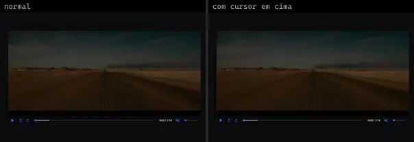 | **Video Player** `kibo:video-player` | Portfólio & Mídia | kibo · MIT · ⚠needs-network | @repo/video-player, media-chrome |
| 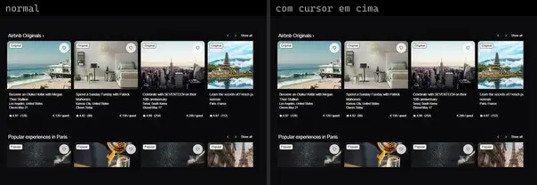 | **Carousel Cards** `kokonutui:carousel-cards` | Portfólio & Mídia | kokonutui · MIT | @radix-ui/react-slot, class-variance-authority, lucide-react |
| 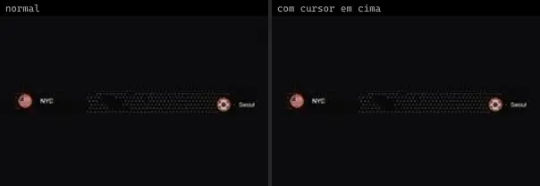 | **Dotted Map** `magicui:dotted-map-demo` | Portfólio & Mídia | magicui · MIT | countries-list, svg-dotted-map |
| 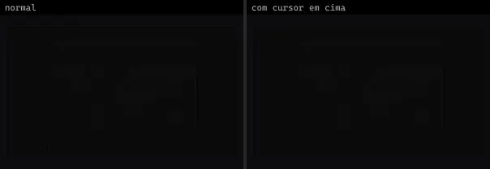 | **Dotted Map 2** `magicui:dotted-map-demo-2` | Portfólio & Mídia | magicui · MIT | svg-dotted-map |
| 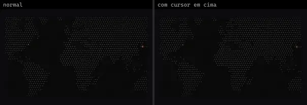 | **Dotted Map 3** `magicui:dotted-map-demo-3` | Portfólio & Mídia | magicui · MIT | svg-dotted-map |
|  | **Globe** `magicui:globe-demo` | Portfólio & Mídia | magicui · MIT | cobe, motion |
| 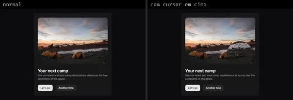 | **Lens** `magicui:lens-demo` | Portfólio & Mídia | magicui · MIT | motion |
| 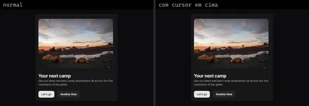 | **Lens 2** `magicui:lens-demo-2` | Portfólio & Mídia | magicui · MIT · ⚠needs-network | motion |
| 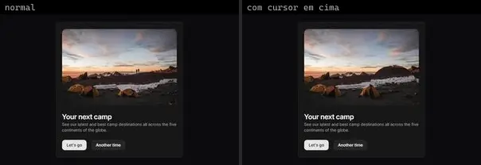 | **Lens 3** `magicui:lens-demo-3` | Portfólio & Mídia | magicui · MIT | motion |
| 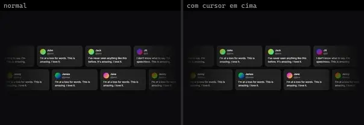 | **Marquee** `magicui:marquee-demo` | Portfólio & Mídia | magicui · MIT | — |
| 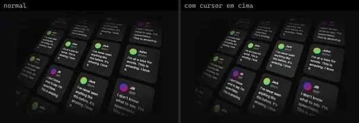 | **Marquee 3D** `magicui:marquee-3d` | Portfólio & Mídia | magicui · MIT | — |
|  | **Marquee Vertical** `magicui:marquee-demo-vertical` | Portfólio & Mídia | magicui · MIT | — |
| 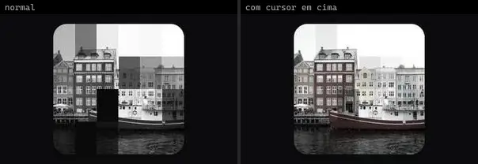 | **Pixel Image** `magicui:pixel-image-demo` | Portfólio & Mídia | magicui · MIT | — |
| 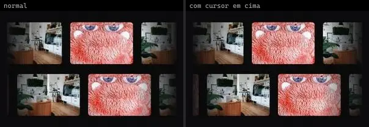 | **Scroll Based Velocity Images** `magicui:scroll-based-velocity-images-demo` | Portfólio & Mídia | magicui · MIT | motion |
| 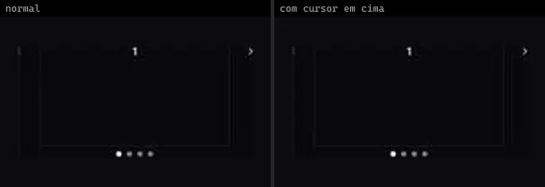 | **Carousel Basic** `motionprimitives:carousel/carousel-basic` | Portfólio & Mídia | motionprimitives · MIT | lucide-react, motion |
| 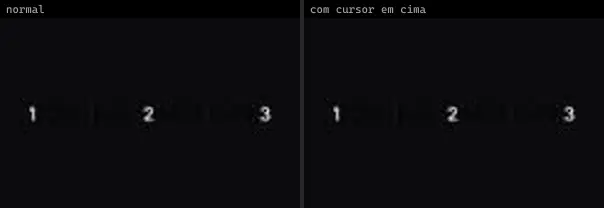 | **Carousel Custom Sizes** `motionprimitives:carousel/carousel-custom-sizes` | Portfólio & Mídia | motionprimitives · MIT | lucide-react, motion |
| 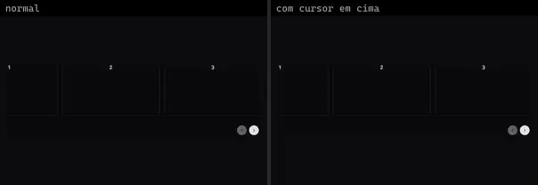 | **Carousel Spacing** `motionprimitives:carousel/carousel-spacing` | Portfólio & Mídia | motionprimitives · MIT | lucide-react, motion |
|  | **Image Comparison Basic** `motionprimitives:image-comparison/image-comparison-basic` | Portfólio & Mídia | motionprimitives · MIT | motion |
|  | **Image Comparison Hover** `motionprimitives:image-comparison/image-comparison-hover` | Portfólio & Mídia | motionprimitives · MIT | motion |
|  | **Image Comparison Spring** `motionprimitives:image-comparison/image-comparison-spring` | Portfólio & Mídia | motionprimitives · MIT | motion |
| 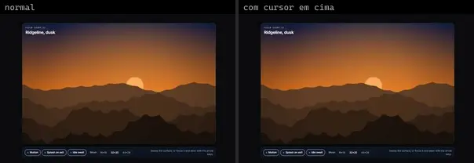 | **Flow Warp Image** `motiq:flow-warp-image` | Portfólio & Mídia | motiq · MIT | — |
|  | **Lens Card** `motiq:lens-card` | Portfólio & Mídia | motiq · MIT | — |
|  | **Orbital Gallery** `motiq:orbital-gallery` | Portfólio & Mídia | motiq · MIT | — |
|  | **Runtime Signal Map** `motiq:catalog/runtime-signal-map` | Portfólio & Mídia | motiq · MIT | — |
|  | **Runtime Signal Map** `motiq:runtime-signal-map` | Portfólio & Mídia | motiq · MIT | — |
|  | **Task Dependency Map** `motiq:catalog/task-dependency-map` | Portfólio & Mídia | motiq · MIT | motion |
|  | **Task Dependency Map** `motiq:task-dependency-map` | Portfólio & Mídia | motiq · MIT | motion |
|  | **Velocity Marquee** `motiq:velocity-marquee` | Portfólio & Mídia | motiq · MIT | — |
|  | **Coverflow Carousel** `smoothui:canvas/coverflow-carousel` | Portfólio & Mídia | smoothui · MIT | @repo/shadcn-ui, @repo/smoothui, motion |
|  | **Coverflow Carousel** `smoothui:coverflow-carousel` | Portfólio & Mídia | smoothui · MIT | @repo/shadcn-ui, @repo/smoothui, motion |
|  | **Cursor Image Trail** `smoothui:cursor-image-trail` | Portfólio & Mídia | smoothui · MIT | @repo/shadcn-ui, @repo/smoothui, motion |
|  | **Hover Image List** `smoothui:hover-image-list` | Portfólio & Mídia | smoothui · MIT | @repo/shadcn-ui, @repo/smoothui, @smoothui/data, lucide-react, motion |
|  | **Orbital Image Wheel** `smoothui:orbital-image-wheel` | Portfólio & Mídia | smoothui · MIT | @repo/shadcn-ui, @repo/smoothui, @smoothui/data, motion |
|  | **Photo Stack** `smoothui:photo-stack` | Portfólio & Mídia | smoothui · MIT | @repo/shadcn-ui, @repo/smoothui, @smoothui/data, motion |
|  | **Phototab** `smoothui:canvas/phototab` | Portfólio & Mídia | smoothui · MIT | @docs/examples, @radix-ui/react-tabs, @repo/smoothui, lucide-react, motion |
|  | **Phototab** `smoothui:phototab` | Portfólio & Mídia | smoothui · MIT | @docs/examples, @radix-ui/react-tabs, @repo/smoothui, lucide-react, motion |
|  | **Video Ambient** `smoothui:video-ambient` | Portfólio & Mídia | smoothui · MIT · ⚠needs-network | @radix-ui/react-slot, @repo/shadcn-ui, @repo/smoothui, class-variance-authority, lucide-react, motion |
|  | **Discloseimage** `spectrumui:discloseimage` | Portfólio & Mídia | spectrumui · Apache-2.0 | clsx, tailwind-merge |
|  | **Globe** `systaliko:blocks/globe` | Portfólio & Mídia | systaliko · MIT | @base-ui/react, lucide-react |
|  | **Image Player** `systaliko:blocks/image-player` | Portfólio & Mídia | systaliko · MIT | — |
|  | **Image Zoom** `systaliko:ecommerce/image-zoom` | Portfólio & Mídia | systaliko · MIT | react-inner-image-zoom |
|  | **Product Carousel** `systaliko:ecommerce/product-carousel` | Portfólio & Mídia | systaliko · MIT | @radix-ui/react-slot, class-variance-authority, motion |
|  | **Product Carousel 2** `systaliko:ecommerce/product-carousel-2` | Portfólio & Mídia | systaliko · MIT · ⚠needs-network | @radix-ui/react-slot, class-variance-authority, motion |
|  | **Product Carousel 3** `systaliko:ecommerce/product-carousel-3` | Portfólio & Mídia | systaliko · MIT | @radix-ui/react-slot, class-variance-authority, motion |
|  | **Scroll X Carousel** `systaliko:scroll-animations/scroll-x-carousel` | Portfólio & Mídia | systaliko · MIT | motion |
|  | **Scroll X Carousel Reverse** `systaliko:scroll-animations/scroll-x-carousel-reverse` | Portfólio & Mídia | systaliko · MIT | motion |
|  | **Slideshow** `systaliko:blocks/slideshow` | Portfólio & Mídia | systaliko · MIT | motion |
|  | **Character Carousel · Filmstrip** `threeui:character-carousel/character-filmstrip` | Portfólio & Mídia | threeui · MIT | — |
|  | **Character Carousel · Wave** `threeui:character-carousel/character-wave` | Portfólio & Mídia | threeui · MIT | — |
|  | **Gallery** `threeui:gallery` | Portfólio & Mídia | threeui · MIT | — |
|  | **Gallery Heading · Glitch Fall** `threeui:gallery-heading/falling-diagonal` | Portfólio & Mídia | threeui · MIT | — |
|  | **Gallery Heading · Halftone Loop** `threeui:gallery-heading/vertical-loop` | Portfólio & Mídia | threeui · MIT | — |
|  | **Gallery Heading · Matte Rise** `threeui:gallery-heading/rising-diagonal` | Portfólio & Mídia | threeui · MIT | — |
|  | **Gallery Heading · Riso Sweep** `threeui:gallery-heading/horizontal-sweep` | Portfólio & Mídia | threeui · MIT | — |
|  | **Text Path Studies · Ball** `threeui:globe-study/ball-study` | Portfólio & Mídia | threeui · MIT | — |
|  | **Text Path Studies · Cloth** `threeui:globe-study/cloth-study` | Portfólio & Mídia | threeui · MIT | — |
|  | **Text Path Studies · Globe Type Study** `threeui:globe-study/globe-study` | Portfólio & Mídia | threeui · MIT | — |
|  | **Text Path Studies · Morphing Glyph Cloud** `threeui:globe-study/morphing-glyph-cloud` | Portfólio & Mídia | threeui · MIT | — |
|  | **Text Path Studies · Outline Typeflow** `threeui:globe-study/outline-typeflow` | Portfólio & Mídia | threeui · MIT | — |
|  | **Text Path Studies · Ripple** `threeui:globe-study/ripple-study` | Portfólio & Mídia | threeui · MIT | — |
|  | **Stacked Card Carousel** `uitripled:motion-core/stacked-card-carousel` | Portfólio & Mídia | uitripled · MIT | framer-motion |
