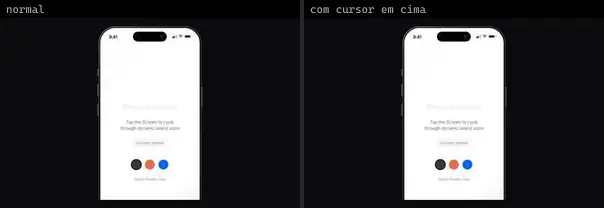
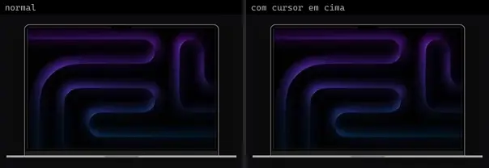
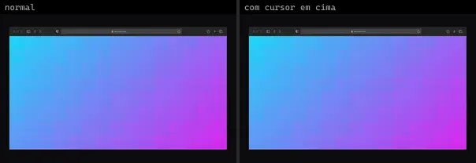
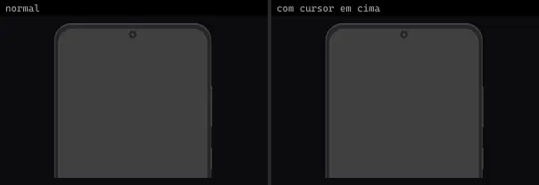
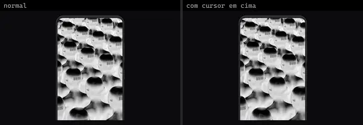
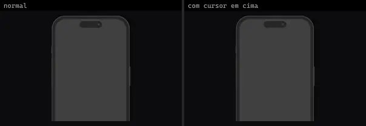
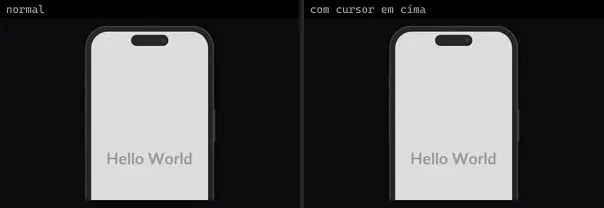
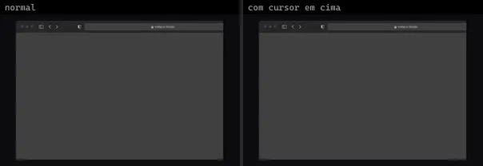
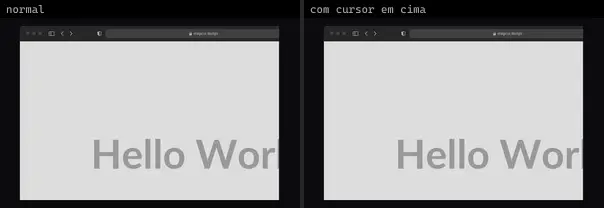
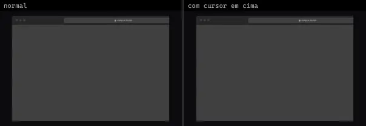

# Mockup (14)

Prévia: estado normal | com o cursor em cima. Código: `node scripts/atlas-find.mjs code <uid>` ou os arquivos em `catalog.jsonl → files`.

| prévia | componente | tipo de aplicação | biblioteca · licença | dependências npm |
|---|---|---|---|---|
|  | **Apple Iphone 17 Pro** `cultui:apple-iphone-17-pro-demo` | Mobile & App | cultui · MIT | lucide-react, motion |
|  | **Iphone 17 Pro** `eldoraui:iphone-17-pro-demo` | Mobile & App | eldoraui · MIT | — |
|  | **Macbook Pro** `eldoraui:macbook-pro-demo` | Mobile & App | eldoraui · MIT | — |
|  | **Safari Browser** `eldoraui:safari-browser-demo` | Mobile & App | eldoraui · MIT | — |
|  | **Android** `magicui:android-demo` | Mobile & App | magicui · MIT · ⚠needs-network | — |
|  | **Android 2** `magicui:android-demo-2` | Mobile & App | magicui · MIT | — |
|  | **Android 3** `magicui:android-demo-3` | Mobile & App | magicui · MIT · ⚠needs-network | — |
|  | **iPhone** `magicui:iphone-demo` | Mobile & App | magicui · MIT | — |
|  | **iPhone 2** `magicui:iphone-demo-2` | Mobile & App | magicui · MIT | — |
|  | **iPhone 3** `magicui:iphone-demo-3` | Mobile & App | magicui · MIT · ⚠needs-network | — |
|  | **Safari** `magicui:safari-demo` | Mobile & App | magicui · MIT | — |
|  | **Safari 2** `magicui:safari-demo-2` | Mobile & App | magicui · MIT | — |
|  | **Safari 3** `magicui:safari-demo-3` | Mobile & App | magicui · MIT · ⚠needs-network | — |
|  | **Safari 4** `magicui:safari-demo-4` | Mobile & App | magicui · MIT · ⚠needs-network | — |
