# Modal & Overlay (77)

Prévia: estado normal | com o cursor em cima. Código: `node scripts/atlas-find.mjs code <uid>` ou os arquivos em `catalog.jsonl → files`.

| prévia | componente | tipo de aplicação | biblioteca · licença | dependências npm |
|---|---|---|---|---|
| 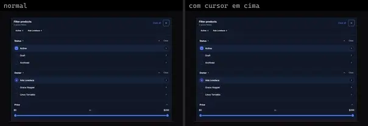 | **Mobile Filter Sheet** `motiq:catalog/mobile-filter-sheet` | Mobile & App | motiq · MIT | motion |
|  | **Mobile Filter Sheet** `motiq:mobile-filter-sheet` | Mobile & App | motiq · MIT | motion |
|  | **Native Dialog Shadcnui** `uitripled:native/native-dialog-shadcnui` | Mobile & App | uitripled · MIT | @radix-ui/react-dialog, framer-motion, lucide-react |
|  | **Native Hover Card** `uitripled:native/demo/native-hover-card-demo` | Mobile & App | uitripled · MIT | @radix-ui/react-slot, class-variance-authority, lucide-react |
| 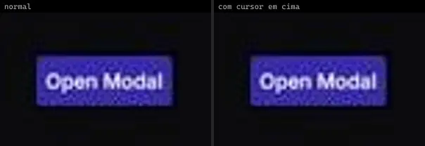 | **Modal** `animata:overlay/modal` | UI base | animata · MIT | lucide-react, motion |
|  | **Alert Dialog** `animateui:components/base/alert-dialog` | UI base | animateui · MIT + Commons Clause | @workspace/ui, class-variance-authority, radix-ui |
|  | **Alert Dialog** `animateui:components/radix/alert-dialog` | UI base | animateui · MIT + Commons Clause | @workspace/ui, class-variance-authority, radix-ui |
|  | **Alert Dialog** `animateui:primitives/base/alert-dialog` | UI base | animateui · MIT + Commons Clause | @base-ui-components/react, motion |
|  | **Alert Dialog** `animateui:primitives/radix/alert-dialog` | UI base | animateui · MIT + Commons Clause | motion, radix-ui |
|  | **Dialog** `animateui:components/base/dialog` | UI base | animateui · MIT + Commons Clause | @workspace/ui, class-variance-authority, lucide-react, radix-ui |
|  | **Dialog** `animateui:components/headless/dialog` | UI base | animateui · MIT + Commons Clause | @workspace/ui, class-variance-authority, lucide-react, motion, radix-ui |
|  | **Dialog** `animateui:components/radix/dialog` | UI base | animateui · MIT + Commons Clause | @workspace/ui, class-variance-authority, lucide-react, radix-ui |
|  | **Dialog** `animateui:primitives/base/dialog` | UI base | animateui · MIT + Commons Clause | @base-ui-components/react, lucide-react, motion |
|  | **Dialog** `animateui:primitives/headless/dialog` | UI base | animateui · MIT + Commons Clause | @headlessui/react, lucide-react, motion |
|  | **Dialog** `animateui:primitives/radix/dialog` | UI base | animateui · MIT + Commons Clause | lucide-react, motion, radix-ui |
| 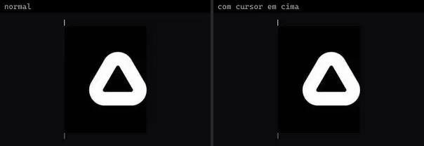 | **Hover Card** `animateui:components/radix/hover-card` | UI base | animateui · MIT + Commons Clause | @workspace/ui |
| 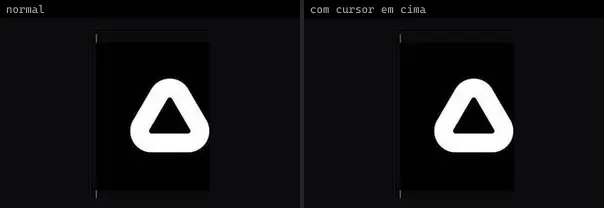 | **Hover Card** `animateui:primitives/radix/hover-card` | UI base | animateui · MIT + Commons Clause | motion, radix-ui |
|  | **Popover** `animateui:components/base/popover` | UI base | animateui · MIT + Commons Clause | @workspace/ui, class-variance-authority, radix-ui |
|  | **Popover** `animateui:components/headless/popover` | UI base | animateui · MIT + Commons Clause | @workspace/ui, class-variance-authority, radix-ui |
|  | **Popover** `animateui:components/radix/popover` | UI base | animateui · MIT + Commons Clause | @workspace/ui, class-variance-authority, radix-ui |
|  | **Popover** `animateui:primitives/base/popover` | UI base | animateui · MIT + Commons Clause | @base-ui-components/react, motion |
|  | **Popover** `animateui:primitives/headless/popover` | UI base | animateui · MIT + Commons Clause | @headlessui/react, motion |
|  | **Popover** `animateui:primitives/radix/popover` | UI base | animateui · MIT + Commons Clause | motion, radix-ui |
|  | **Sheet** `animateui:components/radix/sheet` | UI base | animateui · MIT + Commons Clause | @workspace/ui, class-variance-authority, lucide-react, radix-ui |
|  | **Sheet** `animateui:primitives/radix/sheet` | UI base | animateui · MIT + Commons Clause | motion, radix-ui |
| 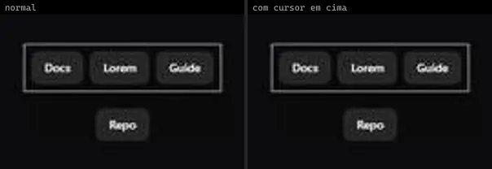 | **Tooltip** `animateui:components/animate/tooltip` | UI base | animateui · MIT + Commons Clause | @workspace/ui, class-variance-authority, motion, radix-ui |
|  | **Tooltip** `animateui:components/base/tooltip` | UI base | animateui · MIT + Commons Clause | @workspace/ui, class-variance-authority, radix-ui |
|  | **Tooltip** `animateui:components/radix/tooltip` | UI base | animateui · MIT + Commons Clause | @workspace/ui, class-variance-authority, radix-ui |
|  | **Tooltip** `animateui:primitives/animate/tooltip` | UI base | animateui · MIT + Commons Clause | @floating-ui/react, motion |
|  | **Tooltip** `animateui:primitives/base/tooltip` | UI base | animateui · MIT + Commons Clause | @base-ui-components/react, motion |
|  | **Tooltip** `animateui:primitives/radix/tooltip` | UI base | animateui · MIT + Commons Clause | motion, radix-ui |
| 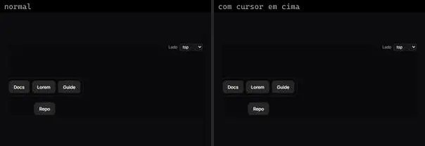 | **SharedTooltip** `atlas:Interactions/SharedTooltip` | UI base | atlas (própria) · Proprietária (Atlas) | motion |
| 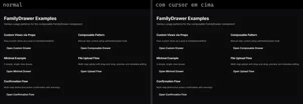 | **Family Drawer** `cultui:family-drawer-demo` | UI base | cultui · MIT | @radix-ui/react-slot, lucide-react, motion, react-use-measure, vaul |
|  | **Floating Panel** `cultui:floating-panel-demo` | UI base | cultui · MIT | lucide-react, motion |
| 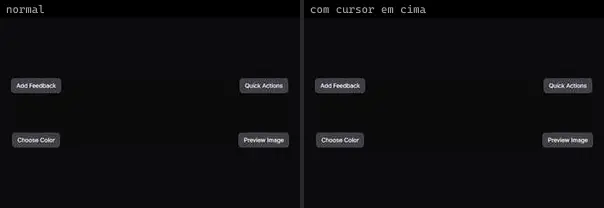 | **Popover** `cultui:popover-demo` | UI base | cultui · MIT | lucide-react, motion |
|  | **Side Panel** `cultui:side-panel-demo` | UI base | cultui · MIT | motion, react-player, react-use-measure |
| 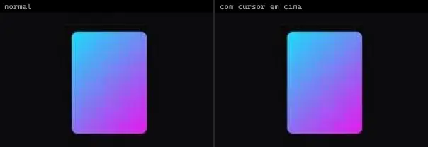 | **Card Flip Hover** `eldoraui:card-flip-hover-demo` | UI base | eldoraui · MIT | — |
|  | **Dialog Stack** `kibo:dialog-stack` | UI base | kibo · MIT | @radix-ui/react-use-controllable-state, @repo/dialog-stack, @repo/shadcn-ui, class-variance-authority, radix-ui |
|  | **Smooth Drawer** `kokonutui:smooth-drawer` | UI base | kokonutui · MIT | @radix-ui/react-slot, class-variance-authority, lucide-react, motion, vaul |
|  | **Dialog Basic** `motionprimitives:dialog/dialog-basic` | UI base | motionprimitives · MIT | lucide-react, motion |
|  | **Dialog Controlled** `motionprimitives:dialog/dialog-controlled` | UI base | motionprimitives · MIT | lucide-react, motion |
|  | **Dialog Custom Backdrop** `motionprimitives:dialog/dialog-custom-backdrop` | UI base | motionprimitives · MIT | lucide-react, motion |
|  | **Dialog Custom Exit** `motionprimitives:dialog/dialog-custom-exit` | UI base | motionprimitives · MIT | lucide-react, motion |
|  | **Dialog Custom Variants Transtion** `motionprimitives:dialog/dialog-custom-variants-transtion` | UI base | motionprimitives · MIT | lucide-react, motion |
|  | **Transition Panel Card** `motionprimitives:transition-panel/transition-panel-card` | UI base | motionprimitives · MIT | motion, react-use-measure |
|  | **Aurora Panel** `motiq:aurora-panel` | UI base | motiq · MIT | — |
|  | **Border Beam Panel** `motiq:border-beam-panel` | UI base | motiq · MIT | — |
|  | **Glass Refraction Panel** `motiq:glass-refraction-panel` | UI base | motiq · MIT | — |
|  | **Animated Tooltip** `smoothui:animated-tooltip` | UI base | smoothui · MIT | @radix-ui/react-slot, @repo/shadcn-ui, @repo/smoothui, class-variance-authority, motion |
|  | **Basic Modal** `smoothui:basic-modal` | UI base | smoothui · MIT | @radix-ui/react-slot, @repo/shadcn-ui, @repo/smoothui, class-variance-authority, lucide-react, motion, usehooks-ts |
| 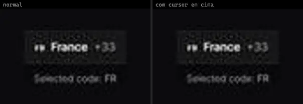 | **Country Dialog** `smoothui:country-dialog` | UI base | smoothui · MIT | @repo/shadcn-ui, @repo/smoothui, lucide-react, motion |
|  | **Dialog** `smoothui:dialog` | UI base | smoothui · MIT | @radix-ui/react-slot, @repo/shadcn-ui, @repo/smoothui, class-variance-authority, lucide-react, motion, radix-ui |
|  | **Drawer** `smoothui:drawer` | UI base | smoothui · MIT | @radix-ui/react-slot, @repo/shadcn-ui, @repo/smoothui, class-variance-authority, motion |
| 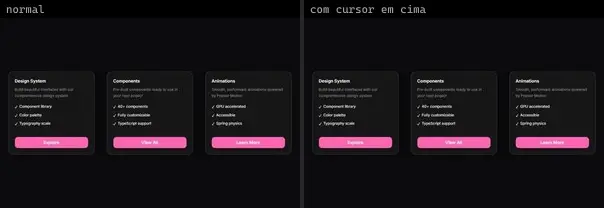 | **Glow Hover Card** `smoothui:glow-hover-card` | UI base | smoothui · MIT | @repo/shadcn-ui, @repo/smoothui, motion |
| 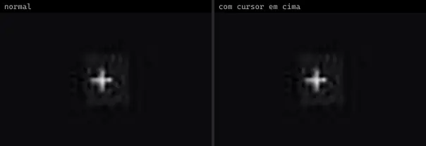 | **Gooey Popover** `smoothui:gooey-popover` | UI base | smoothui · MIT | @repo/shadcn-ui, @repo/smoothui, gsap |
| 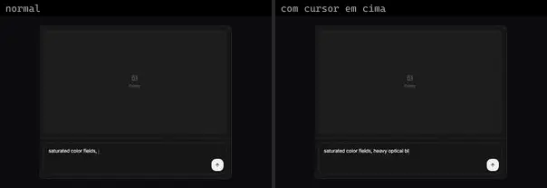 | **Image Generation Panel** `smoothui:image-generation-panel` | UI base | smoothui · MIT | @repo/shadcn-ui, @repo/smoothui, @smoothui/data, lucide-react, motion |
| 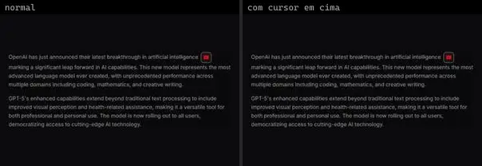 | **Rich Popover** `smoothui:rich-popover` | UI base | smoothui · MIT | @radix-ui/react-popover, @repo/smoothui, lucide-react, motion |
|  | **Social Hover Card** `smoothui:social-hover-card` | UI base | smoothui · MIT | @repo/shadcn-ui, @repo/smoothui, @smoothui/data, lucide-react, motion |
| 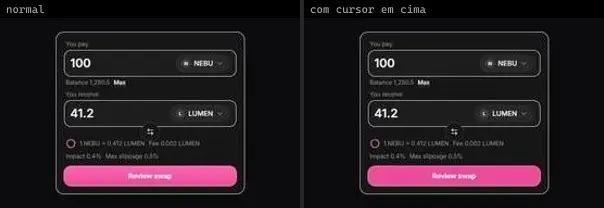 | **Swap Panel** `smoothui:swap-panel` | UI base | smoothui · MIT | @repo/shadcn-ui, @repo/smoothui, lucide-react, motion |
|  | **Video Modal** `smoothui:video-modal` | UI base | smoothui · MIT | @repo/shadcn-ui, @repo/smoothui, lucide-react, motion |
| 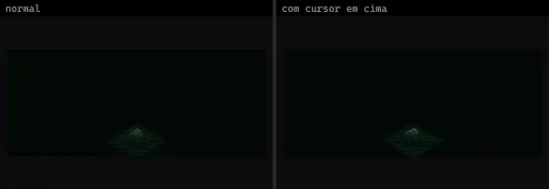 | **Diagnostics Panel · Flowing Mesh** `threeui:diagnostics-panel/flow` | UI base | threeui · MIT · ⚠needs-network | — |
|  | **Diagnostics Panel · Layered Planes** `threeui:diagnostics-panel/layers` | UI base | threeui · MIT · ⚠needs-network | — |
| 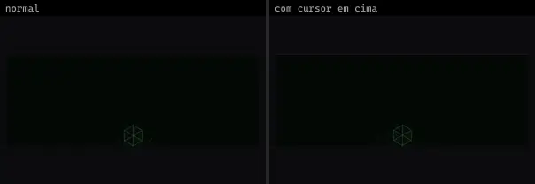 | **Diagnostics Panel · Node Cubes** `threeui:diagnostics-panel/nodes` | UI base | threeui · MIT · ⚠needs-network | — |
| 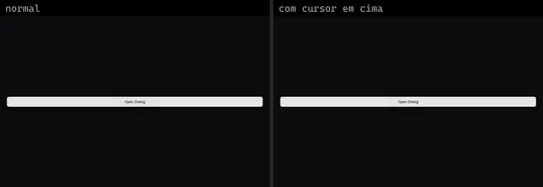 | **Animated Dialog** `uitripled:modals/animated-dialog` | UI base | uitripled · MIT | @radix-ui/react-slot, class-variance-authority, framer-motion, lucide-react |
| 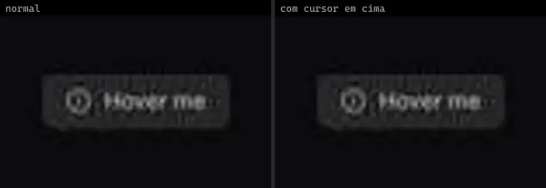 | **Animated Tooltip** `uitripled:tooltips/animated-tooltip` | UI base | uitripled · MIT | framer-motion, lucide-react |
| 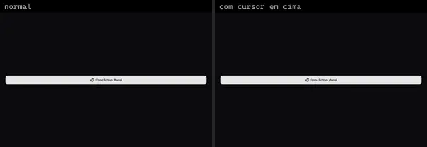 | **Bottom Modal** `uitripled:modals/bottom-modal` | UI base | uitripled · MIT | @radix-ui/react-slot, class-variance-authority, framer-motion, lucide-react |
|  | **Fade Slide** `uitripled:components/modal/fade-slide` | UI base | uitripled · MIT | framer-motion, lucide-react |
| 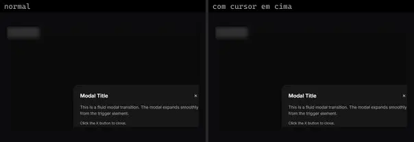 | **Fluid Modal Transition** `uitripled:motion-core/fluid-modal-transition` | UI base | uitripled · MIT | framer-motion, lucide-react |
|  | **Smart Hover Card** `uitripled:motion-core/smart-hover-card` | UI base | uitripled · MIT | framer-motion |
|  | **Angry Dragonfly · iammar99** `uiverse:Tooltips/iammar99_angry-dragonfly-22` | UI base | uiverse · MIT | — |
|  | **Average Earwig · Yaya12085** `uiverse:Tooltips/Yaya12085_average-earwig-11` | UI base | uiverse · MIT | — |
|  | **Hard Starfish · Mohammad-Rahme-576** `uiverse:Tooltips/Mohammad-Rahme-576_hard-starfish-64` | UI base | uiverse · MIT | — |
|  | **Plastic Dolphin · barisdogansutcu** `uiverse:Tooltips/barisdogansutcu_plastic-dolphin-67` | UI base | uiverse · MIT | — |
| 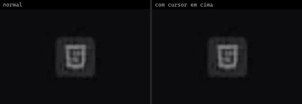 | **Serious Termite · Cobp** `uiverse:Tooltips/Cobp_serious-termite-83` | UI base | uiverse · MIT | — |
| 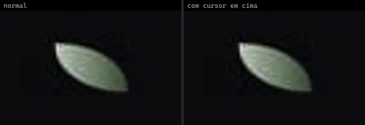 | **Sour Dragon · Lakshay-art** `uiverse:Tooltips/Lakshay-art_sour-dragon-56` | UI base | uiverse · MIT | — |
|  | **Spotty Jellyfish · escannord** `uiverse:Tooltips/escannord_spotty-jellyfish-36` | UI base | uiverse · MIT | — |
|  | **Sweet Sloth · neerajbaniwal** `uiverse:Tooltips/neerajbaniwal_sweet-sloth-99` | UI base | uiverse · MIT | — |
