# Navbar & Header (48)

Prévia: estado normal | com o cursor em cima. Código: `node scripts/atlas-find.mjs code <uid>` ou os arquivos em `catalog.jsonl → files`.

| prévia | componente | tipo de aplicação | biblioteca · licença | dependências npm |
|---|---|---|---|---|
| 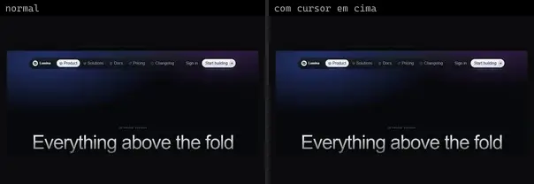 | **Animated Top Dock · Command Bar** `threeui:animated-top-dock/modern` | Login & Conta | threeui · MIT | — |
| 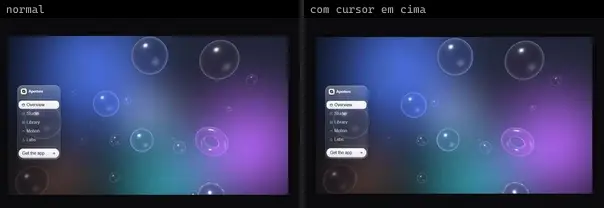 | **Animated Top Dock · Liquid Glass** `threeui:animated-top-dock/glass` | Login & Conta | threeui · MIT | — |
| 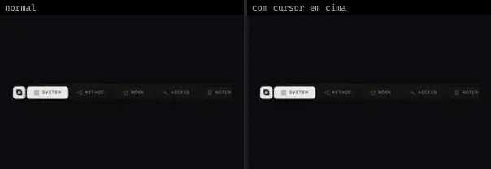 | **Animated Top Dock · Sable Dock** `threeui:animated-top-dock/sable` | Login & Conta | threeui · MIT | — |
|  | **Kage** `threeui:kage-landing-page` | Login & Conta | threeui · MIT · ⚠needs-files | — |
| 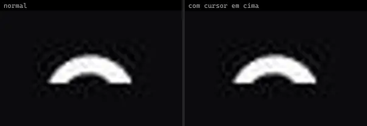 | **Animated Profile Menu** `uitripled:navigation/animated-profile-menu` | Login & Conta | uitripled · MIT | @radix-ui/react-avatar, framer-motion, lucide-react |
| 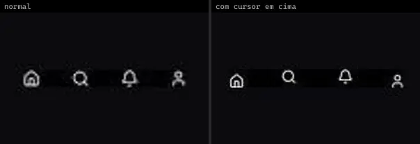 | **Animated Dock** `animata:container/animated-dock` | UI base | animata · MIT | lucide-react, motion |
| 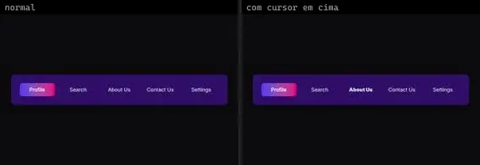 | **Nav Tabs** `animata:container/nav-tabs` | UI base | animata · MIT | motion |
| 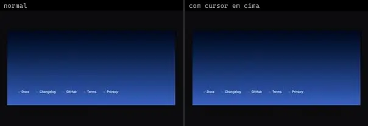 | **Sibling Focus Nav** `animata:container/sibling-focus-nav` | UI base | animata · MIT | @phosphor-icons/react |
| 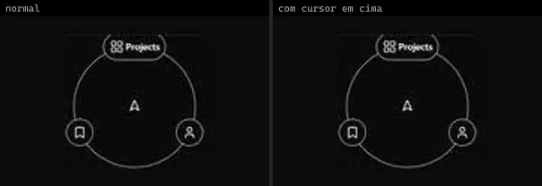 | **Radial Nav** `animateui:components/community/radial-nav` | UI base | animateui · MIT + Commons Clause | lucide-react, motion |
|  | **AnimatedTabs** `atlas:Navigation/AnimatedTabs` | UI base | atlas (própria) · Proprietária (Atlas) | motion |
| 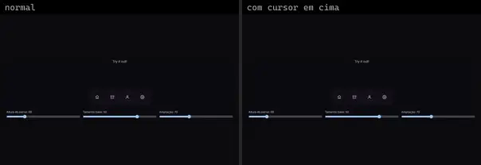 | **MagnifyDock** `atlas:Navigation/MagnifyDock` | UI base | atlas (própria) · Proprietária (Atlas) | motion |
| 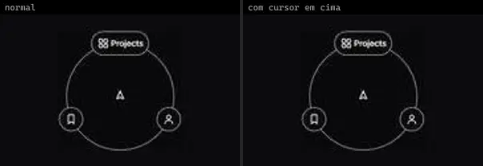 | **RadialNav** `atlas:Navigation/RadialNav` | UI base | atlas (própria) · Proprietária (Atlas) | motion |
| 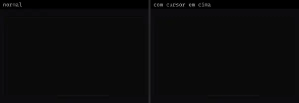 | **Dock** `cultui:dock-demo` | UI base | cultui · MIT | lucide-react, motion |
|  | **Dock Text** `eldoraui:dock-text-demo` | UI base | eldoraui · MIT | motion |
|  | **Dock Text Demo 2** `eldoraui:dock-text-demo-2` | UI base | eldoraui · MIT | motion |
| 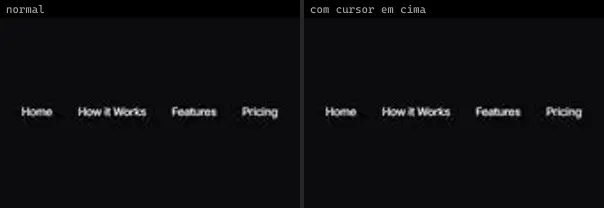 | **Nav Menu** `eldoraui:header-01/components/nav-menu` | UI base | eldoraui · MIT | motion |
| 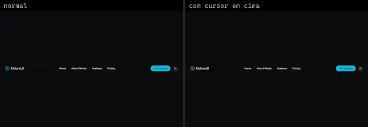 | **Navbar** `eldoraui:header-01/components/navbar` | UI base | eldoraui · MIT | clsx, lucide-react, motion, process, tailwind-merge |
| 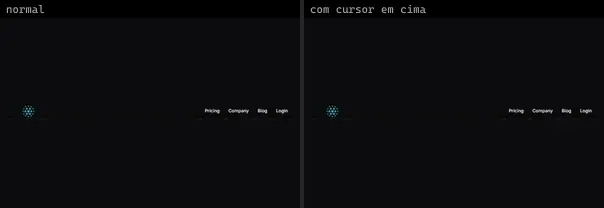 | **Navbar** `eldoraui:header-02/components/navbar` | UI base | eldoraui · MIT | @headlessui/react, @heroicons/react, motion |
|  | **Plus Grid** `eldoraui:header-02/components/plus-grid` | UI base | eldoraui · MIT · ⚠needs-props | clsx |
|  | **Dock** `magicui:dock-demo` | UI base | magicui · MIT | class-variance-authority, lucide-react, motion |
| 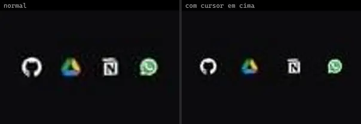 | **Dock 2** `magicui:dock-demo-2` | UI base | magicui · MIT | class-variance-authority, motion |
| 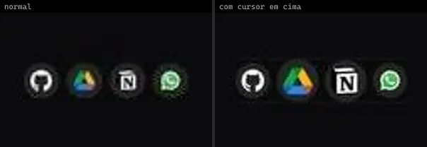 | **Dock 3** `magicui:dock-demo-3` | UI base | magicui · MIT | class-variance-authority, motion |
| 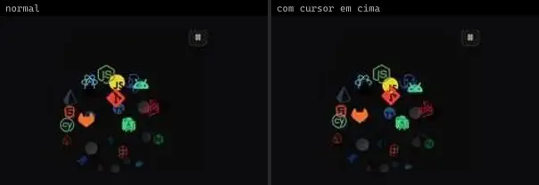 | **Icon Cloud** `magicui:icon-cloud-demo` | UI base | magicui · MIT | lucide-react |
| 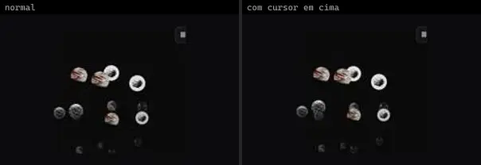 | **Icon Cloud 2** `magicui:icon-cloud-demo-2` | UI base | magicui · MIT | lucide-react |
| 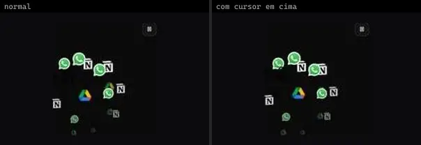 | **Icon Cloud 3** `magicui:icon-cloud-demo-3` | UI base | magicui · MIT | lucide-react |
| 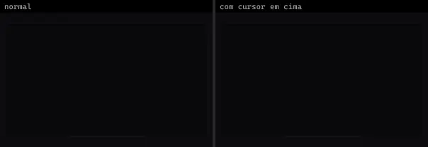 | **Apple Style Dock** `motionprimitives:dock/apple-style-dock` | UI base | motionprimitives · MIT | lucide-react, motion |
| 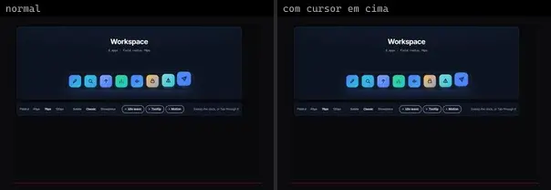 | **Magnetic Dock** `motiq:magnetic-dock` | UI base | motiq · MIT | — |
| 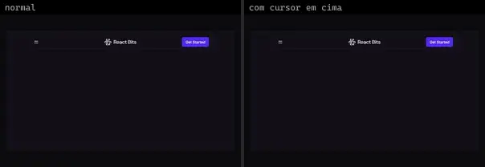 | **CardNav** `reactbits:Components/CardNavDemo` | UI base | reactbits · MIT + Commons Clause | @chakra-ui/react, gsap, react-icons |
|  | **Dock** `reactbits:Components/DockDemo` | UI base | reactbits · MIT + Commons Clause | @chakra-ui/react, motion, react-icons |
| 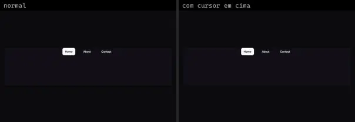 | **GooeyNav** `reactbits:Components/GooeyNavDemo` | UI base | reactbits · MIT + Commons Clause | @chakra-ui/react |
| 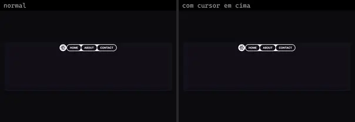 | **PillNav** `reactbits:Components/PillNavDemo` | UI base | reactbits · MIT + Commons Clause | @chakra-ui/react, gsap, react-router-dom |
| 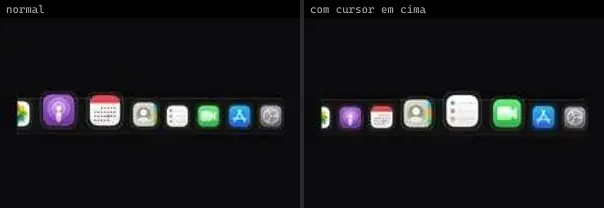 | **Dock** `smoothui:canvas/dock` | UI base | smoothui · MIT | @repo/shadcn-ui, @repo/smoothui, @smoothui/data, motion |
| 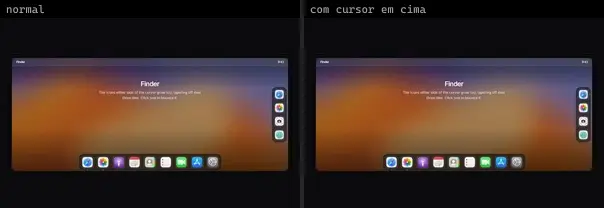 | **Dock** `smoothui:dock` | UI base | smoothui · MIT | @repo/shadcn-ui, @repo/smoothui, @smoothui/data, motion |
| 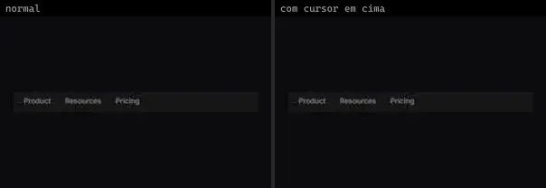 | **Expandable Navbar** `smoothui:expandable-navbar` | UI base | smoothui · MIT | @repo/shadcn-ui, @repo/smoothui, lucide-react, motion |
| 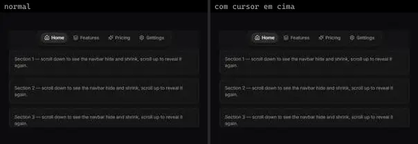 | **Floating Navbar** `smoothui:floating-navbar` | UI base | smoothui · MIT | @repo/shadcn-ui, @repo/smoothui, lucide-react, motion |
| 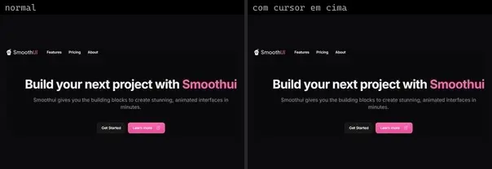 | **Header 1** `smoothui:header-1` | UI base | smoothui · MIT | @repo/smoothui, lucide-react |
|  | **Header 2** `smoothui:header-2` | UI base | smoothui · MIT | @repo/smoothui, @smoothui/data, motion |
|  | **Header 3** `smoothui:header-3` | UI base | smoothui · MIT | @repo/shadcn-ui, @repo/smoothui, @smoothui/data, lucide-react, motion |
|  | **Header 4** `smoothui:header-4` | UI base | smoothui · MIT | @repo/smoothui, lucide-react |
| 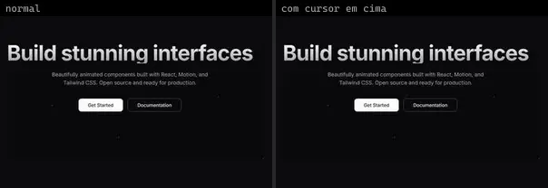 | **Header 5** `smoothui:header-5` | UI base | smoothui · MIT | @repo/smoothui, motion |
|  | **Nav List Card** `spectrumui:nav-list-card` | UI base | spectrumui · Apache-2.0 | clsx, lucide-react, motion, tailwind-merge |
| 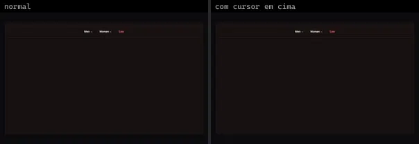 | **Full Screen Navigation Menu** `systaliko:blocks/full-screen-navigation-menu` | UI base | systaliko · MIT | class-variance-authority, lucide-react, radix-ui |
| 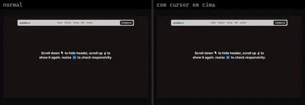 | **Header** `systaliko:blocks/header` | UI base | systaliko · MIT | @radix-ui/react-slot, class-variance-authority, motion |
|  | **Koi Studies** `threeui:koi-studies` | UI base | threeui · MIT | — |
| 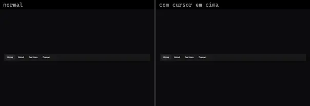 | **Animated Navbar** `uitripled:navigation/animated-navbar` | UI base | uitripled · MIT | framer-motion |
| 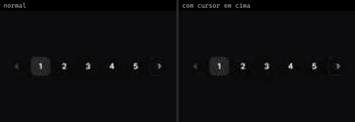 | **Animated Pagination** `uitripled:navigation/animated-pagination` | UI base | uitripled · MIT | framer-motion, lucide-react |
| 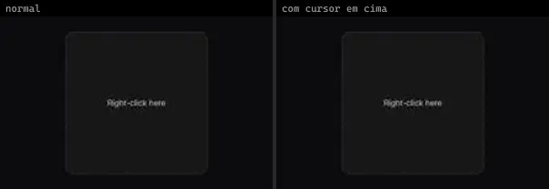 | **Context Menu** `uitripled:navigation/context-menu` | UI base | uitripled · MIT | framer-motion, lucide-react |
| 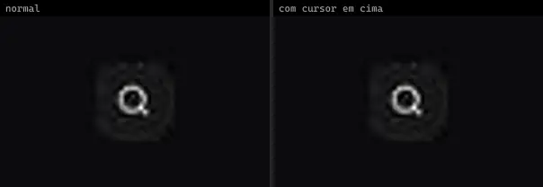 | **Expanding Search Dock** `uitripled:motion-core/expanding-search-dock` | UI base | uitripled · MIT | framer-motion, lucide-react |
