# Outros (195)

Prévia: estado normal | com o cursor em cima. Código: `node scripts/atlas-find.mjs code <uid>` ou os arquivos em `catalog.jsonl → files`.

| prévia | componente | tipo de aplicação | biblioteca · licença | dependências npm |
|---|---|---|---|---|
| 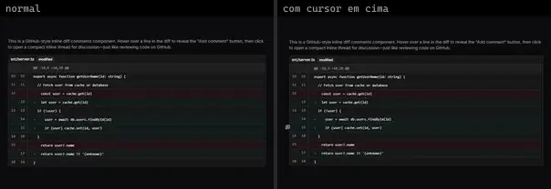 | **Github Inline Comments** `eldoraui:github-inline-comments-demo` | Blog & Conteúdo | eldoraui · MIT | lucide-react |
|  | **Comment Thread** `motiq:catalog/comment-thread` | Blog & Conteúdo | motiq · MIT | motion |
|  | **Comment Thread** `motiq:comment-thread` | Blog & Conteúdo | motiq · MIT | motion |
|  | **Figma Comment** `smoothui:figma-comment` | Blog & Conteúdo | smoothui · MIT | @repo/shadcn-ui, @repo/smoothui, @smoothui/data, motion |
| 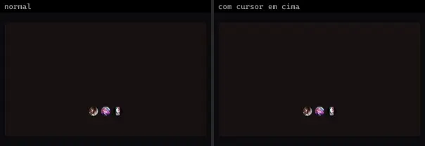 | **Story** `systaliko:blocks/story` | Blog & Conteúdo | systaliko · MIT | @radix-ui/react-avatar, @radix-ui/react-dialog, lucide-react |
| 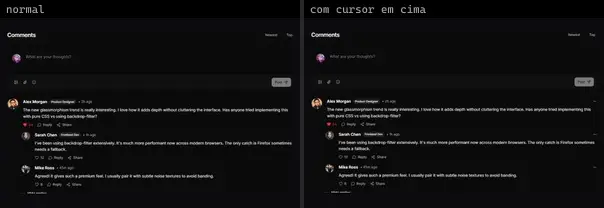 | **Comment Thread** `uitripled:components/comments/comment-thread` | Blog & Conteúdo | uitripled · MIT | @radix-ui/react-avatar, @radix-ui/react-dropdown-menu, @radix-ui/react-slot, class-variance-authority, framer-motion, lucide-react |
| 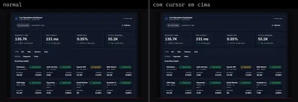 | **Live Operations Dashboard** `motiq:catalog/live-operations-dashboard` | Dashboard & Admin | motiq · MIT | motion |
| 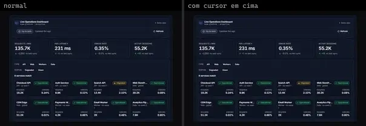 | **Live Operations Dashboard** `motiq:live-operations-dashboard` | Dashboard & Admin | motiq · MIT | motion |
|  | **Dashboard** `uitripled:components/stocks-dashboard/dashboard` | Dashboard & Admin | uitripled · MIT | @radix-ui/react-slot, class-variance-authority, framer-motion, lucide-react, recharts |
|  | **Stocks Dashboard** `uitripled:components/stocks-dashboard/stocks-dashboard` | Dashboard & Admin | uitripled · MIT | @radix-ui/react-dialog, @radix-ui/react-slot, class-variance-authority, framer-motion, lucide-react |
|  | **Weather Dashboard** `uitripled:components/weather/weather-dashboard` | Dashboard & Admin | uitripled · MIT | @radix-ui/react-slot, class-variance-authority, framer-motion, lucide-react, recharts |
|  | **Price Flow** `smoothui:price-flow` | E-commerce | smoothui · MIT | @radix-ui/react-slot, @repo/shadcn-ui, @repo/smoothui, class-variance-authority, motion |
| 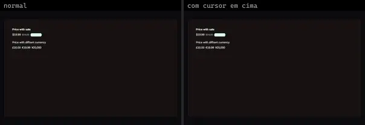 | **Price** `systaliko:ecommerce/price` | E-commerce | systaliko · MIT | @radix-ui/react-slot, class-variance-authority |
| 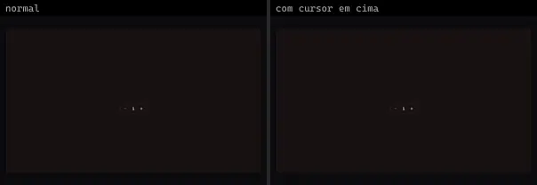 | **Quantity** `systaliko:ecommerce/quantity` | E-commerce | systaliko · MIT | lucide-react, motion |
|  | **Onboarding** `cultui:onboarding-demo` | Login & Conta | cultui · MIT | @radix-ui/react-use-controllable-state, class-variance-authority, lucide-react |
|  | **Native Profile Notch** `uitripled:native/demo/native-profile-notch-demo` | Login & Conta | uitripled · MIT | — |
|  | **Profile Page** `uitripled:components/profile/profile-page` | Login & Conta | uitripled · MIT | @radix-ui/react-avatar, @radix-ui/react-slot, class-variance-authority, framer-motion, lucide-react |
|  | **Native Delete** `uitripled:native/demo/native-delete-demo` | Mobile & App | uitripled · MIT | — |
| 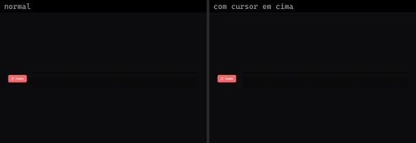 | **Native Delete Shadcnui** `uitripled:native/native-delete-shadcnui` | Mobile & App | uitripled · MIT | @radix-ui/react-slot, class-variance-authority, framer-motion, lucide-react |
| 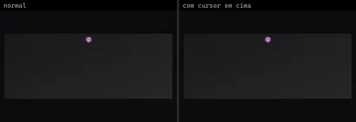 | **Native Notch** `uitripled:native/demo/native-notch-demo` | Mobile & App | uitripled · MIT | @radix-ui/react-avatar |
| 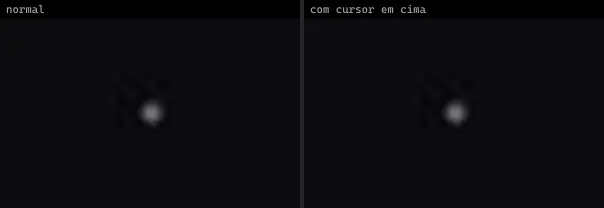 | **Native Notch Shadcnui** `uitripled:native/native-notch-shadcnui` | Mobile & App | uitripled · MIT | framer-motion, lucide-react |
|  | **Native Start Now** `uitripled:native/demo/native-start-now-demo` | Mobile & App | uitripled · MIT | lucide-react |
|  | **Native Start Now** `uitripled:native/native-start-now` | Mobile & App | uitripled · MIT | framer-motion, lucide-react |
|  | **Native Start Now Shadcnui** `uitripled:native/native-start-now-shadcnui` | Mobile & App | uitripled · MIT | framer-motion, lucide-react |
|  | **Battery** `animata:widget/battery` | UI base | animata · MIT | lucide-react |
| 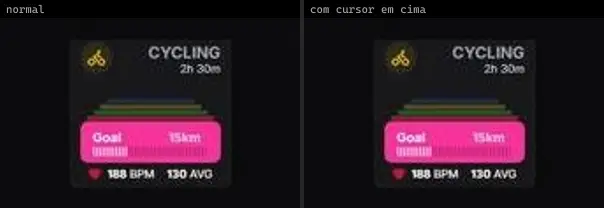 | **Cycling** `animata:widget/cycling` | UI base | animata · MIT | lucide-react |
|  | **Flight widget** `animata:widget/flight-widget` | UI base | animata · MIT | lucide-react |
|  | **Fund Widget** `animata:widget/fund-widget` | UI base | animata · MIT | motion |
|  | **Hover Interaction** `animata:icon/hover-interaction` | UI base | animata · MIT | @radix-ui/react-icons, motion |
|  | **Music Widget** `animata:widget/music-widget` | UI base | animata · MIT | lucide-react |
|  | **Reminder Widget** `animata:widget/reminder-widget` | UI base | animata · MIT | lucide-react |
|  | **Sleep Tracker** `animata:widget/sleep-tracker` | UI base | animata · MIT | — |
| 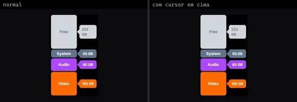 | **Storage Status** `animata:widget/storage-status` | UI base | animata · MIT | — |
|  | **VPN Connection** `animata:widget/vpn-widget` | UI base | animata · MIT | lucide-react |
| 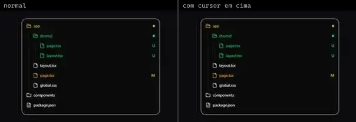 | **Files** `animateui:components/base/files` | UI base | animateui · MIT + Commons Clause | @workspace/ui, lucide-react |
|  | **Files** `animateui:components/radix/files` | UI base | animateui · MIT + Commons Clause | @workspace/ui, lucide-react |
|  | **Files** `animateui:primitives/base/files` | UI base | animateui · MIT + Commons Clause | lucide-react, motion |
| 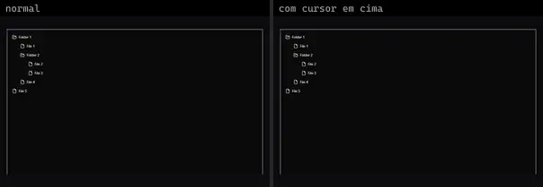 | **Files** `animateui:primitives/radix/files` | UI base | animateui · MIT + Commons Clause | lucide-react, motion |
| 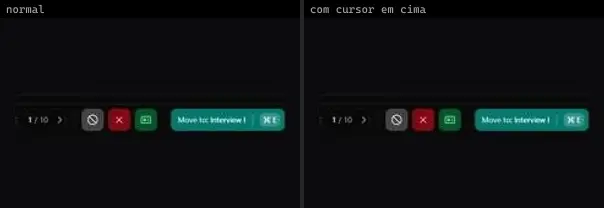 | **Management Bar** `animateui:components/community/management-bar` | UI base | animateui · MIT + Commons Clause | lucide-react, motion |
| 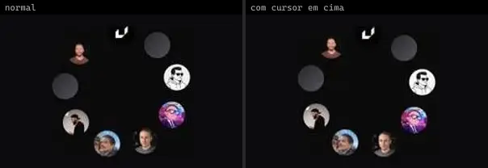 | **Radial Intro** `animateui:components/community/radial-intro` | UI base | animateui · MIT + Commons Clause | motion |
| 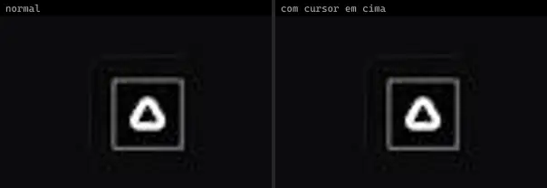 | **Spring** `animateui:primitives/animate/spring` | UI base | animateui · MIT + Commons Clause | motion |
|  | **GradualBlur** `atlas:Misc/GradualBlur` | UI base | atlas (própria) · Proprietária (Atlas) | — |
| 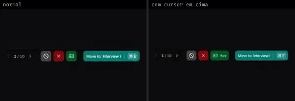 | **ManagementBar** `atlas:Interactions/ManagementBar` | UI base | atlas (própria) · Proprietária (Atlas) | lucide-react, motion |
| 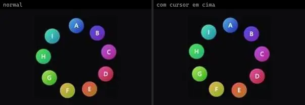 | **RadialIntro** `atlas:Misc/RadialIntro` | UI base | atlas (própria) · Proprietária (Atlas) | motion |
| 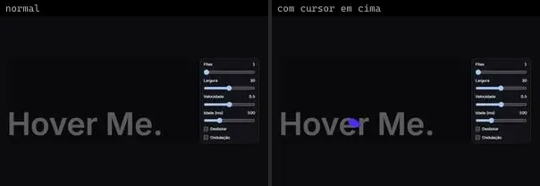 | **Ribbons** `atlas:Interactions/Ribbons` | UI base | atlas (própria) · Proprietária (Atlas) | — |
|  | **Base** `bundui:count-animation/base` | UI base | bundui · MIT | motion |
|  | **Basic** `bundui:sliding-number/basic` | UI base | bundui · MIT | motion, react-use-measure |
|  | **Prefix** `bundui:count-animation/prefix` | UI base | bundui · MIT | motion |
| 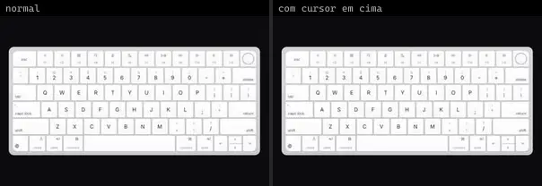 | **Apple Keyboard** `cultui:apple-keyboard-demo` | UI base | cultui · MIT | @tabler/icons-react |
| 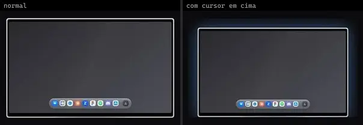 | **Apple Pro Display Xdr** `cultui:apple-pro-display-xdr-demo` | UI base | cultui · MIT | @tabler/icons-react, motion |
|  | **Apple Watch Ultra** `cultui:apple-watch-ultra-demo` | UI base | cultui · MIT | lucide-react, motion |
|  | **Distorted Glass** `cultui:distorted-glass-demo` | UI base | cultui · MIT | motion |
| 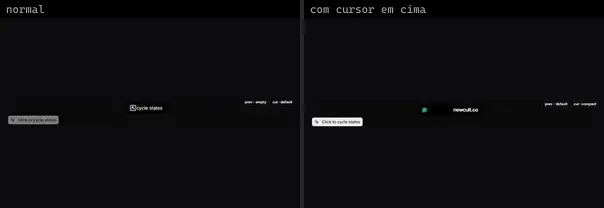 | **Dynamic Island** `cultui:dynamic-island-demo` | UI base | cultui · MIT | lucide-react, motion |
| 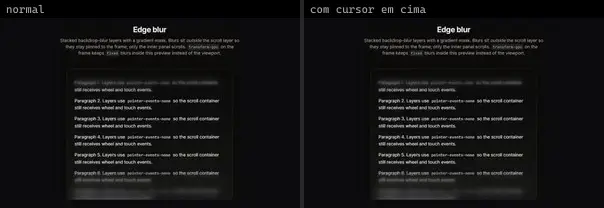 | **Edge Blur** `cultui:edge-blur-demo` | UI base | cultui · MIT | — |
| 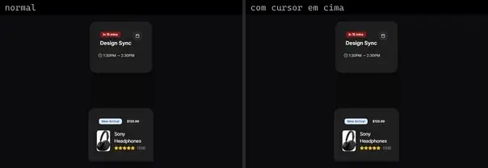 | **Expandable** `cultui:expandable-demo` | UI base | cultui · MIT | lucide-react, motion, react-use-measure |
|  | **Expandable Screen** `cultui:expandable-screen-demo` | UI base | cultui · MIT | lucide-react, motion |
| 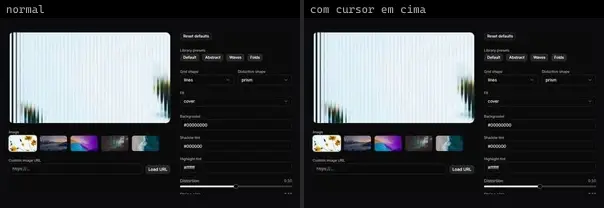 | **Fluted Glass** `cultui:fluted-glass-demo` | UI base | cultui · MIT | @paper-design/shaders-react |
| 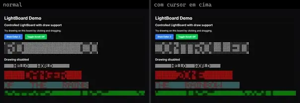 | **Lightboard** `cultui:lightboard-demo` | UI base | cultui · MIT | — |
| 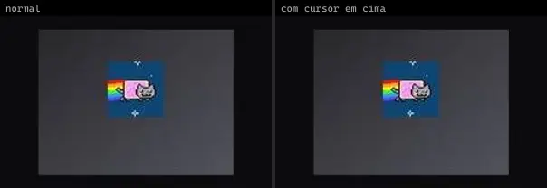 | **Mac Screen** `cultui:mac-screen-demo` | UI base | cultui · MIT | — |
| 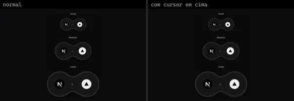 | **Merging Bubbles** `cultui:merging-bubbles-demo` | UI base | cultui · MIT | — |
| 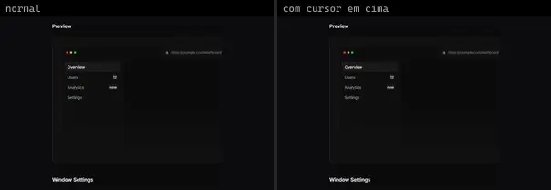 | **Mock Browser Window** `cultui:mock-browser-window-demo` | UI base | cultui · MIT | — |
| 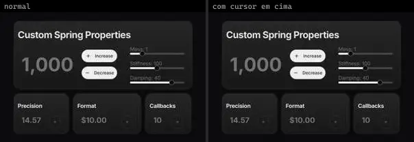 | **Rolling Number** `cultui:rolling-number-demo` | UI base | cultui · MIT | @radix-ui/react-slot, class-variance-authority, lucide-react, motion, sonner |
| 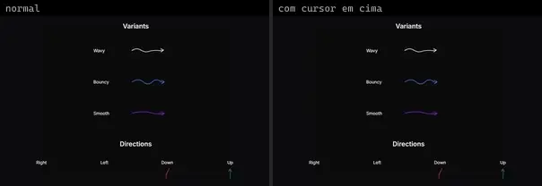 | **Squiggle Arrow** `cultui:squiggle-arrow-demo` | UI base | cultui · MIT | — |
|  | **Svg Bands** `cultui:svg-bands-demo` | UI base | cultui · MIT | — |
| 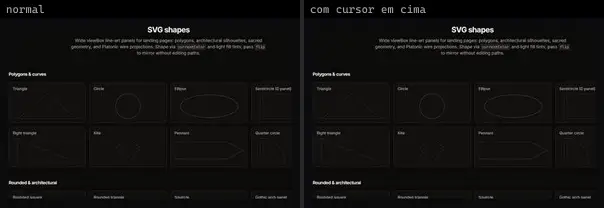 | **Svg Shapes** `cultui:svg-shapes-demo` | UI base | cultui · MIT | — |
| 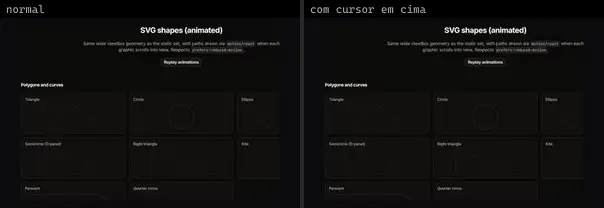 | **Svg Shapes Animated** `cultui:svg-shapes-animated-demo` | UI base | cultui · MIT | motion |
| 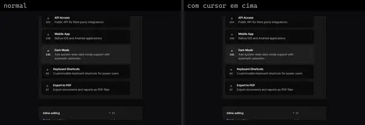 | **Vote Tally** `cultui:vote-tally-demo` | UI base | cultui · MIT | @radix-ui/react-use-controllable-state, lucide-react |
| 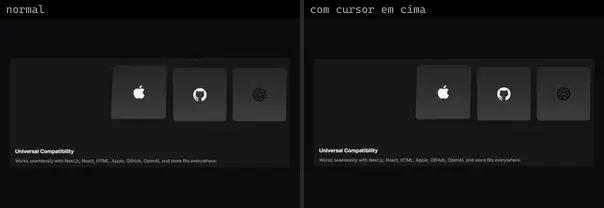 | **Animated Frameworks** `eldoraui:animated-frameworks-demo` | UI base | eldoraui · MIT | — |
| 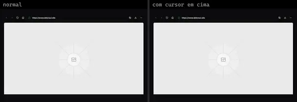 | **Browser** `eldoraui:browser-demo` | UI base | eldoraui · MIT | lucide-react |
| 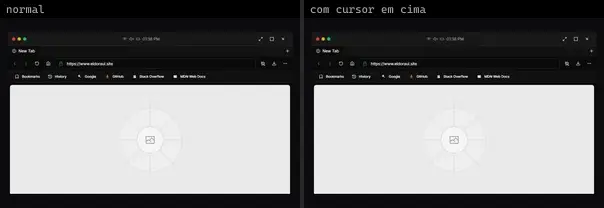 | **Browser Demo 2** `eldoraui:browser-demo-2` | UI base | eldoraui · MIT | lucide-react |
|  | **Integrations** `eldoraui:integrations-demo` | UI base | eldoraui · MIT | lucide-react, motion |
|  | **Integrations Demo 2** `eldoraui:integrations-demo-2` | UI base | eldoraui · MIT | lucide-react, motion |
|  | **Ipad** `eldoraui:ipad-demo` | UI base | eldoraui · MIT | — |
| 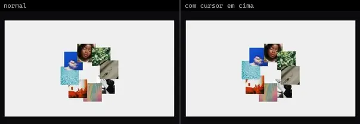 | **Circling Elements** `fancy:blocks/circling-elements-demo` | UI base | fancy · MIT | motion |
| 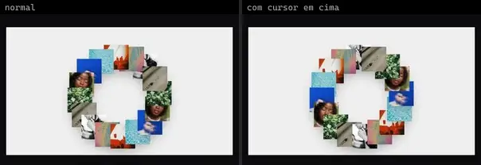 | **Circling Elements Easing** `fancy:blocks/circling-elements-easing-demo` | UI base | fancy · MIT | motion |
|  | **Css Box** `fancy:blocks/css-box-demo` | UI base | fancy · MIT | motion |
|  | **Css Box Hover** `fancy:blocks/css-box-hover-demo` | UI base | fancy · MIT | clsx, motion, tailwind-merge |
|  | **Css Box Non Uniform** `fancy:blocks/css-box-non-uniform-demo` | UI base | fancy · MIT | clsx, motion, tailwind-merge |
| 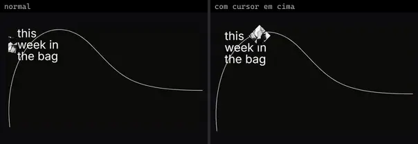 | **Element Along Svg Path** `fancy:blocks/element-along-svg-path-demo` | UI base | fancy · MIT | motion |
|  | **Screensaver** `fancy:blocks/screensaver-demo` | UI base | fancy · MIT | motion |
| 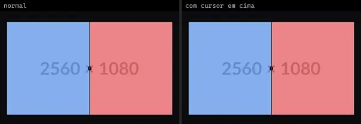 | **Comparison** `kibo:comparison` | UI base | kibo · MIT | @repo/comparison, lucide-react, motion |
| 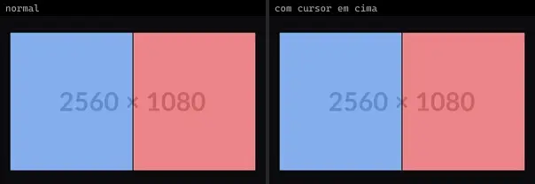 | **Comparison Hover** `kibo:comparison-hover` | UI base | kibo · MIT | @repo/comparison, lucide-react, motion |
|  | **Deck** `kibo:deck` | UI base | kibo · MIT | @radix-ui/react-use-controllable-state, @repo/deck, motion |
| 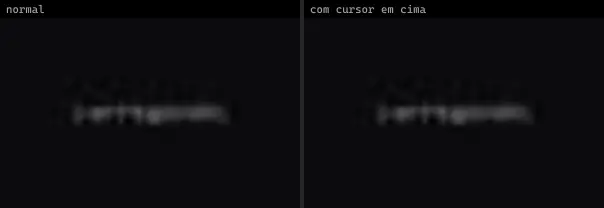 | **Glimpse** `kibo:glimpse` | UI base | kibo · MIT · ⚠needs-network | @repo/glimpse, @repo/shadcn-ui |
| 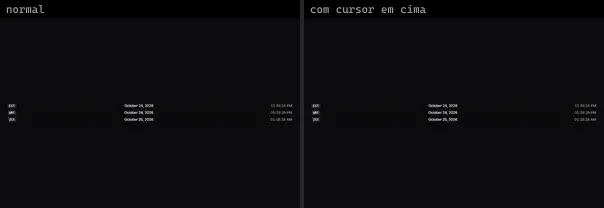 | **Relative Time** `kibo:relative-time` | UI base | kibo · MIT | @radix-ui/react-use-controllable-state, @repo/relative-time |
|  | **Roadmap** `kibo:roadmap` | UI base | kibo · MIT | @dnd-kit/core, @dnd-kit/modifiers, @dnd-kit/sortable, @dnd-kit/utilities, @faker-js/faker, @repo/calendar, @repo/gantt, @repo/kanban, @repo/list, @repo/shadcn-ui, @repo/table, @tanstack/react-table, @uidotdev/usehooks, date-fns, jotai, lodash.groupby, lodash.throttle, lucide-react, radix-ui, tunnel-rat |
| 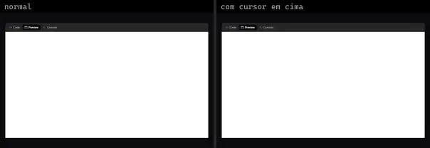 | **Sandbox** `kibo:sandbox` | UI base | kibo · MIT · ⚠needs-network | @codesandbox/sandpack-react, @repo/sandbox, @repo/shadcn-ui, lucide-react, react-resizable-panels |
|  | **Ticker** `kibo:ticker` | UI base | kibo · MIT | @repo/ticker |
|  | **Currency Transfer** `kokonutui:currency-transfer` | UI base | kokonutui · MIT | @radix-ui/react-tooltip, clsx, lucide-react, motion, tailwind-merge |
| 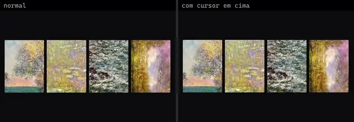 | **Animated Group Custom Variants** `motionprimitives:animated-group/animated-group-custom-variants` | UI base | motionprimitives · MIT | motion |
| 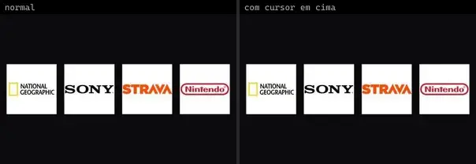 | **Animated Group Custom Variants 2** `motionprimitives:animated-group/animated-group-custom-variants-2` | UI base | motionprimitives · MIT | motion |
| 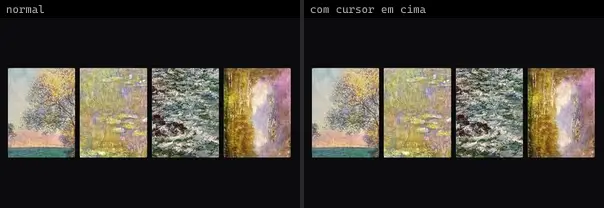 | **Animated Group Preset** `motionprimitives:animated-group/animated-group-preset` | UI base | motionprimitives · MIT | motion |
| 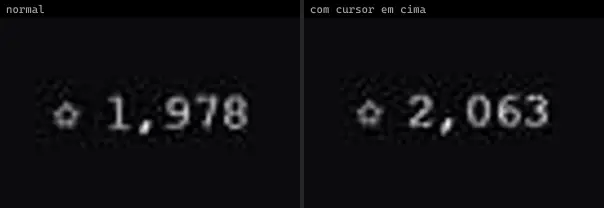 | **Animated Number Basic** `motionprimitives:animated-number/animated-number-basic` | UI base | motionprimitives · MIT | motion |
|  | **Sliding Basic** `motionprimitives:sliding-number/sliding-basic` | UI base | motionprimitives · MIT | motion, react-use-measure |
|  | **Api Request Inspector** `motiq:api-request-inspector` | UI base | motiq · MIT | motion |
|  | **Api Request Inspector** `motiq:catalog/api-request-inspector` | UI base | motiq · MIT | motion |
|  | **Approval Workflow** `motiq:approval-workflow` | UI base | motiq · MIT | @radix-ui/react-dialog, motion |
|  | **Approval Workflow** `motiq:catalog/approval-workflow` | UI base | motiq · MIT | motion |
|  | **Data Contour Surface** `motiq:catalog/data-contour-surface` | UI base | motiq · MIT | — |
|  | **Data Contour Surface** `motiq:data-contour-surface` | UI base | motiq · MIT | — |
|  | **Data Quality Status** `motiq:catalog/data-quality-status` | UI base | motiq · MIT | motion |
|  | **Data Quality Status** `motiq:data-quality-status` | UI base | motiq · MIT | motion |
|  | **Data Refresh State** `motiq:catalog/data-refresh-state` | UI base | motiq · MIT | motion |
|  | **Data Refresh State** `motiq:data-refresh-state` | UI base | motiq · MIT | motion |
|  | **Deployment Pipeline** `motiq:catalog/deployment-pipeline` | UI base | motiq · MIT | motion |
|  | **Deployment Pipeline** `motiq:deployment-pipeline` | UI base | motiq · MIT | motion |
|  | **Event Propagation Matrix** `motiq:catalog/event-propagation-matrix` | UI base | motiq · MIT | — |
|  | **Event Propagation Matrix** `motiq:event-propagation-matrix` | UI base | motiq · MIT | — |
|  | **Filmstrip Scrub** `motiq:filmstrip-scrub` | UI base | motiq · MIT | — |
|  | **Gooey Actions** `motiq:gooey-actions` | UI base | motiq · MIT | — |
|  | **Index** `motiq:index` | UI base | motiq · MIT | motion |
|  | **Kinetic Emphasis** `motiq:catalog/kinetic-emphasis` | UI base | motiq · MIT | motion |
|  | **Live Log Stream** `motiq:catalog/live-log-stream` | UI base | motiq · MIT | motion |
|  | **Live Log Stream** `motiq:live-log-stream` | UI base | motiq · MIT | motion |
|  | **Loom Draft** `motiq:catalog/loom-draft` | UI base | motiq · MIT | — |
|  | **Loom Draft** `motiq:loom-draft` | UI base | motiq · MIT | — |
|  | **Luminous Topography** `motiq:catalog/luminous-topography` | UI base | motiq · MIT | — |
|  | **Luminous Topography** `motiq:luminous-topography` | UI base | motiq · MIT | — |
|  | **Mention Suggestions** `motiq:catalog/mention-suggestions` | UI base | motiq · MIT | motion |
|  | **Mention Suggestions** `motiq:mention-suggestions` | UI base | motiq · MIT | motion |
|  | **Passkey Setup Flow** `motiq:catalog/passkey-setup-flow` | UI base | motiq · MIT | motion |
|  | **Passkey Setup Flow** `motiq:passkey-setup-flow` | UI base | motiq · MIT | motion |
|  | **Proximity Type** `motiq:proximity-type` | UI base | motiq · MIT | — |
|  | **Riso Registration** `motiq:catalog/riso-registration` | UI base | motiq · MIT | — |
|  | **Riso Registration** `motiq:riso-registration` | UI base | motiq · MIT | — |
|  | **Session Security Center** `motiq:catalog/session-security-center` | UI base | motiq · MIT | motion |
|  | **Session Security Center** `motiq:session-security-center` | UI base | motiq · MIT | motion |
|  | **Source Citation Rail** `motiq:catalog/source-citation-rail` | UI base | motiq · MIT | motion |
|  | **Source Citation Rail** `motiq:source-citation-rail` | UI base | motiq · MIT | motion |
|  | **Split Flap** `motiq:split-flap` | UI base | motiq · MIT | — |
|  | **Streaming Data Rows** `motiq:catalog/streaming-data-rows` | UI base | motiq · MIT | motion |
|  | **Streaming Data Rows** `motiq:streaming-data-rows` | UI base | motiq · MIT | motion |
|  | **Swipe Action Row** `motiq:catalog/swipe-action-row` | UI base | motiq · MIT | motion |
|  | **Swipe Action Row** `motiq:swipe-action-row` | UI base | motiq · MIT | motion |
|  | **Thread Expansion** `motiq:catalog/thread-expansion` | UI base | motiq · MIT | motion |
|  | **Thread Expansion** `motiq:thread-expansion` | UI base | motiq · MIT | motion |
|  | **Two Factor Setup Flow** `motiq:catalog/two-factor-setup-flow` | UI base | motiq · MIT | motion |
|  | **Two Factor Setup Flow** `motiq:two-factor-setup-flow` | UI base | motiq · MIT | motion |
|  | **Webhook Event Stream** `motiq:catalog/webhook-event-stream` | UI base | motiq · MIT | motion |
|  | **Webhook Event Stream** `motiq:webhook-event-stream` | UI base | motiq · MIT | motion |
|  | **BorderGlow** `reactbits:Components/BorderGlowDemo` | UI base | reactbits · MIT + Commons Clause | @chakra-ui/react, react-icons |
|  | **DriftWall** `reactbits:Components/DriftWallDemo` | UI base | reactbits · MIT + Commons Clause | @chakra-ui/react |
|  | **FluidGlass** `reactbits:Components/FluidGlassDemo` | UI base | reactbits · MIT + Commons Clause · ⚠needs-network | @chakra-ui/react, @react-three/drei, @react-three/fiber, maath, three |
|  | **FlyingPosters** `reactbits:Components/FlyingPostersDemo` | UI base | reactbits · MIT + Commons Clause | @chakra-ui/react, ogl |
|  | **Folder** `reactbits:Components/FolderDemo` | UI base | reactbits · MIT + Commons Clause | @chakra-ui/react |
|  | **GlassIcons** `reactbits:Components/GlassIconsDemo` | UI base | reactbits · MIT + Commons Clause | @chakra-ui/react, react-icons |
|  | **GlassSurface** `reactbits:Components/GlassSurfaceDemo` | UI base | reactbits · MIT + Commons Clause | @chakra-ui/react, lenis, react-icons, three |
|  | **InfiniteSpiral** `reactbits:Components/InfiniteSpiralDemo` | UI base | reactbits · MIT + Commons Clause | @chakra-ui/react |
|  | **Lanyard** `reactbits:Components/LanyardDemo` | UI base | reactbits · MIT + Commons Clause · ⚠needs-network | @chakra-ui/react, @react-three/drei, @react-three/fiber, @react-three/rapier, meshline, three |
|  | **ModelViewer** `reactbits:Components/ModelViewerDemo` | UI base | reactbits · MIT + Commons Clause · ⚠needs-network | @chakra-ui/react, @react-three/drei, @react-three/fiber, three |
|  | **OptionWheel** `reactbits:Components/OptionWheelDemo` | UI base | reactbits · MIT + Commons Clause | @chakra-ui/react |
|  | **Questionnaire 1** `reui:questionnaire/c-questionnaire-1` | UI base | reui · MIT | @shadcn/react, class-variance-authority, cn, radix-ui |
|  | **Apple Invites** `smoothui:apple-invites` | UI base | smoothui · MIT | @docs/examples, @repo/smoothui, lucide-react, motion, popmotion |
|  | **Arcade Pixel** `smoothui:arcade-pixel` | UI base | smoothui · MIT | @radix-ui/react-slot, @repo/shadcn-ui, @repo/smoothui, class-variance-authority, motion |
|  | **Ascii Render** `smoothui:ascii-render` | UI base | smoothui · MIT | @repo/shadcn-ui, @repo/smoothui, @smoothui/data, motion |
|  | **Blur Out Up** `smoothui:blur-out-up` | UI base | smoothui · MIT | @repo/smoothui, motion |
|  | **Book** `smoothui:book` | UI base | smoothui · MIT | @repo/shadcn-ui, @repo/smoothui, motion |
|  | **Dynamic Island** `smoothui:dynamic-island` | UI base | smoothui · MIT | @repo/smoothui, lucide-react, motion |
|  | **Emboss Surface** `smoothui:emboss-surface` | UI base | smoothui · MIT | @repo/shadcn-ui, @repo/smoothui, lucide-react, motion |
|  | **Emoji Reaction** `smoothui:emoji-reaction` | UI base | smoothui · MIT | @radix-ui/react-slot, @repo/shadcn-ui, @repo/smoothui, class-variance-authority, lucide-react, motion |
|  | **Fade Through** `smoothui:fade-through` | UI base | smoothui · MIT | @repo/smoothui, motion |
|  | **Focus Blur Resolve** `smoothui:focus-blur-resolve` | UI base | smoothui · MIT | @repo/smoothui, motion |
|  | **Hover Expand** `smoothui:hover-expand` | UI base | smoothui · MIT | @repo/shadcn-ui, @repo/smoothui, @smoothui/data, motion |
|  | **Job Listing Component** `smoothui:job-listing-component` | UI base | smoothui · MIT | @repo/smoothui, motion, usehooks-ts |
|  | **Kinetic Center Build** `smoothui:kinetic-center-build` | UI base | smoothui · MIT | @repo/smoothui, motion |
|  | **Line By Line Slide** `smoothui:line-by-line-slide` | UI base | smoothui · MIT | @repo/smoothui, motion |
|  | **Micro Scale Fade** `smoothui:micro-scale-fade` | UI base | smoothui · MIT | @repo/smoothui, motion |
|  | **Per Character Rise** `smoothui:per-character-rise` | UI base | smoothui · MIT | @repo/smoothui, motion |
|  | **Power Off Slide** `smoothui:power-off-slide` | UI base | smoothui · MIT | @repo/smoothui, lucide-react, motion |
|  | **Ransom Note** `smoothui:ransom-note` | UI base | smoothui · MIT | @repo/shadcn-ui, @repo/smoothui, motion |
|  | **Scale Down Fade** `smoothui:scale-down-fade` | UI base | smoothui · MIT | @repo/smoothui, motion |
|  | **Scrubber** `smoothui:scrubber` | UI base | smoothui · MIT | @repo/shadcn-ui, @repo/smoothui, motion |
|  | **Short Slide Down** `smoothui:short-slide-down` | UI base | smoothui · MIT | @repo/smoothui, motion |
|  | **Short Slide Right** `smoothui:short-slide-right` | UI base | smoothui · MIT | @repo/smoothui, motion |
|  | **Soft Blur In** `smoothui:soft-blur-in` | UI base | smoothui · MIT | @repo/smoothui, motion |
|  | **Spring Scale In** `smoothui:spring-scale-in` | UI base | smoothui · MIT | @repo/smoothui, motion |
|  | **Squircle** `smoothui:squircle` | UI base | smoothui · MIT | @repo/shadcn-ui, @repo/smoothui, lucide-react |
|  | **Stagger From Center** `smoothui:stagger-from-center` | UI base | smoothui · MIT | @repo/smoothui, motion |
|  | **Stagger From Edges** `smoothui:stagger-from-edges` | UI base | smoothui · MIT | @repo/smoothui, motion |
|  | **Unlock Face Id** `smoothui:unlock-face-id` | UI base | smoothui · MIT | @radix-ui/react-slot, @repo/shadcn-ui, @repo/smoothui, class-variance-authority, motion |
|  | **Hold To Confirm** `spectrumui:hold-to-confirm` | UI base | spectrumui · Apache-2.0 | clsx, framer-motion, lucide-react, tailwind-merge |
|  | **Reaction Bar** `spectrumui:reaction-bar` | UI base | spectrumui · Apache-2.0 | clsx, framer-motion, lucide-react, tailwind-merge |
|  | **Swipe To Delete** `spectrumui:swipe-to-delete` | UI base | spectrumui · Apache-2.0 · ⚠needs-props | clsx, framer-motion, lucide-react, tailwind-merge |
|  | **Animated Border** `systaliko:components/animated-border` | UI base | systaliko · MIT | @radix-ui/react-slot, class-variance-authority |
|  | **Animation Variants** `systaliko:utils/animation-variants` | UI base | systaliko · MIT | motion |
|  | **Clip Path Animation Variants** `systaliko:utils/clip-path-animation-variants` | UI base | systaliko · MIT | motion |
|  | **Flow** `systaliko:blocks/flow` | UI base | systaliko · MIT | @xyflow/react, clsx |
|  | **Set Stagger Direction** `systaliko:utils/set-stagger-direction` | UI base | systaliko · MIT | motion |
|  | **About Us Page** `uitripled:page/about/about-us-page` | UI base | uitripled · MIT | @radix-ui/react-slot, class-variance-authority, framer-motion, lucide-react |
|  | **Course Content Page** `uitripled:components/course-content/course-content-page` | UI base | uitripled · MIT | @radix-ui/react-slot, class-variance-authority, framer-motion, lucide-react |
|  | **Minimal Resume** `uitripled:components/resumes/shadcnui/minimal-resume` | UI base | uitripled · MIT | @radix-ui/react-separator, @radix-ui/react-slot, class-variance-authority, framer-motion, lucide-react |
|  | **Professional Resume** `uitripled:components/resumes/shadcnui/professional-resume` | UI base | uitripled · MIT | @radix-ui/react-separator, @radix-ui/react-slot, class-variance-authority, framer-motion, lucide-react |
|  | **Standard Resume** `uitripled:components/resumes/shadcnui/standard-resume` | UI base | uitripled · MIT | @radix-ui/react-avatar, @radix-ui/react-separator, @radix-ui/react-slot, class-variance-authority, framer-motion, lucide-react |
|  | **Synced Lyric Captions** `uitripled:motion-core/synced-lyric-captions` | UI base | uitripled · MIT | @radix-ui/react-slot, class-variance-authority, framer-motion, lucide-react |
|  | **Web Performance Page** `uitripled:web-performance/web-performance-page` | UI base | uitripled · MIT | @radix-ui/react-slot, class-variance-authority, framer-motion, lucide-react |
