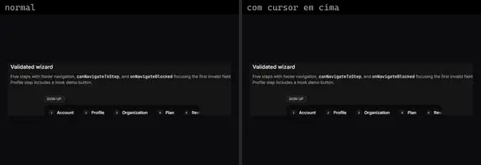
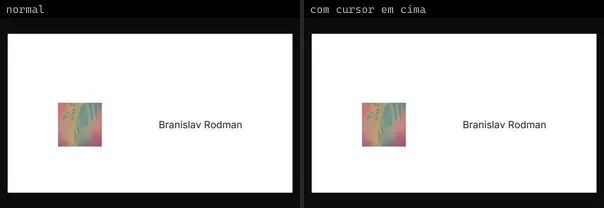
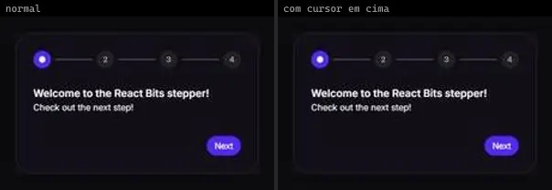
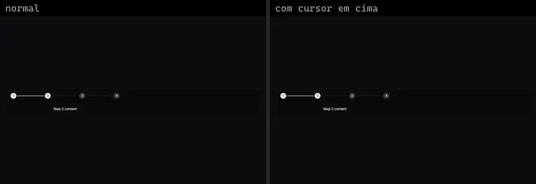
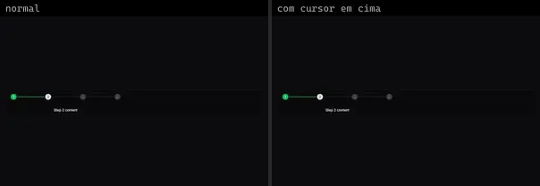
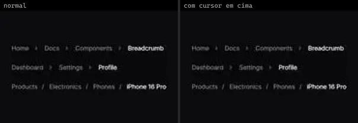
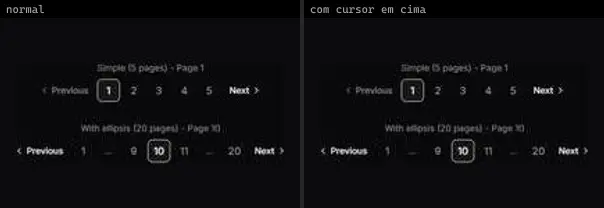
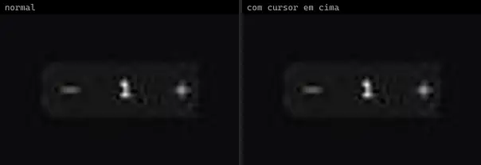

# Paginação & Breadcrumb (11)

Prévia: estado normal | com o cursor em cima. Código: `node scripts/atlas-find.mjs code <uid>` ou os arquivos em `catalog.jsonl → files`.

| prévia | componente | tipo de aplicação | biblioteca · licença | dependências npm |
|---|---|---|---|---|
|  | **Wizard Expandable** `cultui:wizard-expandable-demo` | UI base | cultui · MIT | @base-ui/react, @radix-ui/react-use-controllable-state, lucide-react, motion |
|  | **Text Rotate Scroll Step** `fancy:text/text-rotate-scroll-step-demo` | UI base | fancy · MIT | motion |
|  | **Text Rotate Step** `fancy:text/text-rotate-step-demo` | UI base | fancy · MIT | lucide-react, motion |
|  | **Stepper** `reactbits:Components/StepperDemo` | UI base | reactbits · MIT + Commons Clause | @chakra-ui/react, motion, sonner |
|  | **Stepper 1** `reui:stepper/c-stepper-1` | UI base | reui · MIT | cn, radix-ui |
|  | **Stepper 2** `reui:stepper/c-stepper-2` | UI base | reui · MIT | cn, radix-ui |
|  | **Animated Stepper** `smoothui:animated-stepper` | UI base | smoothui · MIT | @radix-ui/react-slot, @repo/shadcn-ui, @repo/smoothui, class-variance-authority, motion |
|  | **Breadcrumb** `smoothui:breadcrumb` | UI base | smoothui · MIT | @repo/shadcn-ui, @repo/smoothui, lucide-react, motion |
|  | **Pagination** `smoothui:pagination` | UI base | smoothui · MIT | @repo/shadcn-ui, @repo/smoothui, lucide-react, motion |
|  | **Quantity Stepper** `spectrumui:quantity-stepper` | UI base | spectrumui · Apache-2.0 | clsx, framer-motion, lucide-react, tailwind-merge |
|  | **Wizard Form** `uitripled:forms/wizard-form` | UI base | uitripled · MIT | @radix-ui/react-slot, class-variance-authority, framer-motion, lucide-react |
