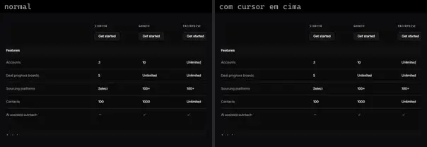
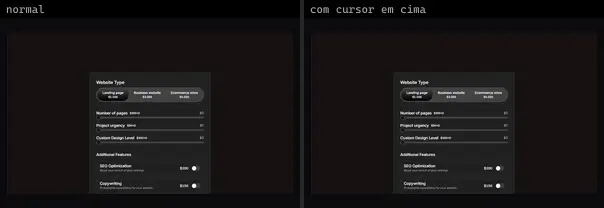
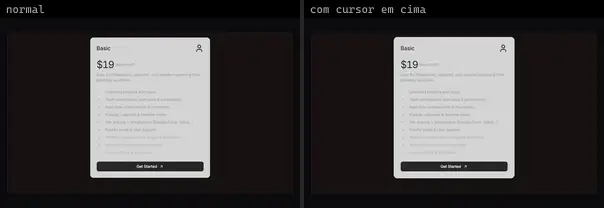

# Pricing (17)

Prévia: estado normal | com o cursor em cima. Código: `node scripts/atlas-find.mjs code <uid>` ou os arquivos em `catalog.jsonl → files`.

| prévia | componente | tipo de aplicação | biblioteca · licença | dependências npm |
|---|---|---|---|---|
|  | **Pricing** `animata:section/pricing` | Landing & Marketing | animata · MIT | motion |
|  | **Pricing** `eldoraui:pricing-01/components/pricing` | Landing & Marketing | eldoraui · MIT | clsx, motion, process, tailwind-merge |
|  | **Pricing Table** `eldoraui:pricing-02/components/pricing-table` | Landing & Marketing | eldoraui · MIT | @headlessui/react, @heroicons/react, @radix-ui/react-slot, class-variance-authority |
|  | **Pricing 1** `smoothui:pricing-1` | Landing & Marketing | smoothui · MIT | @repo/shadcn-ui, @repo/smoothui, motion |
|  | **Pricing 2** `smoothui:pricing-2` | Landing & Marketing | smoothui · MIT | @repo/shadcn-ui, @repo/smoothui, motion |
|  | **Pricing 3** `smoothui:pricing-3` | Landing & Marketing | smoothui · MIT | @repo/shadcn-ui, @repo/smoothui, motion |
|  | **Banner Tiers** `spectrumui:blocks/pricing/banner-tiers` | Landing & Marketing | spectrumui · Apache-2.0 · ⚠needs-props | clsx, lucide-react, tailwind-merge |
|  | **Blueprint Tiers** `spectrumui:blocks/pricing/blueprint-tiers` | Landing & Marketing | spectrumui · Apache-2.0 · ⚠needs-props | clsx, lucide-react, tailwind-merge |
|  | **Dark Matrix** `spectrumui:blocks/pricing/dark-matrix` | Landing & Marketing | spectrumui · Apache-2.0 · ⚠needs-props | clsx, lucide-react, tailwind-merge |
|  | **Offset Tiers** `spectrumui:blocks/pricing/offset-tiers` | Landing & Marketing | spectrumui · Apache-2.0 · ⚠needs-props | clsx, lucide-react, tailwind-merge |
|  | **Receipt Tiers** `spectrumui:blocks/pricing/receipt-tiers` | Landing & Marketing | spectrumui · Apache-2.0 · ⚠needs-props | clsx, tailwind-merge |
|  | **Serif Tiers** `spectrumui:blocks/pricing/serif-tiers` | Landing & Marketing | spectrumui · Apache-2.0 · ⚠needs-props | clsx, tailwind-merge |
|  | **Custom Pricing Design** `systaliko:ecommerce/custom-pricing-design` | Landing & Marketing | systaliko · MIT | @radix-ui/react-slider, @radix-ui/react-switch, motion, radix-ui |
|  | **Pricing** `systaliko:ecommerce/pricing` | Landing & Marketing | systaliko · MIT | @radix-ui/react-slot, class-variance-authority, lucide-react, react-aria-components |
|  | **Pricing 2** `systaliko:ecommerce/pricing-2` | Landing & Marketing | systaliko · MIT | @radix-ui/react-slot, class-variance-authority, lucide-react |
|  | **Glassmorphism Pricing Block** `uitripled:sections/glassmorphism-pricing-block` | Landing & Marketing | uitripled · MIT | @radix-ui/react-slot, class-variance-authority, lucide-react |
|  | **Pricing Section** `uitripled:sections/pricing-section` | Landing & Marketing | uitripled · MIT | @radix-ui/react-slot, class-variance-authority, framer-motion, lucide-react |
