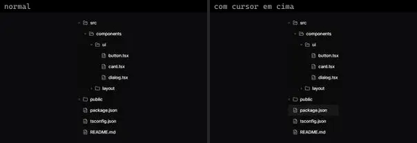
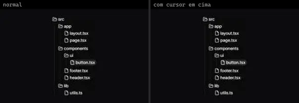
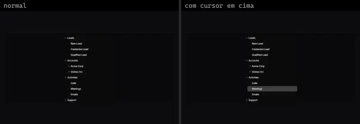
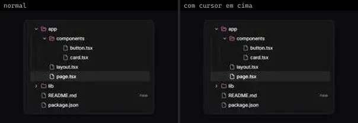
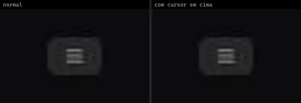

# Sidebar & Menu (7)

Prévia: estado normal | com o cursor em cima. Código: `node scripts/atlas-find.mjs code <uid>` ou os arquivos em `catalog.jsonl → files`.

| prévia | componente | tipo de aplicação | biblioteca · licença | dependências npm |
|---|---|---|---|---|
|  | **Tree** `kibo:tree` | Dashboard & Admin | kibo · MIT | @repo/tree, lucide-react, motion |
|  | **File Tree** `magicui:file-tree-demo` | Dashboard & Admin | magicui · MIT | @radix-ui/react-accordion, lucide-react |
|  | **Tree 1** `reui:tree/c-tree-1` | Dashboard & Admin | reui · MIT | @headless-tree/core, @headless-tree/react, cn, radix-ui |
|  | **Tree 2** `reui:tree/c-tree-2` | Dashboard & Admin | reui · MIT | @headless-tree/core, @headless-tree/react, cn, radix-ui |
|  | **File Tree** `smoothui:file-tree` | Dashboard & Admin | smoothui · MIT | @repo/shadcn-ui, @repo/smoothui, lucide-react, motion |
|  | **Tree Nav** `spectrumui:tree-nav` | Dashboard & Admin | spectrumui · Apache-2.0 · ⚠needs-props | clsx, motion, tailwind-merge |
|  | **Animated Sidebar** `uitripled:navigation/animated-sidebar` | Dashboard & Admin | uitripled · MIT | framer-motion, lucide-react |
