# Stats & KPI (22)

Prévia: estado normal | com o cursor em cima. Código: `node scripts/atlas-find.mjs code <uid>` ou os arquivos em `catalog.jsonl → files`.

| prévia | componente | tipo de aplicação | biblioteca · licença | dependências npm |
|---|---|---|---|---|
|  | **Alarm Clock** `animata:widget/alarm-clock` | Dashboard & Admin | animata · MIT | lucide-react |
|  | **Counter** `animata:text/counter` | Dashboard & Admin | animata · MIT | motion |
| 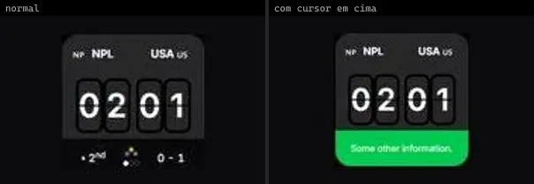 | **Live Score** `animata:widget/live-score` | Dashboard & Admin | animata · MIT | lucide-react |
| 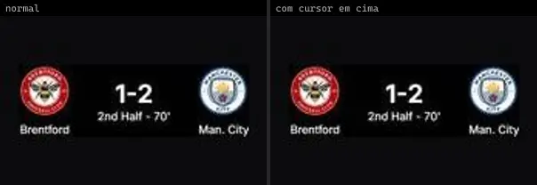 | **Score Card** `animata:card/score-card` | Dashboard & Admin | animata · MIT | motion |
|  | **Study Timer** `animata:widget/study-timer` | Dashboard & Admin | animata · MIT | lucide-react |
|  | **Clock** `bundui:sliding-number/clock` | Dashboard & Admin | bundui · MIT | motion, react-use-measure |
|  | **Countdown** `bundui:countdown` | Dashboard & Admin | bundui · MIT | motion, react-use-measure |
|  | **Geometric** `bundui:backgrounds/geometric` | Dashboard & Admin | bundui · MIT | @radix-ui/react-slot, class-variance-authority, motion |
| 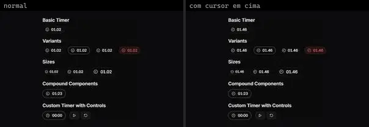 | **Timer** `cultui:timer-demo` | Dashboard & Admin | cultui · MIT | class-variance-authority, lucide-react |
| 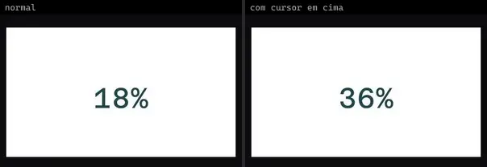 | **Basic Number Ticker** `fancy:text/basic-number-ticker-demo` | Dashboard & Admin | fancy · MIT | motion |
| 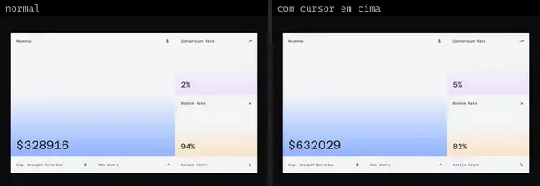 | **Fancy Basic Number Ticker** `fancy:text/fancy-basic-number-ticker-demo` | Dashboard & Admin | fancy · MIT | lucide-react, motion |
| 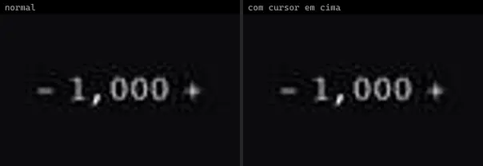 | **Animated Number Counter** `motionprimitives:animated-number/animated-number-counter` | Dashboard & Admin | motionprimitives · MIT | lucide-react, motion |
| 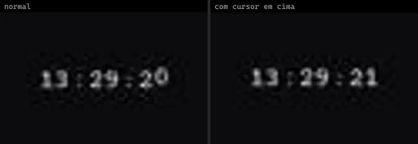 | **Clock** `motionprimitives:sliding-number/clock` | Dashboard & Admin | motionprimitives · MIT | motion, react-use-measure |
| 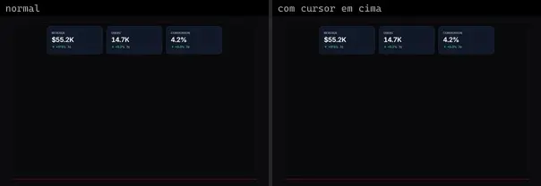 | **Kpi Number Morph** `motiq:catalog/kpi-number-morph` | Dashboard & Admin | motiq · MIT | — |
| 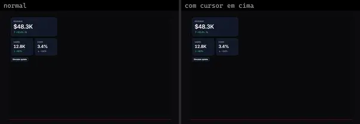 | **Kpi Number Morph** `motiq:kpi-number-morph` | Dashboard & Admin | motiq · MIT | — |
|  | **Scroll Count Stats** `motiq:scroll-count-stats` | Dashboard & Admin | motiq · MIT | — |
| 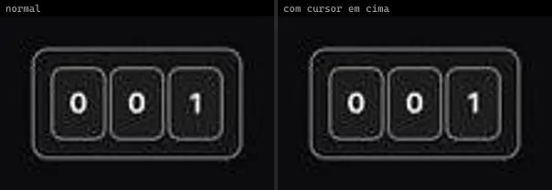 | **Number Flow** `smoothui:canvas/number-flow` | Dashboard & Admin | smoothui · MIT | @repo/shadcn-ui, @repo/smoothui, lucide-react, motion |
| 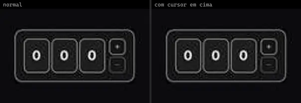 | **Number Flow** `smoothui:number-flow` | Dashboard & Admin | smoothui · MIT | @repo/shadcn-ui, @repo/smoothui, lucide-react |
| 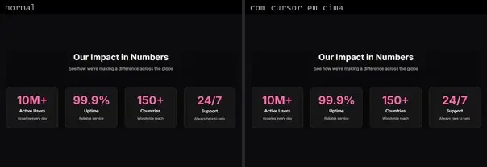 | **Stats 1** `smoothui:stats-1` | Dashboard & Admin | smoothui · MIT | @repo/smoothui, motion |
| 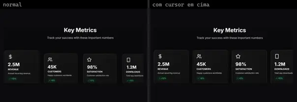 | **Stats 2** `smoothui:stats-2` | Dashboard & Admin | smoothui · MIT | @repo/smoothui, lucide-react, motion |
| 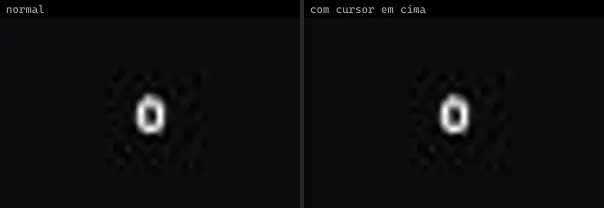 | **Native Counter Up Shadcnui** `uitripled:native/native-counter-up-shadcnui` | Dashboard & Admin | uitripled · MIT | framer-motion |
| 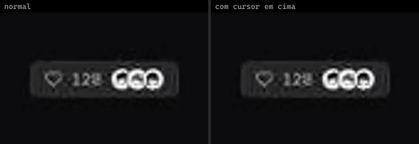 | **Native Likes Counter** `uitripled:native/demo/native-likes-counter-demo` | Dashboard & Admin | uitripled · MIT | — |
