# Tabela & Data grid (20)

Prévia: estado normal | com o cursor em cima. Código: `node scripts/atlas-find.mjs code <uid>` ou os arquivos em `catalog.jsonl → files`.

| prévia | componente | tipo de aplicação | biblioteca · licença | dependências npm |
|---|---|---|---|---|
| 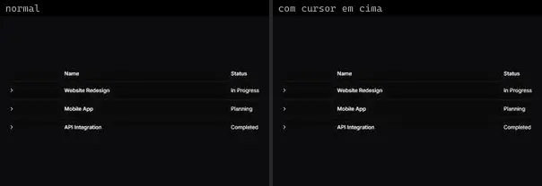 | **Data Table Advanced 1** `kibo:pattern/data-table/advanced/data-table-advanced-1` | Dashboard & Admin | kibo · MIT | @repo/shadcn-ui, @tanstack/react-table, class-variance-authority, lucide-react, radix-ui |
| 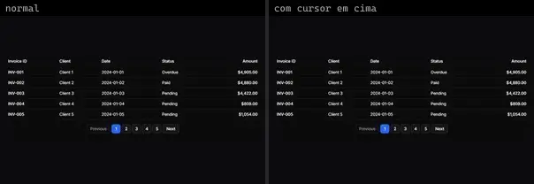 | **Data Table Advanced 2** `kibo:pattern/data-table/advanced/data-table-advanced-2` | Dashboard & Admin | kibo · MIT | @repo/shadcn-ui, @tanstack/react-table, class-variance-authority, radix-ui |
| 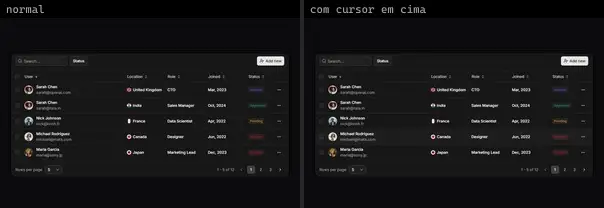 | **Data Grid 22** `reui:data-grid/c-data-grid-22` | Dashboard & Admin | reui · MIT | @base-ui/react, @tanstack/react-table, class-variance-authority, cn, radix-ui, sonner |
| 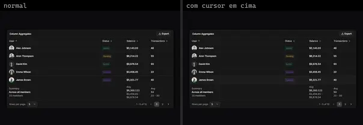 | **Data Grid 26** `reui:data-grid/c-data-grid-26` | Dashboard & Admin | reui · MIT | @base-ui/react, @tanstack/react-table, class-variance-authority, cn, radix-ui |
| 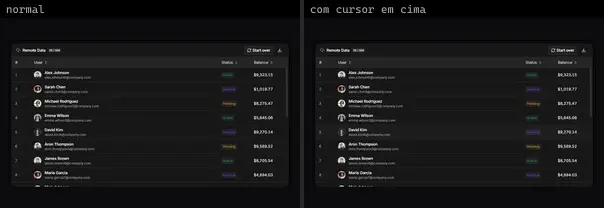 | **Data Grid 28** `reui:data-grid/c-data-grid-28` | Dashboard & Admin | reui · MIT | @base-ui/react, @tanstack/react-table, @tanstack/react-virtual, class-variance-authority, cn, radix-ui |
| 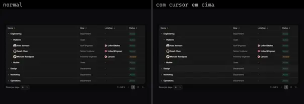 | **Data Grid 30** `reui:data-grid/c-data-grid-30` | Dashboard & Admin | reui · MIT | @base-ui/react, @tanstack/react-table, class-variance-authority, cn, radix-ui |
| 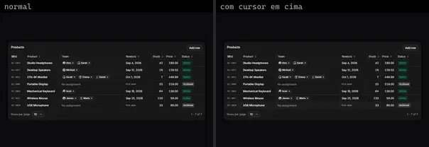 | **Data Grid 31** `reui:data-grid/c-data-grid-31` | Dashboard & Admin | reui · MIT | @base-ui/react, @tanstack/react-table, cn, date-fns, sonner |
| 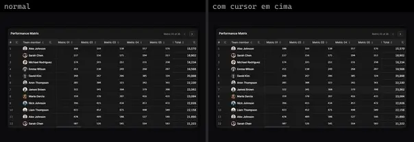 | **Data Grid 32** `reui:data-grid/c-data-grid-32` | Dashboard & Admin | reui · MIT | @base-ui/react, @tanstack/react-table, @tanstack/react-virtual, class-variance-authority, cn, radix-ui |
| 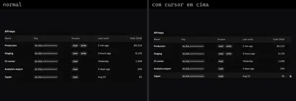 | **Api Keys Table** `spectrumui:blocks/tables/api-keys-table` | Dashboard & Admin | spectrumui · Apache-2.0 | — |
|  | **Audit Log Table** `spectrumui:blocks/tables/audit-log-table` | Dashboard & Admin | spectrumui · Apache-2.0 | — |
|  | **Data Table** `spectrumui:data-table` | Dashboard & Admin | spectrumui · Apache-2.0 · ⚠needs-props | clsx, motion, tailwind-merge |
| 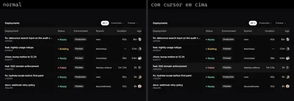 | **Deployments Table** `spectrumui:blocks/tables/deployments-table` | Dashboard & Admin | spectrumui · Apache-2.0 | — |
|  | **Files Table** `spectrumui:blocks/tables/files-table` | Dashboard & Admin | spectrumui · Apache-2.0 | — |
| 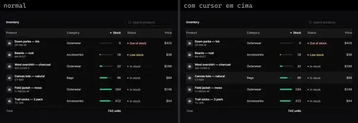 | **Inventory Table** `spectrumui:blocks/tables/inventory-table` | Dashboard & Admin | spectrumui · Apache-2.0 | — |
|  | **Leaderboard Table** `spectrumui:blocks/tables/leaderboard-table` | Dashboard & Admin | spectrumui · Apache-2.0 | — |
| 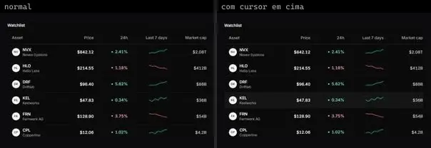 | **Market Table** `spectrumui:blocks/tables/market-table` | Dashboard & Admin | spectrumui · Apache-2.0 | — |
| 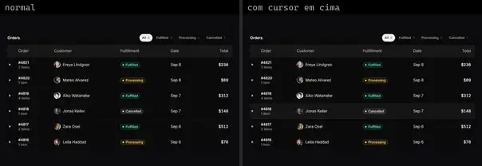 | **Orders Table** `spectrumui:blocks/tables/orders-table` | Dashboard & Admin | spectrumui · Apache-2.0 | — |
|  | **Payments Table** `spectrumui:blocks/tables/payments-table` | Dashboard & Admin | spectrumui · Apache-2.0 | — |
| 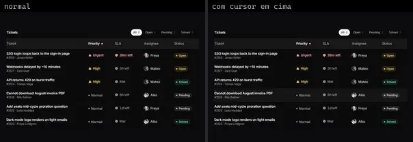 | **Tickets Table** `spectrumui:blocks/tables/tickets-table` | Dashboard & Admin | spectrumui · Apache-2.0 | — |
| 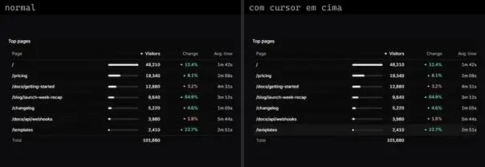 | **Top Pages Table** `spectrumui:blocks/tables/top-pages-table` | Dashboard & Admin | spectrumui · Apache-2.0 | — |
