# Tabs & Accordion (19)

Prévia: estado normal | com o cursor em cima. Código: `node scripts/atlas-find.mjs code <uid>` ou os arquivos em `catalog.jsonl → files`.

| prévia | componente | tipo de aplicação | biblioteca · licença | dependências npm |
|---|---|---|---|---|
|  | **Fluid Tabs** `animata:tabs/fluid-tabs` | UI base | animata · MIT | lucide-react, motion |
|  | **Gooey Tabs** `animata:tabs/gooey-tabs` | UI base | animata · MIT | @phosphor-icons/react, motion |
| 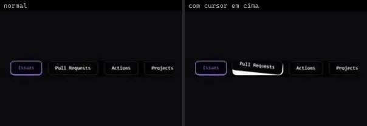 | **Shift Tabs** `animata:tabs/shift-tabs` | UI base | animata · MIT | — |
|  | **Animated Tab** `bundui:animated-tab` | UI base | bundui · MIT | @radix-ui/react-slot, class-variance-authority, motion |
| 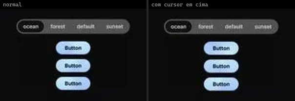 | **Direction Aware Tabs** `cultui:direction-aware-tabs-demo` | UI base | cultui · MIT | @radix-ui/react-slot, class-variance-authority, motion, react-use-measure |
| 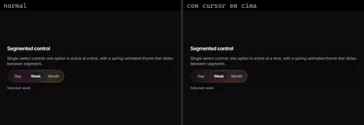 | **Halo Segmented** `cultui:halo-segmented-demo` | UI base | cultui · MIT | @base-ui/react, motion |
| 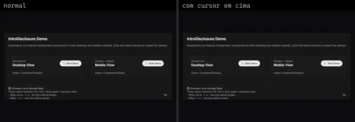 | **Intro Disclosure** `cultui:intro-disclosure-demo` | UI base | cultui · MIT | @radix-ui/react-icons, lucide-react, motion, sonner |
| 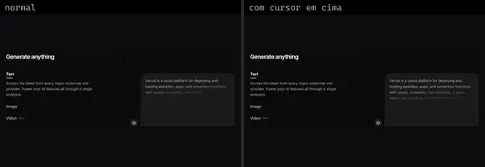 | **Tabs Illustration Vercel** `cultui:tabs-illustration-vercel-demo` | UI base | cultui · MIT | — |
| 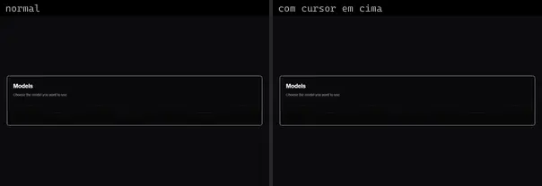 | **Smooth Tab** `kokonutui:smooth-tab` | UI base | kokonutui · MIT | clsx, lucide-react, motion, tailwind-merge |
|  | **Accordion Basic** `motionprimitives:accordion/accordion-basic` | UI base | motionprimitives · MIT | motion |
| 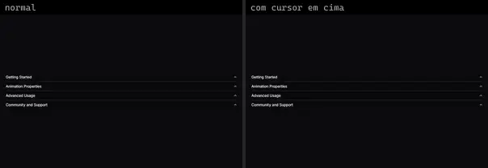 | **Accordion Icons** `motionprimitives:accordion/accordion-icons` | UI base | motionprimitives · MIT | lucide-react, motion |
|  | **Accordion Variant** `motionprimitives:accordion/accordion-variant` | UI base | motionprimitives · MIT | lucide-react, motion |
| 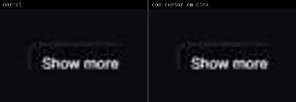 | **Disclosure Basic** `motionprimitives:disclosure/disclosure-basic` | UI base | motionprimitives · MIT | motion |
|  | **Disclosure Card** `motionprimitives:disclosure/disclosure-card` | UI base | motionprimitives · MIT | motion |
| 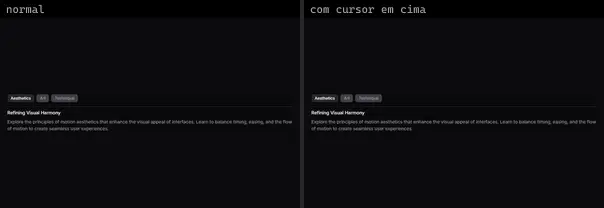 | **Transition Panel Tabs** `motionprimitives:transition-panel/transition-panel-tabs` | UI base | motionprimitives · MIT | motion |
| 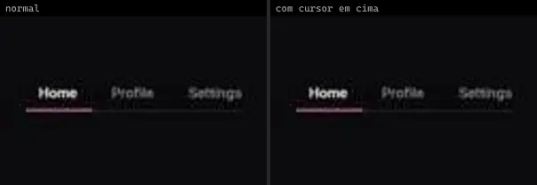 | **Animated Tabs** `smoothui:animated-tabs` | UI base | smoothui · MIT | @repo/shadcn-ui, @repo/smoothui, motion |
| 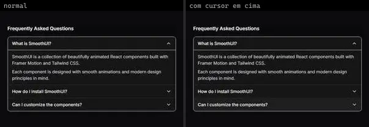 | **Basic Accordion** `smoothui:basic-accordion` | UI base | smoothui · MIT | @repo/smoothui, lucide-react, motion |
| 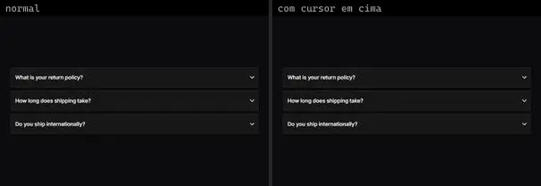 | **Animated Accordion** `uitripled:disclosure/animated-accordion` | UI base | uitripled · MIT | framer-motion, lucide-react |
|  | **Animated Tabs** `uitripled:components/tabs/animated-tabs` | UI base | uitripled · MIT | @radix-ui/react-tabs, framer-motion |
