# Toggle & Checkbox (49)

Prévia: estado normal | com o cursor em cima. Código: `node scripts/atlas-find.mjs code <uid>` ou os arquivos em `catalog.jsonl → files`.

| prévia | componente | tipo de aplicação | biblioteca · licença | dependências npm |
|---|---|---|---|---|
| 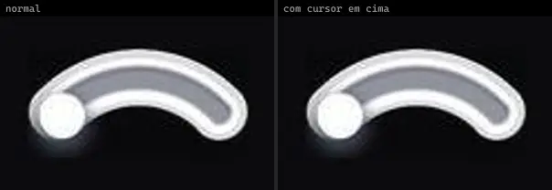 | **Strong Penguin · Admin12121** `uiverse:Toggle-switches/Admin12121_strong-penguin-65` | Dashboard & Admin | uiverse · MIT | — |
| 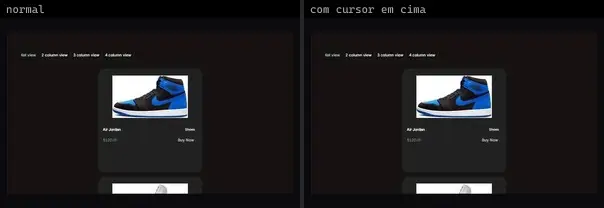 | **Toggle Layout** `systaliko:ecommerce/toggle-layout` | E-commerce | systaliko · MIT | @radix-ui/react-slot, class-variance-authority, motion |
| 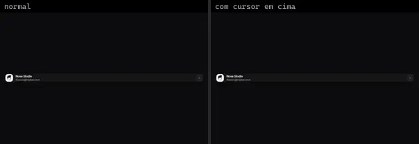 | **Multiple Accounts** `uitripled:components/account-switcher/multiple-accounts` | Login & Conta | uitripled · MIT · ⚠needs-network | framer-motion, lucide-react |
| 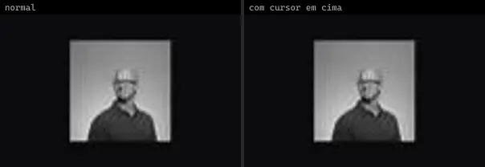 | **Native Image Checkbox** `uitripled:native/demo/native-image-checkbox-demo` | Mobile & App | uitripled · MIT | — |
| 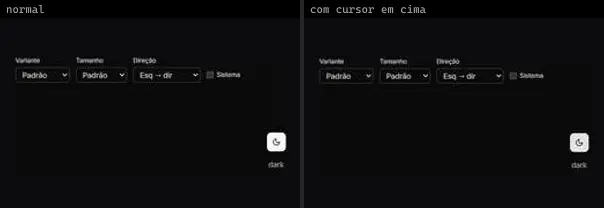 | **ThemeTogglerButton** `atlas:Buttons/ThemeTogglerButton` | UI base | atlas (própria) · Proprietária (Atlas) | lucide-react |
| 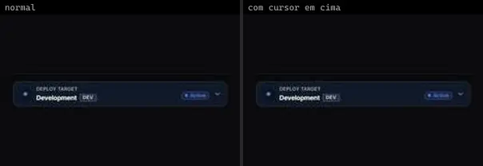 | **Environment Switcher** `motiq:catalog/environment-switcher` | UI base | motiq · MIT | motion |
| 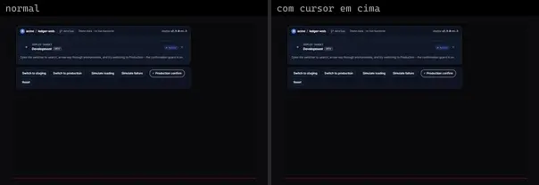 | **Environment Switcher** `motiq:environment-switcher` | UI base | motiq · MIT | motion |
| 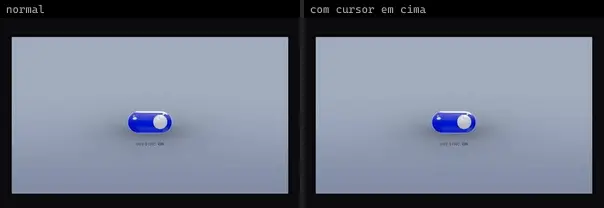 | **Skeuomorphic Toggle · Glass** `threeui:skeuomorphic-toggle/glass` | UI base | threeui · MIT | — |
| 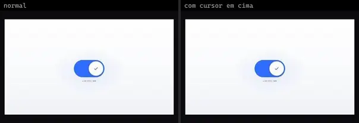 | **Skeuomorphic Toggle · Modern** `threeui:skeuomorphic-toggle/modern` | UI base | threeui · MIT | — |
| 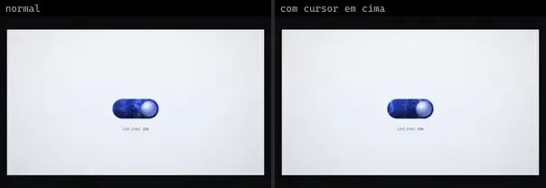 | **Skeuomorphic Toggle · Shader** `threeui:skeuomorphic-toggle/shader` | UI base | threeui · MIT | — |
| 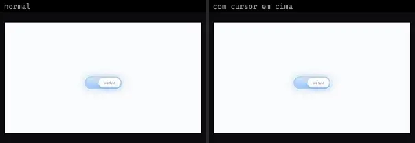 | **Skeuomorphic Toggle · Skeuomorphic** `threeui:skeuomorphic-toggle/skeuomorphic-toggle` | UI base | threeui · MIT | — |
| 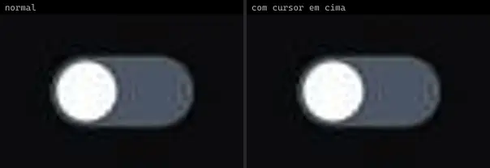 | **Elastic Switch** `uitripled:micro/toggles/elastic-switch` | UI base | uitripled · MIT | framer-motion |
| 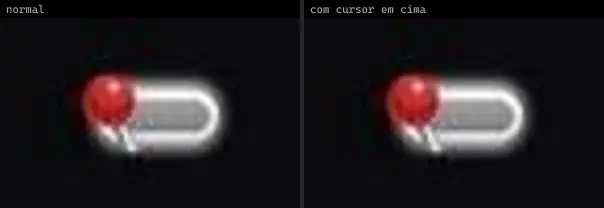 | **Brave Firefox · njesenberger** `uiverse:Toggle-switches/njesenberger_brave-firefox-90` | UI base | uiverse · MIT | — |
|  | **Calm Grasshopper · csemszepp** `uiverse:Checkboxes/csemszepp_calm-grasshopper-57` | UI base | uiverse · MIT | — |
| 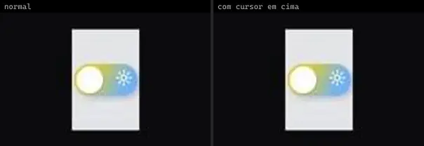 | **Curly Parrot · csemszepp** `uiverse:Toggle-switches/csemszepp_curly-parrot-90` | UI base | uiverse · MIT | — |
| 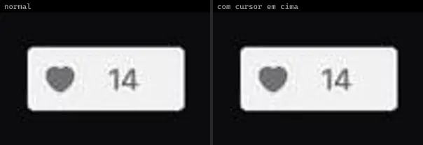 | **Curvy Eagle · TroyRandall** `uiverse:Toggle-switches/TroyRandall_curvy-eagle-61` | UI base | uiverse · MIT | — |
| 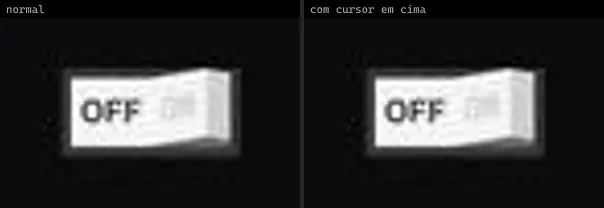 | **Dry Rabbit · r7chardgh** `uiverse:Toggle-switches/r7chardgh_dry-rabbit-69` | UI base | uiverse · MIT | — |
| 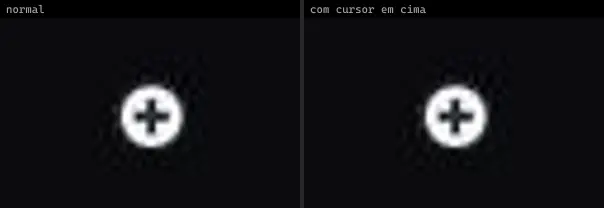 | **Dry Treefrog · Nawsome** `uiverse:Toggle-switches/Nawsome_dry-treefrog-99` | UI base | uiverse · MIT | — |
| 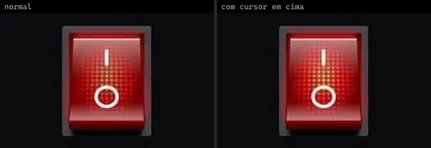 | **Empty Snail · Nawsome** `uiverse:Toggle-switches/Nawsome_empty-snail-69` | UI base | uiverse · MIT | — |
|  | **Evil Dragon · Na3ar-17** `uiverse:Toggle-switches/Na3ar-17_evil-dragon-24` | UI base | uiverse · MIT | — |
| 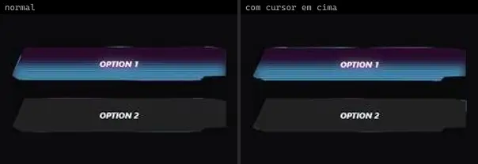 | **Friendly Panther · MijailVillegas** `uiverse:Radio-buttons/MijailVillegas_friendly-panther-39` | UI base | uiverse · MIT | — |
| 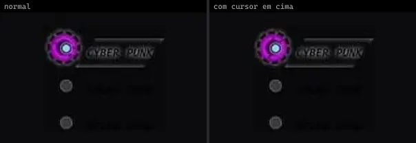 | **Fuzzy Yak · WerlynRodriguez** `uiverse:Radio-buttons/WerlynRodriguez_fuzzy-yak-55` | UI base | uiverse · MIT | — |
| 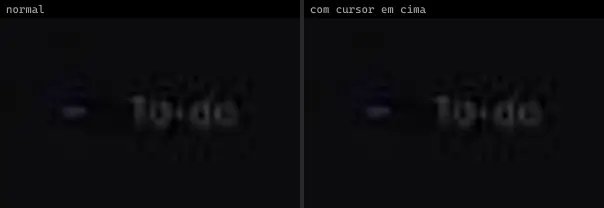 | **Gentle Firefox · Shoh2008** `uiverse:Toggle-switches/Shoh2008_gentle-firefox-59` | UI base | uiverse · MIT | — |
| 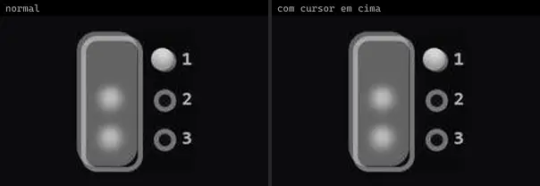 | **Giant Jellyfish · LilaRest** `uiverse:Radio-buttons/LilaRest_giant-jellyfish-3` | UI base | uiverse · MIT | — |
| 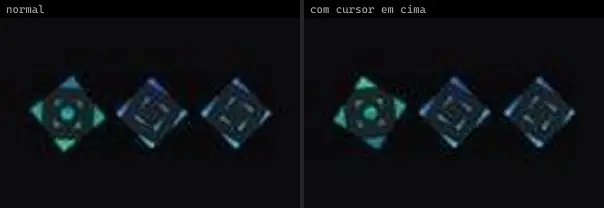 | **Good Newt · Navarog21** `uiverse:Radio-buttons/Navarog21_good-newt-78` | UI base | uiverse · MIT | — |
|  | **Grumpy Wombat · milegelu** `uiverse:Checkboxes/milegelu_grumpy-wombat-18` | UI base | uiverse · MIT | — |
|  | **Hard Eel · Shoh2008** `uiverse:Checkboxes/Shoh2008_hard-eel-52` | UI base | uiverse · MIT | — |
| 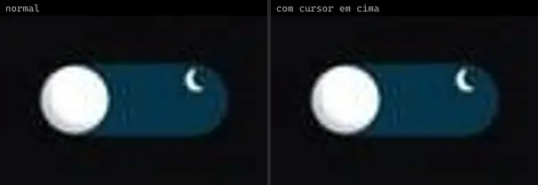 | **Itchy Turtle · JkHuger** `uiverse:Toggle-switches/JkHuger_itchy-turtle-45` | UI base | uiverse · MIT | — |
| 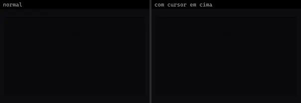 | **Little Grasshopper · PriyanshuGupta28** `uiverse:Toggle-switches/PriyanshuGupta28_little-grasshopper-46` | UI base | uiverse · MIT | — |
| 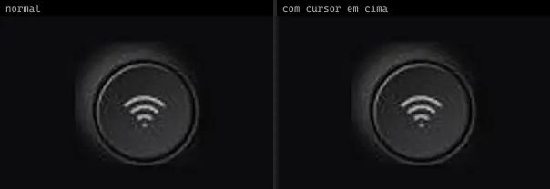 | **Lovely Firefox · Yaya12085** `uiverse:Toggle-switches/Yaya12085_lovely-firefox-94` | UI base | uiverse · MIT | — |
| 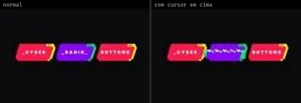 | **Lucky Bobcat · andrew-demchenk0** `uiverse:Radio-buttons/andrew-demchenk0_lucky-bobcat-25` | UI base | uiverse · MIT | — |
| 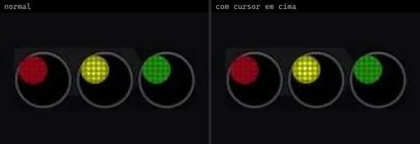 | **Mean Dodo · Praashoo7** `uiverse:Radio-buttons/Praashoo7_mean-dodo-99` | UI base | uiverse · MIT | — |
| 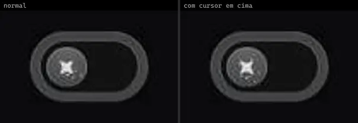 | **Nasty Moth · MuhammadHasann** `uiverse:Toggle-switches/MuhammadHasann_nasty-moth-15` | UI base | uiverse · MIT | — |
| 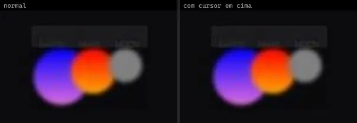 | **Nasty Octopus · shadowfax29** `uiverse:Radio-buttons/shadowfax29_nasty-octopus-47` | UI base | uiverse · MIT | — |
| 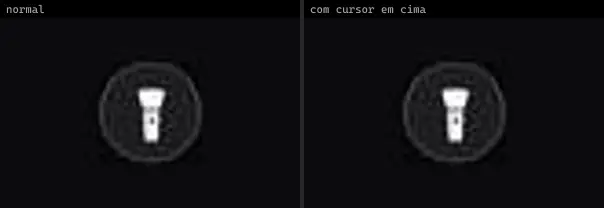 | **Nasty Seahorse · Praashoo7** `uiverse:Toggle-switches/Praashoo7_nasty-seahorse-26` | UI base | uiverse · MIT | — |
|  | **Pink Dragon · andrew-demchenk0** `uiverse:Radio-buttons/andrew-demchenk0_pink-dragon-17` | UI base | uiverse · MIT | — |
| 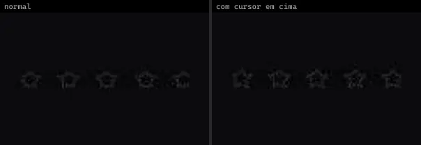 | **Selfish Starfish · SelfMadeSystem** `uiverse:Radio-buttons/SelfMadeSystem_selfish-starfish-40` | UI base | uiverse · MIT | — |
| 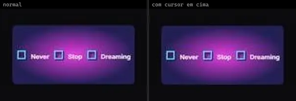 | **Serious Monkey · wizard503** `uiverse:Radio-buttons/wizard503_serious-monkey-58` | UI base | uiverse · MIT | — |
| 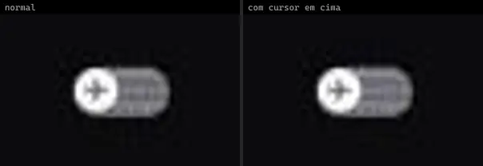 | **Silent Owl · Nawsome** `uiverse:Toggle-switches/Nawsome_silent-owl-45` | UI base | uiverse · MIT | — |
| 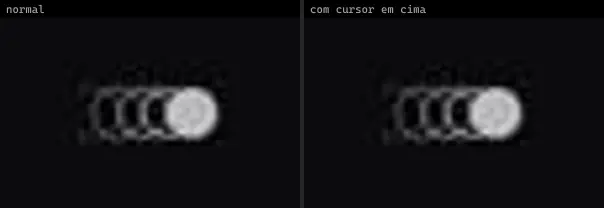 | **Smart Fox · Type-Delta** `uiverse:Toggle-switches/Type-Delta_smart-fox-47` | UI base | uiverse · MIT | — |
| 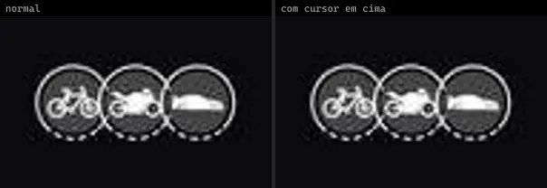 | **Spicy Dingo · Yaya12085** `uiverse:Radio-buttons/Yaya12085_spicy-dingo-98` | UI base | uiverse · MIT | — |
|  | **Strange Frog · mobinkakei** `uiverse:Checkboxes/mobinkakei_strange-frog-14` | UI base | uiverse · MIT | — |
|  | **Tender Badger · mobinkakei** `uiverse:Checkboxes/mobinkakei_tender-badger-3` | UI base | uiverse · MIT | — |
| 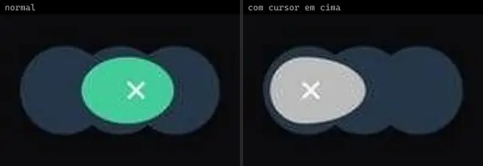 | **Terrible Frog · csemszepp** `uiverse:Toggle-switches/csemszepp_terrible-frog-94` | UI base | uiverse · MIT | — |
| 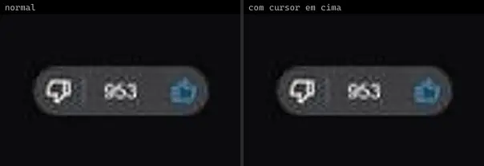 | **Tough Deer · 3bdel3ziz-T** `uiverse:Radio-buttons/3bdel3ziz-T_tough-deer-65` | UI base | uiverse · MIT | — |
| 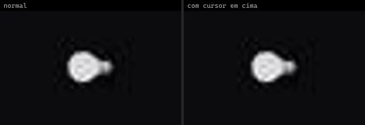 | **Warm Panther · JkHuger** `uiverse:Toggle-switches/JkHuger_warm-panther-53` | UI base | uiverse · MIT | — |
| 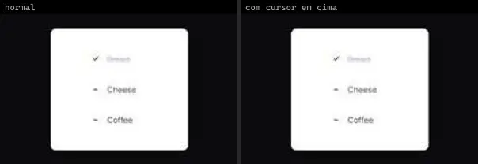 | **Warm Panther · JkHuger** `uiverse:Checkboxes/JkHuger_warm-panther-74` | UI base | uiverse · MIT | — |
| 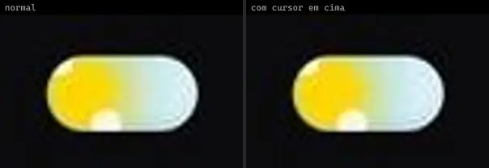 | **Weak Deer · Mohammad-Rahme-576** `uiverse:Toggle-switches/Mohammad-Rahme-576_weak-deer-13` | UI base | uiverse · MIT | — |
| 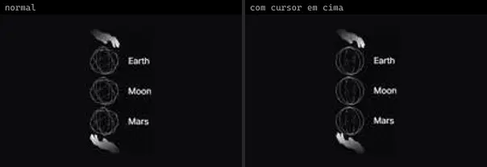 | **White Ape · yaroslavas2001** `uiverse:Radio-buttons/yaroslavas2001_white-ape-33` | UI base | uiverse · MIT | — |
